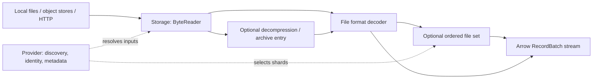

# open-arrow-access

**A Rust library for source access and decoding in pretraining data preparation.**

Built for pretraining data engineers and developers preparing raw corpora for
model training. Read corpus files into Apache Arrow record batches through a
consistent interface across storage backends, file formats, and dataset providers.

Use it in corpus ingestion jobs to read local or object-store shards, stream
compressed JSONL, or load a Hugging Face Parquet split. Provider adapters also
expose original files and metadata for assembling source collections. Their output
contracts are explicit: some return Arrow batches, others return bytes or discovery
metadata.

## Where it fits in data preparation

```text
Raw corpus sources
  → open-arrow-access: discover → read → decompress / select entries → decode
  → Arrow batches for downstream cleaning, filtering, deduplication, and tokenization
  → training sample packing and prepared dataset output
```

The library supplies the source-access and decoding stages of this workflow.
Your preparation pipeline consumes its output and owns the downstream processing
and writing stages. For example, read compressed text records into Arrow, select
the fields your preprocessing job needs, then pass batches to your quality filters
or tokenizer. Provider metadata and original file bytes can be retained alongside
the corpus for source tracking.

## Architecture



- **Storage** wraps a caller-configured OpenDAL operator. Formats consume byte
  readers without knowing the backend or credentials.
- **Decompression and archives** turn compressed objects or selected entries into
  byte readers for the next stage.
- **Formats** decode bytes into typed records. Arrow formats expose a fixed schema
  before the first batch; WARC currently returns native parser records.
- **Datasets and providers** select files, preserve source metadata, and reuse the
  same storage and format components.
- **Layers** wrap accessors through a common extension contract. Streaming
  decompression, Arrow type conversion, and [ordered file-level parallel reads](docs/parallel-read.md)
  and [generated columns](docs/generated-columns.md) are implemented; metrics are planned.

See [architecture](docs/architecture.md) for component boundaries and execution behavior.

## Support at a glance

| Area | Available today | Details |
| --- | --- | --- |
| Arrow formats | Parquet, CSV/TSV, JSON/JSONL, XML, ATIF | [Formats and schema requirements](docs/support.md#file-formats) |
| WARC | Native WARC records; Arrow conversion planned | [WARC behavior](docs/formats.md#warc-parser) |
| Storage | One OpenDAL adapter; configure filesystem, S3, HTTP, or other upstream backends | [Backend configuration and requirements](docs/support.md#storage) |
| Compression | Gzip, bzip2, LZ4 frames, Zstandard | [Byte layers](decompression/README.md) |
| Archives | ZIP Stored/Deflate entries; sequential or ranged TAR access | [Archive requirements](docs/support.md#compression-and-archives) |
| Datasets | Ordered directory and explicit file-set reads; identical projected schemas | [Multi-file reads](docs/usage.md#read-multiple-shards) |
| Providers | Hugging Face, Common Crawl, PMC, Gutenberg, research repositories, books, and government data | [Provider matrix and output types](docs/support.md#dataset-providers) |
| Execution | Pull-based reads; per-reader storage I/O concurrency | [Ordering and concurrency](docs/architecture.md#execution-and-resource-ownership) |

Default Cargo features are empty. Arrow type conversion and shared service utilities such as
`service::common::Connection` and `ApiDocument` are always available, alongside
core contracts and OpenDAL storage. This includes the HTTP/JSON/URL dependency
baseline; concrete providers remain feature-gated. Enable the formats and
providers you need.
A compiled backend still needs suitable read, metadata, and discovery capabilities;
not every storage/decoder combination is valid.

## Quick start

Add a Git dependency and enable the filesystem backend on OpenDAL. Pin `rev` to
a commit in reproducible builds.

```toml
[dependencies]
open-arrow-access = { git = "https://github.com/dentiny/open-arrow-access", features = ["format-parquet"] }
opendal = { version = "0.59.2", default-features = false, features = ["services-fs"] }
tokio = { version = "1", features = ["macros", "rt-multi-thread"] }
```

```rust,no_run
use open_arrow_access::{
    Accessor, ReadRequest,
    file_format::parquet::ParquetAccessor,
    storage::{OpenDalAccessor, opendal},
};

#[tokio::main]
async fn main() -> Result<(), Box<dyn std::error::Error>> {
    let operator = opendal::Operator::new(
        opendal::services::Fs::default().root("/absolute/data/root"),
    )?;
    let parquet = ParquetAccessor::new(OpenDalAccessor::new(operator));
    let mut reader = parquet.open(ReadRequest::new("part-00000.parquet")).await?;

    println!("Schema: {:?}", reader.metadata().schema);
    while let Some(batch) = reader.next().await? {
        println!("{} rows", batch.num_rows());
        // Send this batch to your next pipeline stage.
    }
    Ok(())
}
```

To try the checked-in fixture from a repository checkout:

```sh
cargo run --example read_parquet --features format-parquet -- testdata/parquet ordered-snappy.parquet
```

Continue with the [usage guide](docs/usage.md) for projection, batching, S3,
compressed JSONL, multi-shard reads, and Hugging Face.

## Roadmap

The next planned capabilities focus on preparing consistent Arrow input for corpus
pipelines:

- Opt-in cross-file schema merging and alignment.
- Dependency-aware projection pushdown for generated columns.
- Metrics, timeout, and read-budget layers.
- File-internal partition planning and optional unordered emission.
- WARC-to-Arrow conversion and format-specific indexing/splitting.

These are planned capabilities, with no release-date commitment. The
[roadmap](docs/roadmap.md) separates implemented foundations from proposed work
and records dependencies between workstreams.

## Documentation

| Task | Start here |
| --- | --- |
| Choose components and features | [Support matrix](docs/support.md) |
| Build an ingestion reader | [Usage guide](docs/usage.md) |
| Understand composition and runtime behavior | [Architecture](docs/architecture.md) |
| Check decoder semantics and limits | [Format reference](docs/formats.md) |
| Integrate a source provider | [Provider guide](service/README.md) |
| Implement a format, provider, or wrapper | [Extension guide](docs/extending.md) |
| Explore future capabilities | [Roadmap](docs/roadmap.md) |
| Work on the library | [Documentation index](docs/README.md#contributing) |

## Development

Use rustup to select the toolchain pinned in `rust-toolchain.toml`. Install
`taplo-cli` 0.10.0 for TOML checks, then run:

```sh
cargo install taplo-cli --version 0.10.0 --locked
make lint
cargo check --workspace --no-default-features
cargo test --workspace --all-features --locked
```

See [testing](docs/testing.md) for suite placement and [dependency alignment](docs/dependencies.md)
for the Arrow, Parquet, and OpenDAL version baseline.

## Output type conversion

The [`TypeConversionLayer`](layers/README.md) wraps record accessors
through the shared `Layer<A>` contract. It casts explicitly named top-level columns
using Arrow kernels, plans a fixed output schema before the first batch, and shares
unchanged array buffers. It is always available, including with `default-features = false`.
