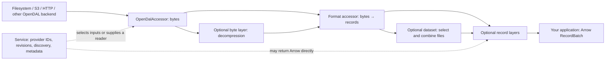
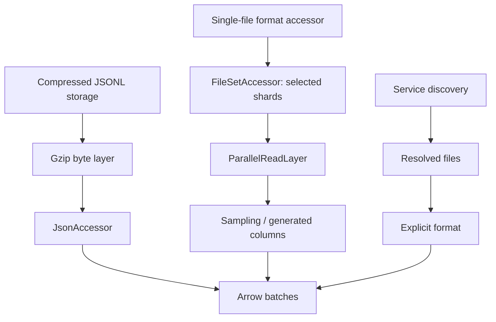
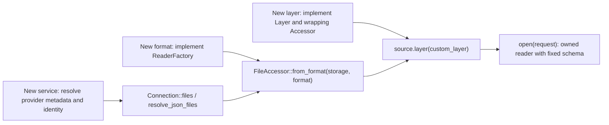

# open-arrow-access

A Rust library for reading files and source datasets as Apache Arrow batches.
Compose storage, decompression, formats, datasets, and record layers in your own
application. Services add provider-specific discovery and metadata; their outputs
may be files, bytes, API documents, or Arrow batches.

<a id="quick-start"></a>

## Read your first file

Enable the format you need and an OpenDAL storage backend. Features are opt-in;
the default feature set is empty. Use a Git dependency and pin `rev` to a tested
commit for reproducible builds.

```toml
[dependencies]
open-arrow-access = { git = "https://github.com/dentiny/open-arrow-access", default-features = false, features = ["format-parquet"] }
opendal = { version = "=0.59.2", default-features = false, features = ["services-fs"] }
tokio = { version = "1", features = ["macros", "rt-multi-thread"] }
```

```rust,no_run
use open_arrow_access::{
    Accessor, ReadRequest,
    file_format::parquet::ParquetAccessor,
    storage::{OpenDalAccessor, opendal},
};

#[tokio::main]
async fn main() -> Result<(), Box<dyn std::error::Error>> {
    let operator = opendal::Operator::new(
        opendal::services::Fs::default().root("/absolute/data/root"),
    )?;
    let files = OpenDalAccessor::new(operator);
    let records = ParquetAccessor::new(files);
    let mut reader = records.open(ReadRequest::new("part-00000.parquet")).await?;

    println!("schema: {:?}", reader.metadata().schema);
    while let Some(batch) = reader.next().await? {
        println!("{} rows", batch.num_rows());
        // Pass the batch to your application.
    }
    Ok(())
}
```

From a repository checkout, run the same path against a local fixture:

```sh
cargo run --locked --example read_parquet --features format-parquet -- testdata/parquet ordered-snappy.parquet
```

`open` returns a reader with its schema already available. Pull batches with
`next().await`: `Some(batch)` is data, `None` is EOF, and an error ends the read.
Readers own their resources. Drop a reader to stop consuming it; after cancelling
a pending read, drop that reader too.

## How the pieces compose



| Component | Responsibility | Use or extend |
| --- | --- | --- |
| Storage | Read object bytes; expose ranges/listing when supported | Configure an OpenDAL operator; wrap with `OpenDalAccessor` |
| Byte layer | Transform bytes, such as gzip → decoded bytes | `storage.layer(DecompressionLayer::new(Gzip))` |
| Format | Decode one byte input; declare output schema and ordering | Built-in accessor, or your `ReaderFactory` |
| Dataset | Select and combine multiple file readers | `FileSetAccessor` or `DirectoryAccessor` |
| Service | Resolve provider identity, metadata, and file membership | Provider API, or your own service built with `Connection` |
| Record layer | Transform records or configure scan execution | `source.layer(layer)` or your `Layer<A>` |

A format consumes `ByteReader`, so changing from local storage to S3 does not
require a new parser. A layer preserves the accessor's Rust request/reader types;
a format adapter changes bytes into records. OpenDAL's own layers configure the
storage operator separately.

## Enable features

Set features on the dependency used by your application:

```toml
open-arrow-access = { git = "https://github.com/dentiny/open-arrow-access", default-features = false, features = [
    "format-json",
    "decompression-gzip",
    "dataset-directory",
    "service-huggingface",
] }
```

For repository examples, use `cargo run --example NAME --features FEATURE`.
Enabling a feature compiles an API; construct the accessor/layer to use it.

| What you need | Facade feature |
| --- | --- |
| CSV/TSV, JSON/JSONL, Parquet, XML, ATIF, WARC | `format-csv`, `format-json`, `format-parquet`, `format-xml`, `format-atif`, `format-warc` |
| Additional Parquet page codecs | `format-parquet-zstd`, `format-parquet-lz4`, `format-parquet-gzip`, `format-parquet-brotli` (each also enables Parquet; Snappy is included in `format-parquet`) |
| Compressed byte streams | `decompression-gzip`, `decompression-bz2`, `decompression-lz4`, `decompression-zstd` |
| Archive members | `decompression-zip`, `decompression-tar` |
| Directory or explicit file-set reads | `dataset-directory` |
| A provider | `service-<name>`; see the [complete service table](service/README.md#choose-a-service) |
| Core contracts, storage, shared service HTTP utilities, record layers | Always available; no extra facade feature |
| Fs, S3, or another storage backend | Enable `services-fs`, `services-s3`, etc. on your **OpenDAL** dependency |

Always-available layers include schema remapping, generated columns, sampling,
parallel reads, and unordered emission. The baseline includes service HTTP/JSON
utilities and DataFusion-backed generated columns, even with defaults disabled.

Facade and component-crate feature names differ: `format-json` becomes `json` on
`open-arrow-access-file-format`, `decompression-gzip` becomes `gzip` on
`open-arrow-access-decompression`, and `service-figshare` becomes `figshare` on
`open-arrow-access-service`. Provider-internal dependencies do not automatically
expose the facade's `file_format`, `dataset`, or `decompression` modules; enable
those facade features when importing them yourself.

## Common compositions



| Task | Guide |
| --- | --- |
| Projection, batch size, S3, compressed JSONL | [Usage](docs/usage.md) |
| Choose a decoder and schema | [File formats](file-format/README.md) |
| Read compressed files or archive members | [Decompression](decompression/README.md) |
| Combine shards and reconcile schemas | [Datasets](dataset/README.md) |
| Discover source datasets and files | [Services](service/README.md) |
| Cast, generate, sample, or parallelize records | [Layers](layers/README.md) |
| Add a format, service, storage adapter, or layer | [Extension guide](docs/extending.md) |

Parquet and ZIP require exact ranges and known input length. Streaming gzip
removes range access, so an outer `.parquet.gz` cannot use the ordinary Parquet
reader directly. Parquet's internal page codecs are independent of byte
compression layers. Provider downloads retain their documented output type:
a PDF URL or downloaded PDF does not become Arrow text automatically.

## Extend the library



Extensions can live in your application or a separate crate. To include one in
this workspace, add its module/export and any optional Cargo dependency features,
then forward those features from the facade. See the [step-by-step extension
guide](docs/extending.md) for contracts, diagrams, and reference implementations.

## More documentation

See the [documentation index](docs/README.md) for detailed contracts, format limits,
and development instructions. The library is MIT licensed.
