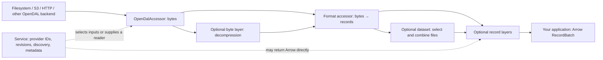
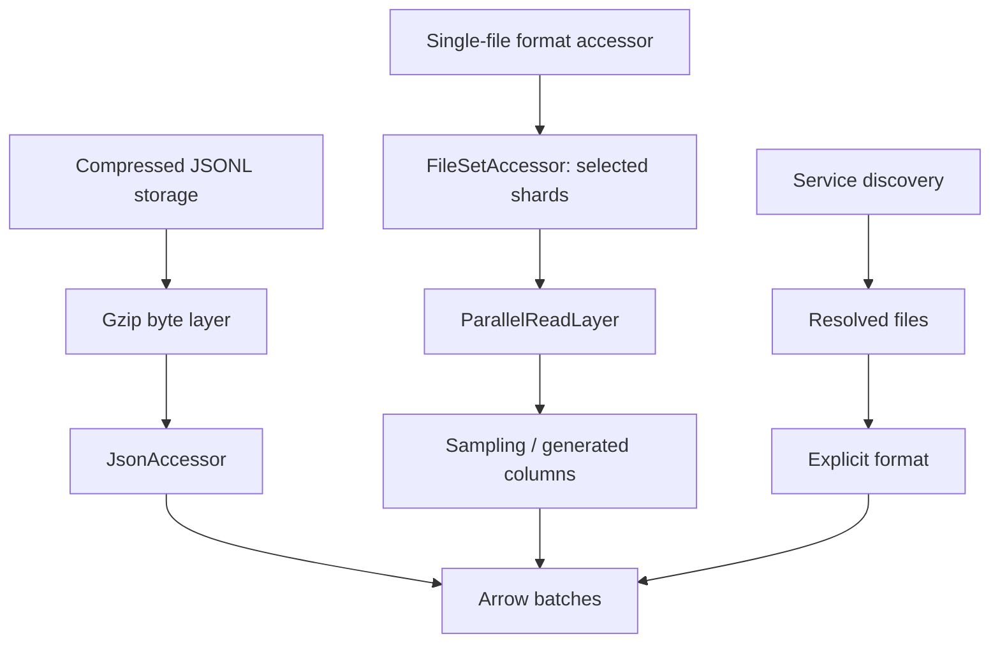
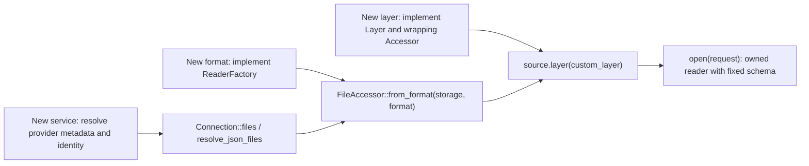

# open-arrow-access

A Rust library for reading files and source datasets as Apache Arrow batches.
Compose storage, decompression, formats, datasets, and record layers in your own
application. Services add provider-specific discovery and metadata; their outputs
may be files, bytes, API documents, or Arrow batches.

<a id="quick-start"></a>

## Read your first file

Enable the format you need and an OpenDAL storage backend. Features are opt-in;
the default feature set is empty. Add the published crate to your application:

```toml
[dependencies]
open-arrow-access = { version = "0.12.1", default-features = false, features = ["format-parquet"] }
opendal = { version = "=0.59.5", default-features = false, features = ["services-fs"] }
tokio = { version = "1", features = ["macros", "rt-multi-thread"] }
```

```rust,no_run
use open_arrow_access::{
    Accessor, ReadRequest,
    file_format::parquet::ParquetAccessor,
    storage::{OpenDalAccessor, opendal},
};

#[tokio::main]
async fn main() -> Result<(), Box<dyn std::error::Error>> {
    let operator = opendal::Operator::new(
        opendal::services::Fs::default().root("/absolute/data/root"),
    )?;
    let files = OpenDalAccessor::new(operator);
    let records = ParquetAccessor::new(files);
    let mut reader = records.open(ReadRequest::new("part-00000.parquet")).await?;

    println!("schema: {:?}", reader.metadata().schema);
    while let Some(batch) = reader.next().await? {
        println!("{} rows", batch.num_rows());
        // Pass the batch to your application.
    }
    Ok(())
}
```

From a repository checkout, run the same path against a local fixture:

```sh
cargo run --locked --example read_parquet --features format-parquet -- testdata/parquet ordered-snappy.parquet
```

`open` returns a reader with its schema already available. Pull batches with
`next().await`: `Some(batch)` is data, `None` is EOF, and an error ends the read.
Readers own their resources. Drop a reader to stop consuming it; after cancelling
a pending read, drop that reader too.

## Query a local or remote DuckDB metadata file

The shared DuckDB utility can query existing local databases, including persisted
provider metadata databases, without enabling a provider feature. Pass its file
path and parameterized SQL:

```rust,no_run
use open_arrow_access::service::duckdb::{DuckDbDatabase, params};

fn main() -> open_arrow_access::Result<()> {
    let database = DuckDbDatabase::open("/data/metadata.duckdb")?;
    let schema = database.query(
        "SELECT * FROM main.page WHERE PageID = ?",
        params![123_i64],
        |batch| {
            println!("{} rows", batch.num_rows());
            Ok(())
        },
    )?;
    println!("{schema:?}");
    Ok(())
}
```

The source database is opened read-only; missing files fail without creating a
database. SQL determines the output schema, filtering, projection and ordering.
Use `[]` for queries without parameters, such as `SHOW TABLES`. The callback
receives batches incrementally and can return an error to stop reading; the
returned schema is available even for an empty result. SQL and fetch errors are
returned through the shared error type. Opening and querying are synchronous;
run them in a blocking worker when using an async runtime. No provider-specific
schema validation is performed.

For HTTP and S3 URLs, use `DuckDbDatabase::connect(location, init_sql, cache_policy)`.
DuckDB attaches the database read-only and `cache_httpfs` fetches requested blocks
into a private temporary on-disk cache. Opening does not first download the entire
database. See [remote access and secrets](#duckdb-native-remote-access-and-secrets).

## Register Parquet files as DuckDB tables

Create an in-memory catalog and register external Parquet files as named views.
The files remain the source of the data; registration does not import their rows
or create a persistent `.duckdb` file. Query results use the same incremental
Arrow interface as existing database queries:

```rust,no_run
use open_arrow_access::service::duckdb::{CachePolicy, DuckDBParquetTable, DuckDbDatabase, params};

fn main() -> open_arrow_access::Result<()> {
    let database = DuckDbDatabase::in_memory(None, CachePolicy::default())?;
    let table = DuckDBParquetTable::new("opinions", &["/data/opinions/part-*.parquet"]);
    table.register(&database)?;
    database.query(
        "SELECT id, download_url FROM opinions WHERE id >= ? LIMIT 100",
        params![0_i64],
        |batch| {
            println!("{} rows", batch.num_rows());
            Ok(())
        },
    )?;
    Ok(())
}
```

`DuckDBParquetTable` exposes its `name`, `paths`, and `options` for caller
configuration. Its public `validate()` checks parameters before I/O; `register()`
always invokes it before registration. `DuckDbDatabase::register_parquet` and
`register_parquet_with_options` remain convenience wrappers around the table object.
Pass one filename, a list of filenames, or DuckDB-supported local/S3 globs.
Names are single SQL identifiers in `main`; registration fails if the name
already exists. Registered views are shared with `try_clone()` and
`DuckDbConnectionPool`, including connections created before registration.
Use the writable in-memory catalog for registration; `open()` and `connect()`
keep their existing read-only source behavior.

Remote Parquet registration configures `cache_httpfs` for HTTP(S)/S3 reads.
DuckDB and its loaded extensions determine which URL schemes are supported.
The cache extension is force-installed from community and loaded before binding
remote views. The constructor takes a `CachePolicy`, shared by clones.
`CachePolicy::default()` selects a 128 MiB memory cache; use
`CachePolicy::InMemory { block_size, max_blocks }` to configure its capacity, or
`CachePolicy::on_disk()` for the owned temporary on-disk cache. Use
`CachePolicy::OnDisk { directory, block_size, max_in_memory_blocks, min_free_disk_bytes }`
to control the cache directory, the block size, its memory read-through capacity, and its
free-disk eviction threshold. Memory capacity is `block_size * max_in_memory_blocks`;
zero memory blocks disable the read-through layer. `min_free_disk_bytes = 0`
retains the extension's default 5% reservation. The threshold reserves free disk
space; cache_httpfs does not expose a hard maximum cache-directory size. `directory: None` uses the connection-owned temporary directory.
Set `directory: Some(PathBuf::from("/data/cache"))` to use a caller-owned directory,
which persists after connections close. Registration preserves this connection policy. `CachePolicy::validate()` is also public;
connection constructors validate the policy automatically. Local Parquet support is bundled and needs no
extension download. Registration can read footers and list matching
files; queries fetch needed columns/pages. Query intermediates may still spill
to the owned temporary directory.

For OCI, use its S3-compatible endpoint in initialization SQL and register
`s3://bucket/prefix/*.parquet`. Authentication uses DuckDB secrets, as described
under [remote access and secrets](#duckdb-native-remote-access-and-secrets):

```rust,ignore
let init_sql = std::fs::read_to_string("/run/secrets/duckdb.sql")?;
let database = DuckDbDatabase::in_memory(Some(&init_sql), CachePolicy::default())?;
database.register_parquet("opinions", &[
    "s3://bucket/courtlistener/2026-09-30/opinions/*.parquet",
])?;
```

Defaults require compatible file schemas and disable inferred Hive partition
columns. Use `register_parquet_with_options` and
`ParquetOptions { union_by_name: true, hive_partitioning: false }` to combine
files by column name and fill unavailable columns with NULL. Enable
`hive_partitioning` explicitly to expose `key=value` directory components.

## Reusable file sources

For an explicitly selected provider attachment, use the typed
[`open_attachment_source` entry point](docs/attachments.md) to choose binary,
CSV/TSV, JSON(L), Parquet or XML decoding and outer compression.

For reusable attachment scans, `AttachmentAccessor::new(files, options)?` exposes
the same decoding as a record accessor, so applications can pass it directly to
their existing bound/prepared source pipeline. Clones share provider configuration
and open independent reader cursors. See [attachment accessors](docs/attachments.md#reuse-an-attachment-accessor).

`open_file_source` is always available in the facade. Enable the desired format
and pass a configured OpenDAL operator, the complete read request, a typed format
and an explicit outer-compression policy:

```rust,ignore
use open_arrow_access::{open_file_source, OuterCompression, ReadRequest};
use open_arrow_access::file_format::parquet::ParquetFormat;

let source = open_file_source(
    operator,
    ReadRequest::new("part-00000.parquet"),
    ParquetFormat,
    OuterCompression::None,
).await?;
println!("schema: {:?}", source.schema());
let mut reader = source.reader().await?;
while let Some(batch) = reader.next().await? { /* consume batch */ }
```

The source retains the reader opened during binding. Reading after schema
inspection does not repeat the initial open or inference. Later `reader()` calls open independent
cursors with the same request and reject a changed schema. Binding fixes the
schema rather than the file contents. The application supplies the runtime.

Use `OuterCompression::None` for Parquet's original bytes and range access. For
CSV, JSON and XML, `Auto` selects an enabled decoder by object-key suffix; enable
the required `decompression-*` features too. Format-specific options stay on the
typed format; projection, batch size and byte I/O options stay on `ReadRequest`.
URI interpretation and credential selection remain application responsibilities.

For native file partitions, use `file_scan_accessor(operator, format, compression)`.
The helper and `file_format` module are always available; concrete decoders remain
opt-in through their `format-*` features. The helper returns a `FileAccessor`
retaining the format's `ScanPlanner` implementation and `with_partition_options`
configuration.
Pass it to `PreparedSource::prepare_plannable` to bind a complete schema and plan
later scans with execution-time projection and batch size, or compose it with
`ParallelReadLayer`. The helper performs no I/O and creates no executor;
`ScanPlan::into_reader` consumes partitions sequentially.

For a synchronous Arrow consumer, enable the optional `blocking` feature and wrap
an opened `Box<dyn RecordReader>` in `BlockingRecordBatchReader::new(reader,
runtime)`, passing an `Arc<tokio::runtime::Runtime>` configured for the source's
I/O. It implements Arrow's `RecordBatchReader`, pulls one batch at a time, and
keeps the runtime alive. Consume and drop it on a synchronous thread outside a
Tokio runtime context; an async caller can use a separate synchronous thread.
The core reader contracts remain runtime-independent.

## How the pieces compose

New to the types? Start with the [architecture walkthrough](docs/architecture.md).
It explains accessors, readers, factories, layers, reusable sources, and scan plans
with diagrams of one read and one parallel scan.



| Component | Responsibility | Use or extend |
| --- | --- | --- |
| Storage | Read object bytes; expose ranges/listing when supported | Configure an OpenDAL operator; wrap with `OpenDalAccessor` |
| Byte layer | Transform bytes, such as gzip → decoded bytes | `storage.layer(DecompressionLayer::new(Gzip))` |
| Format | Decode one byte input; declare output schema and ordering | Built-in accessor, or your `ReaderFactory` |
| Dataset | Select and combine multiple file readers | `FileSetAccessor` or `DirectoryAccessor` |
| Service | Resolve provider identity, metadata, and file membership | Provider API, or your own service built with `Connection` |
| Record layer | Transform records or configure scan execution | `source.layer(layer)` or your `Layer<A>` |

A format consumes `ByteReader`, so changing from local storage to S3 does not
require a new parser. A layer preserves the accessor's Rust request/reader types;
a format adapter changes bytes into records. OpenDAL's own layers configure the
storage operator separately.

## Enable features

Set features on the dependency used by your application:

```toml
open-arrow-access = { version = "0.12.1", default-features = false, features = [
    "format-json",
    "decompression-gzip",
    "service-huggingface",
] }
```

For repository examples, use `cargo run --example NAME --features FEATURE`.
Enabling a feature compiles an API; construct the accessor/layer to use it.

| What you need | Facade feature |
| --- | --- |
| CSV/TSV, JSON/JSONL, Parquet, XML, ATIF, WARC | `format-csv`, `format-json`, `format-parquet`, `format-xml`, `format-atif`, `format-warc` |
| Additional Parquet page codecs | `format-parquet-zstd`, `format-parquet-lz4`, `format-parquet-gzip`, `format-parquet-brotli` (each also enables Parquet; Snappy is included in `format-parquet`) |
| Compressed byte streams | `decompression-gzip`, `decompression-bz2`, `decompression-lz4`, `decompression-zstd` |
| Archive members (low-level) | TAR always available; ZIP through `decompression-zip` |
| Integrated TAR/single-file expansion into binary member rows | Always available, including TAR and gzip |
| Directory or explicit file-set reads | Always available; enable the selected `format-*` reader |
| A provider | `service-<name>`; see the [complete service table](service/README.md#choose-a-service) |
| Core contracts, storage, shared service HTTP utilities, record layers | Always available; no extra facade feature |
| Fs, S3, or another storage backend | Enable `services-fs`, `services-s3`, etc. on your **OpenDAL** dependency |

`ArchiveAccessor::new(bytes, ArchiveOptions::new(ArchiveFormat::Tar))` combines
outer decompression, header filtering and incremental member batching. Output
contains `source_uri`, `entry_index`, `entry_name` and unchanged binary `data`.
Configure `with_entry_filter` to select members before buffering their bodies.
Native batch partitions allow record layers to process batches concurrently
while the archive is read sequentially once, using `ParallelReadLayer` or
`CrawlAccessor`. Row and soft byte batch targets still apply.
Use `ArchiveFormat::Single { name }` for a lone file. The default outer decoder
uses object suffixes; format selection is explicit. Read through EOF to finish
decoder integrity checks. The [Rust API documentation](src/archive/accessor.rs)
describes projection, batching, error timing and composition with `CrawlAccessor`.

Always-available layers include schema evolution with SQL/Expr computed columns, sampling, row limits,
parallel reads, and unordered emission. See the
[schema evolution](examples/schema_evolution.rs),
[SQL generated columns](examples/generated_columns.rs), and
[parallel sampling](examples/parallel_sampling.rs) examples for runnable layer usage. The baseline includes service
HTTP/JSON utilities and DataFusion-backed generated columns, even with defaults disabled.

Facade and component-crate feature names differ: `format-json` becomes `json` on
`open-arrow-access-file-format`, `decompression-gzip` becomes `gzip` on
`open-arrow-access-decompression`, and `service-figshare` becomes `figshare` on
`open-arrow-access-service`. Provider-internal dependencies do not automatically
expose the facade's `file_format`, `dataset`, or `decompression` modules; enable
those facade features when importing them yourself.

## S2ORC v2 output schema

After explicit gzip decompression, `S2orcV2Accessor` produces one paper per
Arrow row with body text in a top-level `text` column:

| Column | Arrow output type | Contents |
| --- | --- | --- |
| `corpusid` | Required `UInt64` | Paper identity |
| `openaccessinfo` | Nullable `Struct` | Open-access metadata and external IDs |
| `title` | Nullable `LargeUtf8` | Paper title |
| `authors` | Nullable `List<Utf8>` | Author names |
| `body` | Nullable `Struct<annotations: Struct<...>>` | Body annotations |
| `bibliography` | Nullable `Struct<text: LargeUtf8, annotations: Struct<...>>` | Reference text and annotations |
| `text` | Nullable `LargeUtf8` | Paper body moved from upstream `body.text` |

The typed reader applies `SchemaEvolutionLayer` after decoding and validation,
removing the original `body.text` while preserving body annotation offsets,
parent nulls and the independent bibliography. Metadata, sequential reads and
native scan partitions expose the same schema, including projected reads.
`SemanticScholarService::dataset` continues to return original compressed shard
bytes; the byte interface does not perform this transformation.

This changes the typed output from published 0.12.0: consumers must read `text`
instead of `body.text` and account for the appended seventh column. Existing
stored datasets require separate conversion/migration. Downstream writers can
request per-column LZ4 for `text`; the access reader returns strings and does
not choose storage compression. See the [Semantic Scholar guide](service/semantic-scholar.md#typed-s2orc-v2-records)
for nested types and the decoding contract.

## Common compositions



| Task | Guide |
| --- | --- |
| Projection, batch size, S3, compressed JSONL | [Usage](docs/usage.md) |
| Choose a decoder and schema | [File formats](file-format/README.md) |
| Read compressed files or archive members | [Decompression](decompression/README.md) |
| Combine shards and reconcile schemas | [Datasets](dataset/README.md) |
| Discover source datasets and files | [Services](service/README.md) |
| Cast, generate, sample, or parallelize records | [Layers](layers/README.md) |
| Add a format, service, storage adapter, or layer | [Extension guide](docs/extending.md) |

Parquet and ZIP require exact ranges and known input length. Streaming gzip
removes range access, so an outer `.parquet.gz` cannot use the ordinary Parquet
reader directly. Parquet's internal page codecs are independent of byte
compression layers. Provider downloads retain their documented output type:
a PDF URL or downloaded PDF does not become Arrow text automatically.

## Extend the library



Extensions can live in your application or a separate crate. To include one in
this workspace, add its module/export and any optional Cargo dependency features,
then forward those features from the facade. See the [step-by-step extension
guide](docs/extending.md) for contracts, diagrams, and reference implementations.

## More documentation

See the [documentation index](docs/README.md) for detailed contracts, format limits,
and development instructions. The library is MIT licensed.

### Read metrics

Use `layers::MetricsLayer` for instance-scoped byte/row counters and call timings.
The default exporter only accumulates in memory. Share it with
`storage::opendal_metrics_layer` to observe OpenDAL I/O separately from delivered
output. See [metrics](docs/metrics.md) and [the example](examples/read_metrics.rs).

### Inspect ingestion statistics before reading records

For accessors implementing `StatisticsProvider`, retain that interface through
preparation with `PreparedSource::prepare_with_statistics`, or retain native
partition planning as well with `prepare_plannable_with_statistics`:

```rust,ignore
let source = PreparedSource::prepare_with_statistics(accessor, request).await?;
let stats = source.statistics(read_options.clone()).await?;
// Hand stats.source_bytes to the application's sink concurrency planner here.
let mut reader = source.scan(read_options).await?;
while let Some(batch) = reader.next().await? { /* stream into the sink */ }
```

Statistics are explicit metadata inspection, available before record consumption;
there is no scan-to-EOF, final-metrics dependency, or statistics sampling pass.
Inspection preserves the cached initial reader and forwards the saved selection,
provider/byte options, and effective read options. It may perform metadata I/O;
results are not cached and do not provide a source snapshot. Provider errors are
returned. Ordinary preparation remains supported and reports unknown statistics
without invoking an optional provider.

`SelectionAccessor` forwards statistics using the bound provider selection and
byte options, replacing only execution-time read options.

Parquet exposes encoded input length and footer row count. File-set and directory
accessors propagate this optional interface when their supplied format supports
it, aggregate metadata with bounded concurrency, and count explicit duplicates.
Unknown values or arithmetic overflow yield unknown totals; an estimated operand
makes a known sum estimated. Directory statistics use the same glob, suffix, and
recursion rules as reading, but listing can change between calls.

Encoded source size is not projected Arrow memory or destination file size. It
can be used as an explicitly labeled planning proxy, or converted by the
application when output-size information is available. If later processing
filters records or materializes external blobs, update or discard the estimate.

## Integrated crawls

Use [`crawl::CrawlAccessor`](docs/crawl.md) to combine service/dataset discovery,
native scan planning, bounded parallel reads, unordered emission, schema
conversion and optional coalescing/read-ahead. Supply existing layer configurations
through `CrawlOptions`; caller-bound storage retains HTTP, retry and I/O policy.

### DuckDB-native remote access and secrets

`DuckDbDatabase::connect(location, init_sql, cache_policy)` accepts a local path or a
DuckDB-supported URL. It creates an in-memory control connection, executes the
optional trusted SQL string, always configures cache_httpfs, then attaches
the source read-only and selects it as the default database. Run this synchronous
API on a blocking worker in async apps.

```rust,ignore
use open_arrow_access::service::duckdb::{CachePolicy, DuckDbDatabase};

let database = DuckDbDatabase::connect(
    "s3://bucket/metadata.duckdb",
    Some("CREATE SECRET metadata (TYPE s3, PROVIDER credential_chain);"),
    CachePolicy::on_disk(),
)?;
database.query("SELECT * FROM metadata LIMIT 10", [], |batch| {
    println!("{batch:?}");
    Ok(())
})?;
```

The SQL string can load required extensions and create scoped credentials:

```sql
LOAD httpfs;
CREATE SECRET metadata_storage (
    TYPE s3,
    PROVIDER credential_chain,
    SCOPE 's3://bucket/'
);
```

For an authenticated HTTP endpoint, use DuckDB's `TYPE http` secret with
`BEARER_TOKEN` or `EXTRA_HTTP_HEADERS` instead. Each `connect` runs
`FORCE INSTALL cache_httpfs FROM community` followed by `LOAD cache_httpfs`,
including for local paths. Script errors are redacted to avoid including credentials in error messages. Secrets
remain temporary unless the script explicitly uses `CREATE PERSISTENT SECRET`.
Cloned connections share secrets, the selected search path and cached remote
blocks. Scratch and default cache directories are removed when the final
connection closes; an explicitly configured cache directory remains caller-owned.
The shared loader applies `CachePolicy`, including its single disk-cache
directory, before ATTACH. There is no full-download fallback.
A query that scans most of a database can still fetch most blocks on demand.
The attached source is read-only; the control database and connection-local
temporary objects remain writable. BHL consumes the same loader through
`BhlMetadata::from_tables_database(database, snapshot_id)`.

Read-only BHL snapshots apply a query budget of 1 GiB for DuckDB's buffer
manager, two execution threads and at most 1 GiB of spill files, shared by all
query clones. Arrow output, OCR reads and the Lance writer need additional
memory; this is not a process RSS limit. BHL switches an already-loaded
`cache_httpfs` to a bounded 128 MiB in-memory block cache before querying,
instead of retaining a separate multi-GB on-disk snapshot cache per conversion
worker. HTTP request fanout is limited to four subrequests per read. Large
working sets can re-fetch evicted remote blocks. Generic `DuckDbDatabase`
queries retain the on-disk cache behavior described above, and metadata imports
and lookup preparation retain their existing resource settings.
