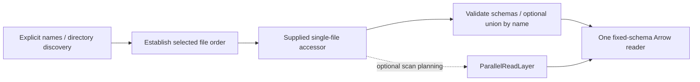

# Multi-file datasets

Combine a single-file Arrow accessor across multiple objects. Directory and
file-set APIs are always available; enable the format readers you use.

| Accessor | Selection | Output order |
| --- | --- | --- |
| `file_set::FileSetAccessor` | Explicit nonempty object list | Caller order; duplicates retained |
| `directory::DirectoryAccessor` | Prefix, optional case-sensitive suffix, recursion | Lexicographic locators; duplicates removed |

## Read selected shards

Enable `format-json`. This function reads two files with
the same inferred schema from a caller-configured storage operator:

```rust,no_run
use open_arrow_access::{
    Accessor,
    dataset::file_set::{FileSetAccessor, FileSetRequest},
    file_format::json::JsonAccessor,
    storage::{OpenDalAccessor, opendal},
};

async fn read(operator: opendal::Operator) -> open_arrow_access::Result<()> {
    let format = JsonAccessor::infer(OpenDalAccessor::new(operator));
    let files = FileSetAccessor::new(format);
    let mut reader = files.open(FileSetRequest::new(["a.jsonl", "b.jsonl"])).await?;
    println!("schema: {:?}", reader.metadata().schema);
    while let Some(batch) = reader.next().await? {
        println!("{} rows", batch.num_rows());
    }
    Ok(())
}
```



Ordinary reads open files lazily and sequentially. Directory discovery collects
locators before reading to establish order; recursion defaults to true. Prefix
and locator syntax belongs to the byte backend. File-set output has no single
source object. An empty selection is invalid; a selected empty file with a known
schema is valid.

Use request `with_options` for projection and batch rows, and `with_byte_options`
for per-file I/O settings. See [multi-shard usage](../docs/usage.md#read-multiple-shards)
for directory construction and complete request examples.

<a id="union-by-name"></a>

## Choose a schema policy

The default is strict: the first file establishes the projected schema and later
files must match, including schema metadata. Opt into union by name on the
accessor when fields may be missing:

```rust,ignore
let files = FileSetAccessor::new(JsonAccessor::infer(storage)).with_union_by_name();
```

Union mode inspects every full schema before emitting rows, then reopens files
lazily. Missing fields receive nulls; fields follow first-seen order. Structs and
supported lists combine recursively; other differing types or conflicting
metadata fail. There is no implicit numeric/string cast. Projection is resolved
after union, and conflicts in unselected fields still fail preflight. Execution
requests only selected columns present in each file, then fills missing columns
and restores output order. JSON readers still validate and decode the full input
schema before projection, including when the output has zero columns.

Keep source files stable between inspection and reading; schema drift in reopened
selected fields fails the reader. JSON also checks unselected fields and rejects
unknown keys, including keys outside each file's inference sample. Other formats
may skip changes to unselected fields after preflight.
Union may sample a file twice and stores selected requests/schemas, while keeping
preflight readers/plans one at a time.

## Execute in parallel

Install [`ParallelReadLayer`](../docs/parallel-read.md) to run files concurrently
while preserving order. Use `.with_file_planning()` on a planner-capable dataset
to expose file-internal partitions too. `UnorderedEmissionLayer` can opt eligible
sources into ready-batch emission; sources requiring global order reject it.
See [layer composition](../layers/README.md) for placement of sampling and
generated columns after parallel execution.

## Select the format automatically

Automatic format selection is always available. Enable the `format-*` readers and
`decompression-*` codecs you need on the facade, or `format-*` on this crate.

`AutoFormatAccessor` routes only the built-in `DetectedFormat` / `ResolvedKind`
variants with an enabled reader. This version reads CSV, TSV, Parquet, and WARC;
recognizing a suffix does not guarantee an available reader.

Applications can still define their own formats by implementing `ReaderFactory`
and binding them with `FileAccessor::from_format(storage, format)`. Compose that
accessor with `FileSetAccessor` to read multiple files. These custom formats are
not selected by `AutoFormatAccessor`, which currently has no registration API.
See the [proposed registration design](../docs/extending.md#custom-format-registration-proposed)
and its [roadmap TODO](../docs/roadmap.md#planned-capabilities).

```rust,ignore
let auto = AutoFormatAccessor::new(storage);
let request = AutoFormatRequest::Directory(DirectoryRequest::new("data/**/*"));
let selected = auto.resolve(request.clone()).await?;
let reader = auto.layer(ParallelReadLayer::new(concurrency, prefetch)).open(request).await?;
```

Suffix detection performs no I/O. Automatic selection ignores unknown suffixes
and requires one format; CSV and TSV are distinct formats. No format takes priority.
Use `.with_format(DetectedFormat::Json)` (or another format) to read every supplied
object as that format, including files without a recognized suffix. Explicit CSV
uses commas; explicit TSV uses tabs, regardless of filename. `resolve` also lists directories,
but does not decode Arrow records. Mixed formats return
`InvalidInput` with examples; no recognized files returns `NotFound`.

Explicit CSV schemas are accessor settings; custom CSV dialects use `CsvAccessor` directly. Projection,
batch size, and byte options remain on the request. Native file planning and union
by name support record layers. Parquet keeps raw range reads and size hints already
configured on storage with `with_content_lengths`. Discovery does not snapshot data.

JSON and ATIF auto-detection are added in the next PR; JSON selections currently
return `Unsupported`. Existing typed JSON/ATIF readers are unchanged.
