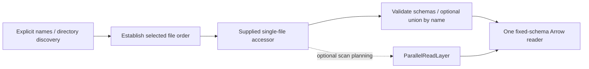

# Multi-file datasets

Combine a single-file Arrow accessor across multiple objects. Directory and
file-set APIs are always available; enable the format readers you use.

| Accessor | Selection | Output order |
| --- | --- | --- |
| `file_set::FileSetAccessor` | Explicit nonempty object list | Caller order; duplicates retained |
| `directory::DirectoryAccessor` | Prefix, optional case-sensitive suffix, recursion | Lexicographic locators; duplicates removed |

## Read selected shards

Enable `format-json`. This function reads two files with
the same inferred schema from a caller-configured storage operator:

```rust,no_run
use open_arrow_access::{
    Accessor,
    dataset::file_set::{FileSetAccessor, FileSetRequest},
    file_format::json::JsonAccessor,
    storage::{OpenDalAccessor, opendal},
};

async fn read(operator: opendal::Operator) -> open_arrow_access::Result<()> {
    let format = JsonAccessor::infer(OpenDalAccessor::new(operator));
    let files = FileSetAccessor::new(format);
    let mut reader = files.open(FileSetRequest::new(["a.jsonl", "b.jsonl"])).await?;
    println!("schema: {:?}", reader.metadata().schema);
    while let Some(batch) = reader.next().await? {
        println!("{} rows", batch.num_rows());
    }
    Ok(())
}
```



Ordinary reads open files lazily and sequentially. Directory discovery collects
locators before reading to establish order; recursion defaults to true. Prefix
and locator syntax belongs to the byte backend. File-set output has no single
source object. An empty selection is invalid; a selected empty file with a known
schema is valid.

Use request `with_options` for projection and batch rows, and `with_byte_options`
for per-file I/O settings. See [multi-shard usage](../docs/usage.md#read-multiple-shards)
for directory construction and complete request examples.

<a id="union-by-name"></a>

## Choose a schema policy

The default is strict: the first file establishes the projected schema and later
files must match, including schema metadata. Opt into union by name on the
accessor when fields may be missing:

```rust,ignore
let files = FileSetAccessor::new(JsonAccessor::infer(storage)).with_union_by_name();
```

Union mode opens files with bounded concurrency (at most 16 opens in flight)
and inspects every full schema before emitting rows. It retains those plans for
execution, so inferred JSON/CSV readers replay their samples without reopening.
Missing fields receive nulls; fields follow first-seen order. Structs and
supported lists combine recursively; other differing types or conflicting
metadata fail. There is no implicit numeric/string cast. Projection is resolved
after union, and conflicts in unselected fields still fail preflight. Retained
readers decode the full source schema; alignment selects output columns, fills
missing columns, and preserves row counts even for zero-column output.

Keep source files stable during a scan. JSON checks unselected fields and rejects
unknown keys, including keys outside each file's inference sample.
Retaining plans also retains readers, open resources, and inference samples for
all selected files until their partitions are consumed or the scan is dropped.
The concurrency limit bounds in-flight opens, not total retained sample bytes.
Zero-field inputs still require a separate metadata inspection to distinguish
empty inferred files from JSON `{}` rows without polling an output decoder.

## Execute in parallel

Install [`ParallelReadLayer`](../docs/parallel-read.md) to run files concurrently
while preserving order. Use `.with_file_planning()` on a planner-capable dataset
to expose file-internal partitions too. `UnorderedEmissionLayer` can opt eligible
sources into ready-batch emission; sources requiring global order reject it.
See [layer composition](../layers/README.md) for placement of sampling and
generated columns after parallel execution.

## Resolve a paths manifest

Paths manifests are always available. Enable the required `decompression-*`
codecs for compressed manifests and bind storage to the origin root:

```rust,ignore
let files = PathsManifest::new("crawl-data/CC-MAIN-2022-40/warc.paths.gz")
    .with_prefix("crawl-data/CC-MAIN-2022-40/segments/1664030338280.51/")
    .with_formats(&[DetectedFormat::Warc], Mismatch::Error)
    .resolve(&storage).await?;
```

The default base is the origin root; `ManifestDirectory` and `Explicit(ObjectRef)`
select a directory instead. Relative entries become decoded storage keys.
Absolute HTTP(S) entries always remain full URLs, regardless of the manifest's
origin, and require an accessor that supports URLs. Absolute URLs and relative
keys are distinct locators for duplicate detection.

Security checks run before prefix filtering: dot segments (even contained ones),
credentials, network-path references, malformed encoding, encoded delimiters,
backslashes and controls are rejected. Entry query/fragment components are always
preserved; the accessor must support these semantics. Fragments are never sent by
HTTP itself. Manifest locations remain storage keys without query/fragment.
Transport and redirect policy remain the caller's responsibility.

Blank lines are ignored. Format mismatches and selected duplicates error by
default; `Mismatch::Skip` and `Duplicates::Dedupe` retain the other entries in
manifest order. Empty results return `InvalidInput`; errors name the manifest and
line. Only selected keys are accumulated. `resolve` decompresses raw bytes by
suffix; `resolve_reader` accepts already-decoded bytes.
