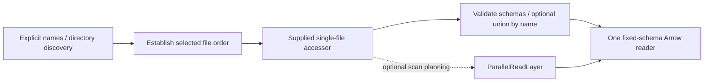

# Multi-file datasets

Enable `dataset-directory` on `open-arrow-access` (`directory` on this component
crate) to combine a single-file Arrow accessor across multiple objects.

| Accessor | Selection | Output order |
| --- | --- | --- |
| `file_set::FileSetAccessor` | Explicit nonempty object list | Caller order; duplicates retained |
| `directory::DirectoryAccessor` | Prefix, optional case-sensitive suffix, recursion | Lexicographic locators; duplicates removed |

## Read selected shards

Enable `format-json` and `dataset-directory`. This function reads two files with
the same inferred schema from a caller-configured storage operator:

```rust,no_run
use open_arrow_access::{
    Accessor,
    dataset::file_set::{FileSetAccessor, FileSetRequest},
    file_format::json::JsonAccessor,
    storage::{OpenDalAccessor, opendal},
};

async fn read(operator: opendal::Operator) -> open_arrow_access::Result<()> {
    let format = JsonAccessor::infer(OpenDalAccessor::new(operator));
    let files = FileSetAccessor::new(format);
    let mut reader = files.open(FileSetRequest::new(["a.jsonl", "b.jsonl"])).await?;
    println!("schema: {:?}", reader.metadata().schema);
    while let Some(batch) = reader.next().await? {
        println!("{} rows", batch.num_rows());
    }
    Ok(())
}
```



Ordinary reads open files lazily and sequentially. Directory discovery collects
locators before reading to establish order; recursion defaults to true. Prefix
and locator syntax belongs to the byte backend. File-set output has no single
source object. An empty selection is invalid; a selected empty file with a known
schema is valid.

Use request `with_options` for projection and batch rows, and `with_byte_options`
for per-file I/O settings. See [multi-shard usage](../docs/usage.md#read-multiple-shards)
for directory construction and complete request examples.

<a id="union-by-name"></a>

## Choose a schema policy

The default is strict: the first file establishes the projected schema and later
files must match, including schema metadata. Opt into union by name on the
accessor when fields may be missing:

```rust,ignore
let files = FileSetAccessor::new(JsonAccessor::infer(storage)).with_union_by_name();
```

Union mode inspects every full schema before emitting rows, then reopens files
lazily. Missing fields receive nulls; fields follow first-seen order. Structs and
supported lists combine recursively; other differing types or conflicting
metadata fail. There is no implicit numeric/string cast. Projection is resolved
after union, and conflicts in unselected fields still fail preflight.

Keep source files stable between inspection and reading; observed schema drift
fails the reader. JSON inference cannot recover keys outside each file's sample.
Union may sample a file twice and stores selected requests/schemas, while keeping
preflight readers/plans one at a time.

## Execute in parallel

Install [`ParallelReadLayer`](../docs/parallel-read.md) to run files concurrently
while preserving order. Use `.with_file_planning()` on a planner-capable dataset
to expose file-internal partitions too. `UnorderedEmissionLayer` can opt eligible
sources into ready-batch emission; sources requiring global order reject it.
See [layer composition](../layers/README.md) for placement of sampling and
generated columns after parallel execution.
