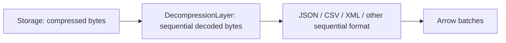
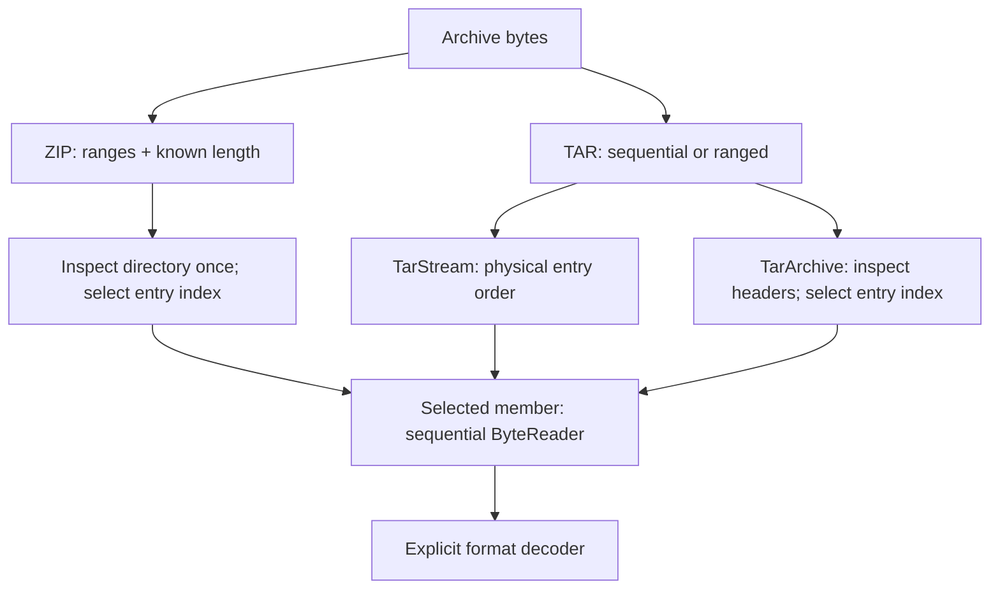

# Decompression and archives

Compose byte decoding before your file format. Enable only the codecs/archive
APIs you use. All outputs here are bytes; the next format determines Arrow rows.

## Enable a codec

| Codec / archive | Facade feature | Component-crate feature | API |
| --- | --- | --- | --- |
| Gzip | `decompression-gzip` | `gzip` | `DecompressionLayer::new(gzip::Gzip)` |
| Bzip2 | `decompression-bz2` | `bz2` | `DecompressionLayer::new(bz2::Bzip2)` |
| LZ4 frames | `decompression-lz4` | `lz4` | `DecompressionLayer::new(lz4::Lz4)` |
| Zstandard frames | `decompression-zstd` | `zstd` | `DecompressionLayer::new(zstd::Zstd)` |
| ZIP | `decompression-zip` | `zip` | `zip::ZipAccessor` / `zip::ZipArchive` |
| TAR | `decompression-tar` | `tar` | `tar::TarStream` / `tar::TarArchive` |

## Read gzip-compressed JSONL

Enable `format-json` and `decompression-gzip`. Supply a configured OpenDAL
operator, with its backend feature enabled on your OpenDAL dependency:

```rust,no_run
use open_arrow_access::{
    Accessor, AccessorExt, ReadRequest,
    decompression::{DecompressionLayer, gzip::Gzip},
    file_format::json::JsonAccessor,
    storage::{OpenDalAccessor, opendal},
};

async fn read(operator: opendal::Operator) -> open_arrow_access::Result<()> {
    let bytes = OpenDalAccessor::new(operator).layer(DecompressionLayer::new(Gzip));
    let records = JsonAccessor::infer(bytes);
    let mut reader = records.open(ReadRequest::new("records.jsonl.gz")).await?;
    while let Some(batch) = reader.next().await? {
        println!("{} rows", batch.num_rows());
    }
    Ok(())
}
```



The explicit layer uses the selected codec regardless of filename. For mixed
plain/compressed objects, use `AutoDecompressionLayer::new()` instead. It routes
by the final, case-sensitive suffix: `.gz` / `.tgz`, `.bz2`, `.lz4`, `.zst` /
`.zstd`. Enable each corresponding codec feature; a recognized but disabled codec
fails before opening storage. Other suffixes pass through. This removes one
compression layer, without sniffing bytes, stripping URL query strings, guessing
record formats, or opening archive members.

Decoded readers are sequential and have unknown decoded length; exact ranges
are unsupported. Source/version still identify the compressed object. Listing
and byte request options pass through. Parquet/ZIP cannot directly consume this
sequential representation: they require exact ranges and known length.
Parquet page compression uses separate `format-parquet-*` features.

Decoding is pull-based. Default output chunks are at most 64 KiB; `with_chunk_size`
changes that limit, not total memory. Read through EOF to validate checksums and
trailing data; an error can occur after earlier chunks were delivered.

| Codec | Stream behavior |
| --- | --- |
| Gzip / bzip2 | Concatenated members, including empty members |
| LZ4 | Standard, concatenated, and skippable frames; no raw/legacy blocks |
| Zstandard | Standard, concatenated, and skippable frames; no custom dictionary configuration |

A valid empty member/frame yields no bytes; an empty compressed object is
invalid. Corrupt/truncated streams terminate with decode errors. Upstream errors
retain their category and source chain.

<a id="zip-entries"></a>

## Select archive members



For ZIP, enable `decompression-zip`:

```rust,no_run
use open_arrow_access::{
    ByteReadRequest, decompression::zip::ZipAccessor,
    storage::{OpenDalAccessor, opendal},
};

async fn read(operator: opendal::Operator) -> open_arrow_access::Result<()> {
    let zip = ZipAccessor::new(OpenDalAccessor::new(operator), 0);
    let archive = zip.archive(ByteReadRequest::new("papers.zip")).await?;
    for entry in archive.entries() {
        println!("{}: {:?}", entry.index, entry.name);
    }
    let mut member = archive.open_entry(0, std::num::NonZeroUsize::new(65536).unwrap()).await?;
    while let Some(bytes) = member.next().await? {
        println!("{} member bytes", bytes.len());
    }
    Ok(())
}
```

A ZIP session caches the directory and supports independently owned entry
readers. Select by index because names may repeat. Stored/Deflate entries,
ZIP64, and data descriptors are supported; encrypted/split archives and other
codecs are unsupported. Default `ZipLimits` cap compressed and decoded entry size
at 1 GiB each. CRC/decoded-length checks finish at EOF.

| TAR API | Input | When to use |
| --- | --- | --- |
| `TarStream::new(input, limits)` | Sequential bytes, including gzip-decoded `.tar.gz` | One physical-order scan; consume/drop the current body before advancing |
| `TarArchive::open(input, limits).await` | Exact ranges and known length | Inspect headers once and independently open selected entries |

TAR supports regular GNU/USTAR files and directories; links, sparse files, and
extension headers are unsupported. Default limits are 65,536 entries and 1 GiB
per entry. Ranged inspection issues a header request per entry. Selected TAR
and ZIP member readers remain sequential. Names are raw metadata; these APIs
perform no filesystem extraction or recursive expansion.

Run local examples from the repository:

```sh
cargo run --locked --example read_zip --features decompression-zip -- testdata/zip mixed.zip 1
cargo run --locked --example read_tar --features decompression-tar -- /absolute/data/root archive.tar
```

Use `ReaderFactoryExt::open_input` to decode an already-open member. See
[archive composition](../docs/usage.md#work-with-archives-and-other-providers).

## Add a codec

Implement `Codec` in a new module using an upstream futures `AsyncRead` decoder.
Reuse `DecompressionLayer` and its factory; expose a component feature for the
codec dependency and forward it as `decompression-<name>` on the facade. Validate
fragmented input, concatenated streams, corruption, and source-error propagation
with [shared test helpers](../test-support/README.md).
