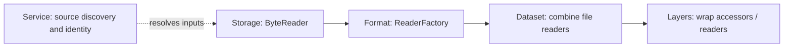

# Documentation

Start with the [quick start](../README.md#read-your-first-file), then choose the
components your application needs. Features compile APIs; accessor and layer
construction selects the runtime composition.

## Use the library

| Goal | Guide |
| --- | --- |
| Configure Cargo features and storage backends | [Feature selection](../README.md#enable-features) |
| Read files, project fields, configure batches, or use S3 | [Usage](usage.md) |
| Choose a decoder and understand schema behavior | [Formats](../file-format/README.md), [format reference](formats.md) |
| Decode compressed objects or archive members | [Decompression and archives](../decompression/README.md) |
| Combine shards with strict schemas or union by name | [Datasets](../dataset/README.md) |
| Discover provider metadata and original files | [Services](../service/README.md) |
| Cast, generate columns, sample, or configure execution | [Layers](../layers/README.md) |
| Configure bounded parallel scans and ordering | [Parallel reads](parallel-read.md) |
| Use row-level SQL expressions | [Generated columns](generated-columns.md) |
| Check supported representations and limitations | [Support matrix](support.md) |

## Understand and extend



| Goal | Guide |
| --- | --- |
| Understand boundaries, resource ownership, and execution | [Architecture](architecture.md) |
| Add a format, service, byte backend, codec, or layer | [Extension guide](extending.md) |
| Implement request, reader, capability, and planning contracts | [API contracts](contracts.md) |

## Develop the library

Use the toolchain pinned in `rust-toolchain.toml`. Development checks from the
repository root:

```sh
cargo install taplo-cli --version 0.10.0 --locked
make lint
cargo check --workspace --no-default-features --locked
cargo test --workspace --all-features --locked
```

[Test guidance](testing.md) explains suite ownership and fixture usage;
[test helpers](../test-support/README.md) provide shared contracts.
[Dependency alignment](dependencies.md) describes upstream version updates.
[Roadmap](roadmap.md) and [source-attribute design](source-attributes.md) track
future work; consult the public APIs and usage guides for available behavior.
