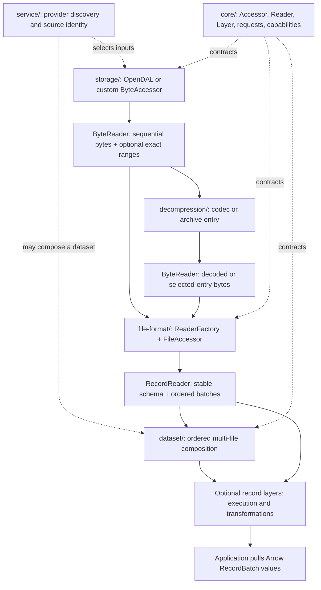
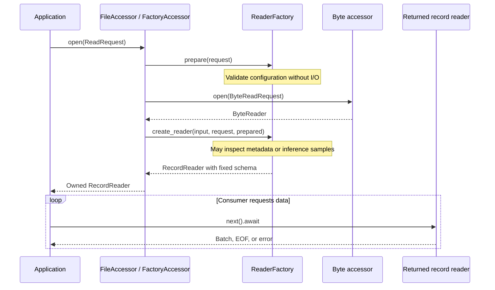
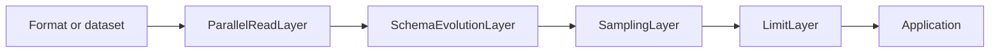
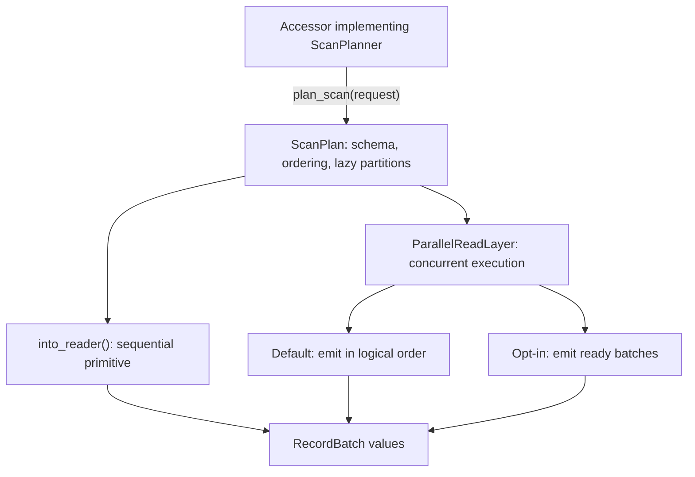

# Architecture

open-arrow-access reads source data and turns it into Arrow batches. Its types
separate four questions: where are the bytes, how are they decoded, which files
are selected, and how is the work executed?

Start with storage and one format. Add the other components when you need them.
The same format can read local files, object stores, or provider downloads because
it receives a byte reader rather than a storage backend.

## From source to Arrow



Solid arrows show data flow. Dashed arrows show selection, composition, or shared
contracts. `core/` supplies those contracts; it is not another processing stage.
An accessor opens an owned reader, and the consumer pulls items with `next().await`.
Providers may return bytes or metadata rather than Arrow. WARC uses the same
factory contract, exposing native `WarcRecord` values through `WarcAccessor`
or projected Arrow batches through `WarcArrowAccessor`.

## Component boundaries

| Crate / directory | Responsibility | Reuses |
| --- | --- | --- |
| Root facade | Feature selection and public re-exports | Component crates |
| `core/` | Reader/accessor/layer contracts, requests, capabilities, errors, stream and decoder adapters | Arrow and common types; no concrete backend |
| `storage/` | OpenDAL byte access, exact ranges, discovery, named-file namespaces | Caller-configured operator |
| `decompression/` | Streaming codecs and TAR/ZIP entry access | Byte readers and upstream decoders |
| `file-format/` | Parser configuration, schemas, projection, and decoding | Byte readers and format libraries |
| `dataset/` | Directory discovery and explicit ordered file sets | Supplied single-file record accessor |
| `service/` | Provider discovery, identities, metadata, and source-specific composition | Storage, formats, archives, and datasets |
| `layers/` | Schema changes, sampling, limits, prefetch, parallel execution, and emission policy | Core contracts, Arrow kernels, and DataFusion expressions |
| `test-support/` | Unpublished shared test fixtures and contract assertions | Component test suites |

A format receives a `ByteReader`, not an OpenDAL operator. Storage knows object
locators and I/O options, not Arrow columns. Dataset composition knows file order
and schema compatibility, not how Parquet or XML works. Providers resolve their
own APIs and source conventions while reusing these components.

## The public contracts

An **accessor** is a reusable way to open a selection. A **reader** is one opened
read, with its own cursor and decoder state. Opening the same accessor again
creates an independent reader.

| Type | Question it answers |
| --- | --- |
| `Accessor` | How do I open this typed request? |
| `Reader` | What metadata and next item does this open read expose? |
| `ReaderFactory` | How do I build a reader from an opened byte input? |
| `FactoryAccessor<B, F>` | How do I connect byte accessor `B` to factory `F`? |
| `FileAccessor<B, F>` | How do I use that binding as a file format, with format-specific partition planning where supported? |
| `Layer<A>` | How do I wrap an accessor and the readers it creates? |

```text
Accessor::open(request).await -> owned Reader
Accessor::capability()        -> available operations before opening
Reader::metadata()            -> stable metadata for this opened representation
Reader::next().await          -> Result<Option<Item>>
Reader::capability()          -> operations on this opened reader
Layer::layer(accessor)        -> wrapped accessor with the same request/reader types
```

| Boundary | Request | Reader output | Metadata |
| --- | --- | --- | --- |
| Byte access | `ByteReadRequest` | Nonempty `Bytes` chunks | Source, optional length/version |
| Arrow file access | `ReadRequest` | `RecordBatch` | Fixed `SchemaRef`, optional source |
| Dataset access | `DirectoryRequest` / `FileSetRequest` | `RecordBatch` | Fixed projected schema |
| Provider access | Provider-specific request or method | Bytes, records, file sets, or metadata | Defined by the provider |

`ReadRequest` carries Arrow options and separate byte I/O options. Storage ignores
Arrow projection; a format applies it and forwards byte settings to its input.
`ObjectRef` is a locator interpreted by the byte accessor. It is not a universal
URI resolver. A provider can use a different request type to carry a dataset ID,
revision, or split along with common read options.

### Follow one open

`ReaderFactory` separates decoder creation from storage access. Its shared opening
protocol validates configuration before opening storage:



Constructing the accessor does no reading. Opening it may perform I/O to establish
metadata. Calling `next()` consumes its output. These are separate steps.

`FactoryAccessor` implements the shared binding. `FileAccessor` contains that
binding and adds partition configuration and format-specific `ScanPlanner`
implementations. For example, `JsonAccessor<B>` is a type alias for
`FileAccessor<B, JsonFormat>`, not a separate reader system.

A factory can also decode an already-open `ByteReader` through `open_input`.
Use that path for an archive member; it does not reopen the request's locator.

### Add behavior with layers

A layer wraps an accessor while keeping its Rust request and reader interfaces.
It may wrap `open`, the returned reader, or both. Byte layers remain byte
interfaces; record layers remain record interfaces. A record layer can change
Arrow fields and values as long as its metadata describes the final schema.
Converting bytes into Arrow records is a format adapter, not a layer.

For `source.layer(a).layer(b)`, `b` is outermost. Opening calls `b`, then `a`, then
the source. Output flows back through `a`, then `b`:



This placement gives transformations one merged scan. Schema evolution, sampling,
limits, and prefetch do not expose `ScanPlanner`; install planning/execution layers
inside them. See [layer composition](../layers/README.md#compose-layers).

### Bind a source for later reads

Source helpers save an accessor and request behind one non-generic type. They are
useful when an integration needs a schema before it starts reading.

| Helper | What is fixed | How to read |
| --- | --- | --- |
| `BoundSource` | Complete request and initial output schema | `reader()` takes the retained first reader, then reopens independent readers and checks their schemas |
| `PreparedSource` | Selection and complete unprojected schema | `scan(ReadOptions)` chooses projection and batch size for each scan |
| `FileSource` | File selection through the same binding lifecycle | Wraps `BoundSource`; `into_bound_source()` removes the file-specific wrapper |

Binding opens a reader without polling output rows. `PreparedSource` clears the
initial projection to establish the complete schema. It reuses that reader only
for a scan with matching preparation options; other scans reopen the selection.
These helpers do not cache the dataset or create a snapshot. Source contents and
file membership must remain stable when the application needs reproducible reads.

Use `PreparedSource::prepare_plannable` to retain an accessor's optional planner.
`scan()` still uses the accessor's `open` path; `plan_scan()` explicitly asks for
partitions.

See [API contracts](contracts.md) for factory hooks, byte adapters, and lifecycle
details, or [extending](extending.md) to implement a component.

## Capabilities and valid compositions

Cargo features make implementations available. Runtime `Capability` flags describe
the operations a configured accessor or opened reader exposes.

| Flag | Meaning |
| --- | --- |
| `read` | Consume this interface's item type |
| `read_with_range` | Read exact byte ranges without moving the sequential cursor |
| `list` | Discover objects through a byte accessor; never a reader operation |
| `read_parallel` | This interface executes files/partitions concurrently; advertised by `ParallelReadLayer` |

Byte interfaces report `Capability`. Record interfaces report `RecordCapability`,
which also declares an `OrderRequirement`: `PreserveGlobal` or `Reorderable`.
This is permission to relax ordering, not a request to emit out of order.

A wrapper must forward or clear flags to match its output. Decompression, for
example, accepts sequential bytes and removes range access. Parquet requires
ranges and a known length, so `storage → gzip → Parquet` is not a valid direct
composition. JSONL is sequential, so `storage → gzip → JSONL → Arrow` works.
ZIP inspection also requires ranges. TAR offers separate sequential and ranged
APIs; use sequential TAR after gzip for `.tar.gz`.

A capability is not a snapshot or access guarantee: a supported operation may
still fail because an object is missing, permissions differ, or metadata is invalid.

## Execution and resource ownership

Reading is pull-based. Core adapters and decoders do not start detached background
jobs. Each reader owns the state needed for its scan; dropping it stops its work.
OpenDAL can prefetch using the per-reader I/O settings.

| Control | Unit | Behavior |
| --- | --- | --- |
| `ReadOptions::batch_size` | Arrow rows | Target rows per batch; default 8,192 |
| `ReadOptions::projection` | Top-level fields | Requested output order; empty projection retains row counts |
| `ByteReadOptions::io_concurrency` | In-flight storage I/O | Default one; budget is per opened reader |
| `ByteReadOptions::io_chunk_size` | Storage I/O splitting | Backend default when unset |
| `OpenDalAccessor::with_chunk_size` | Emitted byte chunks | Independent of I/O splitting and Arrow batch size |

Ordinary file-set reads open files sequentially in caller order; directory scans
sort selected paths. By default, later files must match the first file's projected
schema, including metadata. Optional `with_union_by_name()` inspects full schemas
before execution and aligns missing fields. See
[schema policies](../dataset/README.md#union-by-name). Discovery may collect a file
list; decoders may buffer a document, record, or row group. Batch/chunk targets do
not bound total memory or an individual value's size.

Storage I/O concurrency preserves byte and record order. It does not parallelize
files or partitions. Multiple application-owned readers each have their own I/O
budget. `ParallelReadLayer` and `UnorderedEmissionLayer` are separate policies;
source ordering requirements constrain admission to unordered emission.

### Separate planning from execution

`ScanPlanner` is an optional accessor extension. It returns a `ScanPlan` with a
fixed schema, an ordering requirement, and lazily discovered partition openers.
Each opener creates an owned reader. Exposing partitions does not execute them
concurrently or advertise `read_parallel`.



The diagram shows two ways to consume partitions. In normal application code,
install `ParallelReadLayer` on the planner-capable accessor and call `open`.
That path collects and executes the composed policies. Calling a returned plan's
`into_reader()` directly is only sequential consumption; it does not execute
collected parallel or emission policies.

`UnorderedEmissionLayer` opts into ready-batch emission only for a `Reorderable`
source. Parallel execution alone preserves order. Unordered emission alone does
not start workers. These policies are separate from per-reader byte I/O concurrency.

For example, Hugging Face dataset access pins an export revision and composes a
file set with Parquet readers. It exposes scan planning but retains global order;
an outer parallel layer can read partitions concurrently while emitting in order.

The executor limits resident partitions. This is not a total memory limit:
streaming-file scans currently use unbounded output queues for each resident
file, while independent native partitions use bounded batch queues. See
[parallel reads](parallel-read.md) for scheduling, ordering, and memory details.

## Schema, errors, and source identity

Record metadata is available when `open` completes and every returned batch
matches that schema. Opening may perform I/O to inspect Parquet metadata, sample
XML records, or discover a provider's shard list. Fixed-schema validation can
happen before opening bytes.

EOF and errors terminate record reading. Error categories and source chains are
preserved across adapters. If an in-flight decoder call is cancelled, drop its
reader; resumability is not guaranteed. Layers must not transparently replay
already emitted records. Compression integrity validation completes only when
the relevant stream reaches EOF.

Objects must remain stable during a read. Generic storage does not create a
snapshot. Some providers pin a revision or release, such as Hugging Face's Parquet
export; others expose mutable catalogues. Record the chosen identity and provider
metadata in your pipeline's manifest. Reader source metadata is not automatically
added as Arrow provenance columns.

## Shared service HTTP client

Service HTTP mechanisms compile without provider features. The root facade
always exposes `service::common`, including with `--no-default-features`. The internal
`HttpClient` constructs GET requests, checks metadata/sequential response status,
collects bodies, validates declared lengths and parses typed JSON. Public
`common::Connection` supplies provider URL rules and scoped credentials, then
uses that same client; `ApiDocument` uses its JSON parser. The shared body-length
tracker also validates lazy sequential downloads. Error operations remain owned
by callers (`provider_http`, `resolve_zenodo`, and so on), and transport and parser
causes remain attached.

Transport policy and download capabilities remain explicit. OpenDAL HTTP and
Hugging Face use the ordinary redirect-following transport and handle HEAD/range
statuses themselves. `Connection` uses a single-hop transport underneath its
origin-scoped redirect layer, including when a custom context is supplied. That
layer preserves signed URLs, strips configured credentials on an origin change
and rejects HTTPS downgrades. Keeping those policies distinct prevents a second
redirect follower or an `AuthScope` requirement on raw OpenDAL requests.

The OpenDAL download adapter retains exact ranges and known-length storage
semantics; `Connection` retains sequential absolute-URL downloads. Sharing the
client does not make a sequential download suitable for Parquet. Provider
identity/version validation, metadata mappings and optional concrete providers
stay outside the client. No provider feature is required to use `Connection`.

This default-on facade deliberately includes the service crate's HTTP baseline
(OpenDAL HTTP/reqwest transport, JSON/Serde, URL and supporting utilities).
Provider features remain empty by default: making common code available does not
enable Hugging Face, Zenodo, XML parsing, or other concrete providers.
