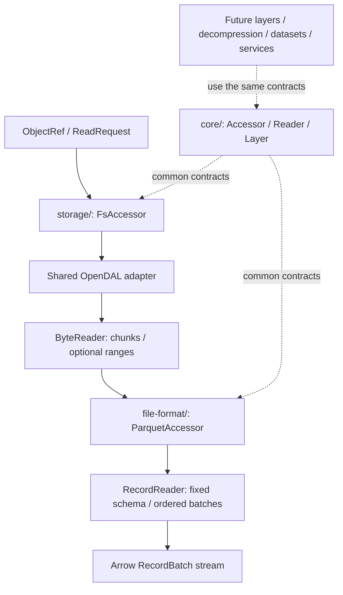

# Framework contracts

The first PR implements the common framework and a single concrete pipeline:
OpenDAL Fs → Parquet → Arrow. Dataset, service, decompression and production
layer implementations follow in independent PRs.

## Reader

`Reader` has associated `Item` and `Metadata` types. Metadata is available when
opening finishes. `next` returns a Send boxed future yielding one item, EOF or
an error. Byte readers return nonempty `Bytes` chunks; record readers return
`RecordBatch` values with one fixed schema. Sequential order is the default.

`ByteReader` specializes this contract with `ByteMetadata` and optional exact
range reads. `read_range(start..end)` uses the current representation's byte
coordinates and leaves the sequential cursor unchanged. Unsupported ranged
access is explicit, not emulated by decoding repeatedly from zero.

A future gzip reader wraps another byte reader, reports decoded rather than
compressed length (or unknown), and normally removes range capability. It can
use this contract without changing a format reader. Compressed Parquet will
need bounded materialization or another valid random-access mechanism.

`RecordReader` specializes the same reader protocol with `RecordMetadata`.
`into_stream` owns the reader and stops polling it after EOF or the first error.
No background execution is created by these contracts.

## Accessor

`Accessor` is a Send + Sync factory. Associated `Request` and `Reader` types
allow storage, formats and future datasets/services to use the same `open`
contract without a closed enum of every source or format.

| Adapter | Request | Reader |
| --- | --- | --- |
| Fs storage | `ObjectRef` | `dyn ByteReader` |
| Parquet format | `ReadRequest` | `dyn RecordReader` |
| Future JSON format | Typed file request | Record reader |
| Future directory dataset | Directory selection and options | Record reader |
| Future Hugging Face service | Repository/revision/config/split selection | Record reader or resolved object discovery |

`Arc<dyn ByteAccessor>` supports application-owned backend injection. Optional
`ByteAccessor::list` defaults to Unsupported and is not implemented by the
initial Fs adapter. The directory PR can add discovery without redesigning
the opening/reading contract. Input locators remain backend-owned.

## Layer

`Layer<A>` wraps an accessor while preserving its request and reader types.
`AccessorExt::layer` composes wrappers; the newest wrapper is outermost. A layer
can intercept opening and wrap the readers returned from it. Test-only layers
exercise this contract on both byte and record accessors, including optional
range/discovery delegation and operation order.

Type-preserving byte transformations, such as a future gzip wrapper, remain
within the byte accessor/reader family. Bytes → Arrow conversion is a format
adapter: its input and output item types differ.

Each layer declares its supported specialization and operation scope. It must
delegate optional operations or accurately remove their advertised abilities.
Wrapping only `next` does not intercept a Parquet reader's range I/O.

Future `ParallelReadLayer` and `UnorderedEmissionLayer` remain independent,
default-off enhancements. Parallel execution alone preserves ordering; unordered
emission alone does not create concurrency. Emission policy must reach a future
executor before ordered merging. Partition planning is an optional extension
to this framework, not a required method for every byte reader in this PR.

## Implementation boundaries

Generated columns are a required record-layer extension. The core
`ReadOptionsProvider` trait lets a layer adjust common projection settings on
file, dataset or service request types. `ReadRequest` implements it; expression
evaluation and DataFusion integration remain a separate PR. See
[generated-column design](generated-columns.md) for dependency/projection,
schema and optional reader-context contracts.

- `core/` depends on common types and Arrow, never concrete backends or formats.
- `storage/` builds OpenDAL operators; shared reads are independent of the Fs
  constructor. Production file reads and metadata access go through OpenDAL.
- `file-format/` consumes shared byte accessors. Its Parquet bridge implements
  Arrow Rust's `AsyncFileReader` using exact ranges.
- The facade forwards independent, additive `storage-fs` / `format-parquet`
  features. Features make implementations available; they do not change runtime
  ordering or silently attach layers.
- `dataset/`, `service/`, `decompression/`, and `layers/` currently contain only
  scope/extension documentation; unimplemented capabilities are not registered.

The project output boundary is Arrow records. Internal temporary inputs may be
introduced for materialization in a later decompression PR; downstream writes,
commit protocols and sink integrations are outside the project.

## References

- [OpenDAL Operator](https://opendal.apache.org/docs/rust/opendal/struct.Operator.html)
- [OpenDAL Reader](https://opendal.apache.org/docs/rust/opendal/struct.Reader.html)
- [Arrow Rust async Parquet reading](https://docs.rs/parquet/59.3.0/parquet/arrow/async_reader/index.html)
