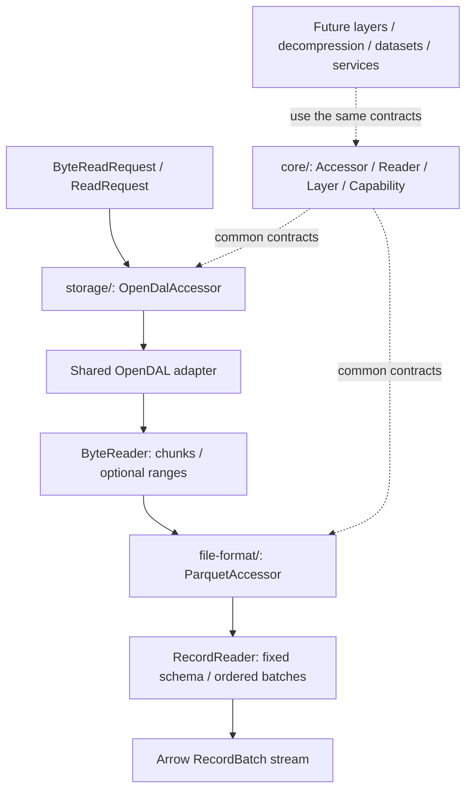

# Framework contracts

The first PR implements the common framework and a single concrete pipeline:
OpenDAL Fs → Parquet → Arrow. The default-off directory dataset adds sequential
file composition. Streaming decompression layers compose with byte readers;
services and production record layers follow in independent PRs.

## Reader

`Reader` has associated `Item` and `Metadata` types. Metadata is available when
opening finishes. `next` is an `async fn` with a Send future yielding one item,
EOF or an error. Byte readers return nonempty `Bytes` chunks; record readers return
`RecordBatch` values with one fixed schema. Sequential order is the default.

`ByteReader` specializes this contract with `ByteMetadata` and optional exact
range reads. `read_range(start..end)` uses the current representation's byte
coordinates and leaves the sequential cursor unchanged. Unsupported ranged
access is explicit, not emulated by decoding repeatedly from zero.

`read_ranges` returns results in request order, including duplicate, overlapping
and empty ranges. Its default calls `read_range` sequentially; OpenDAL implements
it through `Reader::fetch` for range coalescing and bounded concurrency. Parquet's
`get_byte_ranges` uses this operation rather than upstream's sequential fallback.
The adapter sets the coalescing gap to zero. It fetches small ranges in batches
totaling at most 2 MiB, coalescing adjacent and overlapping ranges within each
batch without reading gaps. Larger ranges stream into a preallocated contiguous
output using `Reader::read_into`, releasing input fragments as they are copied.
This avoids staging every fragmented range before allocating contiguous outputs.
Large ranges and ranges in separate batches are not coalesced with each other.
The default I/O chunk is 2 MiB; explicit chunk/concurrency options control staging
size and parallel reads. The final requested bytes and decoder memory remain
unbounded by these staging limits.

The optional gzip layer wraps another byte reader, reports unknown decoded
length, and removes range capability. It uses this contract without changing
a format reader. Compressed Parquet still needs bounded materialization or
another valid random-access mechanism. See [decompression](../decompression/README.md).

`RecordReader` specializes the same reader protocol with `RecordMetadata`.
`into_stream` owns the reader and stops polling it after EOF or the first error.
No background execution is created by these contracts.

### Reader lifecycle

`ReadState` in core tracks input EOF separately from output completion. Marking
input EOF allows a decoder to drain buffered rows. Observing an output error or
`Ok(None)` finishes the reader permanently; observing `Ok(Some(item))` preserves
the current state. A reader can also finish explicitly while emitting a known
final item, as the JSON decoder does when flushing at input EOF.

Readers check `is_finished()` before doing work and call `observe(&result)` on
their output. State transitions are synchronous and format-independent. Input,
decoder, pending bytes, metadata and resource cleanup remain owned by each
reader. For example, OpenDAL releases its sequential stream and pending buffer
at completion, while exact range reads remain independent of sequential EOF.

Project-owned I/O methods (`open`, `list`, `next`, `read_range`, `read_ranges`) are declared as
`async fn` on traits and implementations. Apply the re-exported `#[async_trait]`
attribute to those traits/impls: it retains Send futures and `dyn` compatibility.
Capability queries and already-loaded metadata stay synchronous and perform no I/O.
The Parquet `AsyncFileReader` bridge must retain upstream's `BoxFuture` method
signatures; its wrappers only box calls to the private `async fn` read helpers.

## Capability

Both `Accessor::capability()` and `Reader::capability()` return the same public
`Capability` value, following [OpenDAL's reporting pattern](https://opendal.apache.org/docs/rust/opendal/struct.Capability.html).
The flags describe operation support, including a declaration for future parallel reads:

| Flag | Meaning |
| --- | --- |
| `read` | Open/consume the interface's item type |
| `read_with_range` | Exact byte ranges without changing the sequential cursor; implies `read` |
| `read_parallel` | Parallel file/partition reads within the interface; implies `read`, independent of range access and output ordering |
| `list` | Object discovery through `ByteAccessor::list`; accessor-only |

Flags describe the **effective interface after composition**, without I/O.
Transparent layers forward them; wrappers that remove an operation clear its
flag on both accessor and reader. The sequential gzip wrapper clears
`read_with_range`. `OpenDalAccessor` reports the configured operator's effective read/range and
listing capabilities. The Parquet accessor
reports record reading only when its input supports ranges; neither its output
reader nor its accessor exposes byte-range operations.

Accessor flags describe operation support before opening. Reader flags describe
the opened representation; readers always report `list = false`. A supported
operation may still fail for a request due to permissions, missing input,
invalid options, or unavailable metadata. Parquet also checks the opened byte
reader's range flag and known length. Capabilities are not authorization or
snapshot guarantees, and new operation flags are added alongside their APIs.
Cargo features control which implementations are compiled; runtime capabilities
describe which operations a particular composed object exposes. `read_parallel`
is a declaration only: existing concrete implementations report `false`, and
transparent wrappers forward it. It does not enable execution, describe
per-reader byte I/O concurrency, or describe caller-managed concurrency across
separate readers. No parallel scheduler or emission-policy flag is introduced.

## Accessor

Future record-side introspection separates declared `SourceAttributes` from
resolved `ScanProperties`. Formats, datasets and provider services contribute
ordering requirements and partition strategies; byte storage keeps its existing
capability contract. Our ATIF adapter requires global order, so unordered
emission must be rejected for the entire composed ATIF scan. See
[source attributes and planning](source-attributes.md) for conditional indexed
WARC support, dataset/service composition and the optional planner design.
These are proposed contracts, not new runtime capabilities in this PR.

`Accessor` is a Send + Sync factory. Associated `Request` and `Reader` types
allow storage, formats and future datasets/services to use the same `open`
contract without a closed enum of every source or format.

| Adapter | Request | Reader |
| --- | --- | --- |
| OpenDAL storage | `ByteReadRequest` | `dyn ByteReader` |
| Parquet format | `ReadRequest` | `dyn RecordReader` |
| JSON object stream | `ReadRequest`; schema configured on accessor | Record reader |
| Directory/file-set dataset | Directory or explicit ordered file selection and options | Record reader |
| Hugging Face repository | `ByteReadRequest` | `dyn ByteReader` |

`Arc<dyn ByteAccessor>` supports application-owned backend injection. Optional
`ByteAccessor::list` accepts `ListRequest` and defaults to Unsupported. Recursive
discovery is enabled by default; nonrecursive requests must not descend into child
directories. `OpenDalAccessor` passes that policy to OpenDAL, and transparent wrappers forward the
complete request. Other byte accessors can supply their own implementation. Input locators
remain backend-owned. Directory datasets consume those file
references and compose any shared single-file record accessor. Directory prefixes
normalize repeated and trailing slash separators before discovery and matching.

`ByteReadRequest` carries an `ObjectRef` and `ByteReadOptions`. `io_concurrency`
defaults to one and `io_chunk_size` defaults to the backend's choice. Record-file
`ReadRequest::with_byte_options` forwards these settings through the format
adapter and layers into storage. Arrow batch/projection options stay separate.
`OpenDalAccessor::with_chunk_size` controls output chunk size, not I/O splitting.
Configured concurrency is per open reader, so several readers multiply the total
possible in-flight I/O. This does not change logical record order or implement
file/partition parallelism.

Sequential byte output reuses one OpenDAL stream. Retained prefetch and range
reads share an executor budget allocated per opened reader, so interleaving the
two paths does not multiply in-flight I/O. Contiguous output fragments are sliced
without copying; fragmented output is assembled only when needed.

## Layer

`Layer<A>` wraps an accessor while preserving its request and reader types.
`AccessorExt::layer` composes wrappers; the newest wrapper is outermost. A layer
can intercept opening and wrap the readers returned from it. Test-only layers
exercise this contract on both byte and record accessors, including optional
range/discovery delegation and operation order.

Type-preserving byte transformations, such as a future gzip wrapper, remain
within the byte accessor/reader family. Bytes → Arrow conversion is a format
adapter: its input and output item types differ.

Each layer declares its supported specialization and operation scope. It must
delegate optional operations or accurately remove their advertised abilities.
Wrapping only `next` does not intercept a Parquet reader's range I/O. Byte
wrappers must also handle `read_ranges`: delegate it for transparent observation
or keep its sequential fallback to route each range through the wrapper.

Future `ParallelReadLayer` and `UnorderedEmissionLayer` remain independent,
default-off enhancements. Parallel execution alone preserves ordering; unordered
emission alone does not create concurrency. Emission policy must reach a future
executor before ordered merging. Partition planning is an optional extension
to this framework, not a required method for every byte reader in this PR.

## Implementation boundaries

Generated columns are a required record-layer extension. The core
`ReadOptionsProvider` trait lets a layer adjust common projection settings on
file, dataset or service request types. `ReadRequest` implements it; expression
evaluation and DataFusion integration remain a separate PR. See
[generated-column design](generated-columns.md) for dependency/projection,
schema and optional reader-context contracts.

- `core/` depends on common types and Arrow, never concrete backends or formats.
- `storage/` exposes one `OpenDalAccessor` over a caller-configured OpenDAL
  operator. Backend features, root validation, credentials, and initialization
  belong to the caller. Production reads and metadata access go through OpenDAL;
  the adapter does not construct backend-specific accessors.
- `file-format/` consumes shared byte accessors. Its Parquet bridge implements
  Arrow Rust's `AsyncFileReader` using exact ranges. Each format has its own
  directory under `src/`. In `src/parquet/`, `accessor.rs`, `input.rs` and
  `reader.rs` own their respective structs and implementations; `mod.rs` declares
  the modules, exports the accessor and provides common error conversion.
- The facade always exposes OpenDAL storage, including with no default features.
  Format, dataset, and decompression features remain independent and additive;
  they do not change runtime ordering or silently attach layers.
- `decompression/` shares streaming byte adapters across codec modules. Its
  independent gzip/LZ4/bzip2/Zstandard features use upstream decoders with
  concatenated frames or members;
  source versions remain upstream identities and decoded lengths are unknown.
- `format-json` adds an Arrow JSON decoder with a caller-supplied fixed schema.
  It reads whitespace-separated objects, including JSONL, from sequential bytes
  without materializing the input. Top-level arrays/null/scalars are rejected;
  projection selects the decoder schema before opening input. Byte options pass
  through the same `ReadRequest` contract as Parquet.
- `dataset/` provides sequential `FileSetAccessor` and `DirectoryAccessor` behind
  the default-off `dataset-directory` feature, without depending on a format.
- `service/` provides default-off Hugging Face repository access over the shared
  OpenDAL byte adapter. Config/split Parquet dataset access follows separately.
- `layers/` remains an extension point.

The project output boundary is Arrow records. Internal temporary inputs may be
introduced for materialization in a later decompression PR; downstream writes,
commit protocols and sink integrations are outside the project.

Parquet errors preserve an upstream shared error's category and source chain.
An I/O failure during decoding remains an I/O error; invalid Parquet data is
reported as `Decode`. Identity column projections skip per-batch reordering.

Arrow, Parquet, OpenDAL, and the future DataFusion layer follow one recorded
latest upstream Lance revision. Workspace requirements record the baseline, and
the committed lockfile preserves resolved versions, including transitive family components. See
[dependency alignment](dependencies.md) for the baseline and update procedure.

## References

- [OpenDAL Operator](https://opendal.apache.org/docs/rust/opendal/struct.Operator.html)
- [OpenDAL Reader](https://opendal.apache.org/docs/rust/opendal/struct.Reader.html)
- [Arrow Rust async Parquet reading](https://docs.rs/parquet/59.3.0/parquet/arrow/async_reader/index.html)
