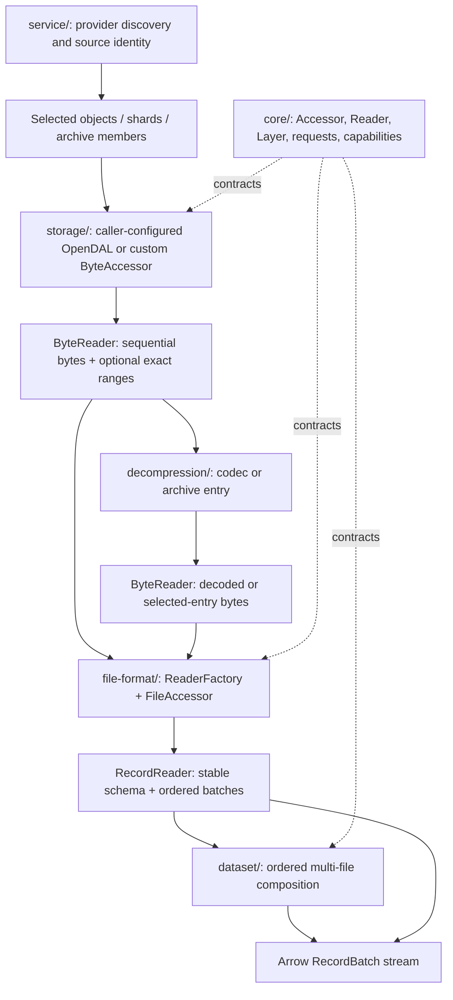

# Architecture

open-arrow-access is the source-access and decoding library in a pretraining data
preparation pipeline. It turns heterogeneous corpus inputs into Arrow batches for
downstream preprocessing jobs.

The architecture separates where bytes live, how they are decoded, and how files
are selected. A corpus ingestion job can reuse the same decoder for local files,
object stores, or provider downloads, and replace storage without rewriting its
record-reading path.

## From source to Arrow



The diagram shows data flow. In code, an accessor is a factory: `open(request)`
returns an owned reader, and the consumer pulls items with `next().await`.
Providers may return bytes or metadata rather than Arrow. WARC uses the same
factory contract, exposing native `WarcRecord` values through `WarcAccessor`
or projected Arrow batches through `WarcArrowAccessor`.

## Component boundaries

| Crate / directory | Responsibility | Reuses |
| --- | --- | --- |
| Root facade | Feature selection and public re-exports | Component crates |
| `core/` | Reader/accessor/layer contracts, requests, capabilities, errors, stream and decoder adapters | Arrow and common types; no concrete backend |
| `storage/` | OpenDAL byte access, exact ranges, discovery, named-file namespaces | Caller-configured operator |
| `decompression/` | Streaming codecs and TAR/ZIP entry access | Byte readers and upstream decoders |
| `file-format/` | Parser configuration, schemas, projection, and decoding | Byte readers and format libraries |
| `dataset/` | Directory discovery and explicit ordered file sets | Supplied single-file record accessor |
| `service/` | Provider discovery, identities, metadata, and source-specific composition | Storage, formats, archives, and datasets |
| `layers/` | Arrow output type conversion; future record and execution enhancements | Core layer contract and Arrow kernels |
| `test-support/` | Unpublished shared test fixtures and contract assertions | Component test suites |

A format receives a `ByteReader`, not an OpenDAL operator. Storage knows object
locators and I/O options, not Arrow columns. Dataset composition knows file order
and schema compatibility, not how Parquet or XML works. Providers resolve their
own APIs and source conventions while reusing these components.

## The public contracts

```text
Accessor::open(request).await -> owned Reader
Accessor::capability()        -> available operations before opening
Reader::metadata()            -> stable metadata for this opened representation
Reader::next().await          -> Result<Option<Item>>
Reader::capability()          -> operations on this opened reader
Layer::layer(accessor)        -> wrapped accessor with the same request/reader types
```

| Boundary | Request | Reader output | Metadata |
| --- | --- | --- | --- |
| Byte access | `ByteReadRequest` | Nonempty `Bytes` chunks | Source, optional length/version |
| Arrow file access | `ReadRequest` | `RecordBatch` | Fixed `SchemaRef`, optional source |
| Dataset access | `DirectoryRequest` / `FileSetRequest` | `RecordBatch` | Fixed projected schema |
| Provider access | Provider-specific request or method | Bytes, records, file sets, or metadata | Defined by the provider |

`ReadRequest` carries Arrow options and separate byte I/O options. Storage ignores
Arrow projection; a format applies it and forwards byte settings to its input.
`ReaderFactory` centralizes per-open preparation and decoder creation.
`FileAccessor<B, F>` binds a byte accessor to a factory; familiar constructors such
as `ParquetAccessor::new(bytes)` are convenience aliases over that composition.

See [API contracts](contracts.md) for factory hooks, byte adapters, and lifecycle
details, or [extending](extending.md) to implement a component.

## Capabilities and valid compositions

Cargo features make implementations available. Runtime `Capability` flags describe
the operations a configured accessor or opened reader exposes.

| Flag | Meaning |
| --- | --- |
| `read` | Consume this interface's item type |
| `read_with_range` | Read exact byte ranges without moving the sequential cursor |
| `list` | Discover objects through a byte accessor; never a reader operation |
| `read_parallel` | File/partition parallelism; currently false in concrete implementations |

A wrapper must forward or clear flags to match its output. Decompression, for
example, accepts sequential bytes and removes range access. Parquet requires
ranges and a known length, so `storage → gzip → Parquet` is not a valid direct
composition. JSONL is sequential, so `storage → gzip → JSONL → Arrow` works.
ZIP inspection also requires ranges. TAR offers separate sequential and ranged
APIs; use sequential TAR after gzip for `.tar.gz`.

A capability is not a snapshot or access guarantee: a supported operation may
still fail because an object is missing, permissions differ, or metadata is invalid.

## Execution and resource ownership

Reading is pull-based. Core adapters and decoders do not start detached background
jobs. Each reader owns the state needed for its scan; dropping it stops its work.
OpenDAL can prefetch using the per-reader I/O settings.

| Control | Unit | Behavior |
| --- | --- | --- |
| `ReadOptions::batch_size` | Arrow rows | Target rows per batch; default 8,192 |
| `ReadOptions::projection` | Top-level fields | Requested output order; empty projection retains row counts |
| `ByteReadOptions::io_concurrency` | In-flight storage I/O | Default one; budget is per opened reader |
| `ByteReadOptions::io_chunk_size` | Storage I/O splitting | Backend default when unset |
| `OpenDalAccessor::with_chunk_size` | Emitted byte chunks | Independent of I/O splitting and Arrow batch size |

File sets open files sequentially in caller order; directory scans sort selected
paths. Later files must match the first file's projected schema, including
metadata. No schema merging occurs. Discovery may collect a file list; decoders
may buffer a document, record, or row group. Batch/chunk targets do not bound
total memory or an individual value's size.

Storage I/O concurrency preserves byte and record order. It does not parallelize
files or partitions. Multiple application-owned readers each have their own I/O
budget. `ParallelReadLayer` and `UnorderedEmissionLayer` are separate policies;
source ordering requirements constrain admission to unordered emission. Both
collect settings before one bounded executor starts.

## Schema, errors, and source identity

Record metadata is available when `open` completes and every returned batch
matches that schema. Opening may perform I/O to inspect Parquet metadata, sample
XML records, or discover a provider's shard list. Fixed-schema validation can
happen before opening bytes.

EOF and errors terminate record reading. Error categories and source chains are
preserved across adapters. If an in-flight decoder call is cancelled, drop its
reader; resumability is not guaranteed. Layers must not transparently replay
already emitted records. Compression integrity validation completes only when
the relevant stream reaches EOF.

Objects must remain stable during a read. Generic storage does not create a
snapshot. Some providers pin a revision or release, such as Hugging Face's Parquet
export; others expose mutable catalogues. Record the chosen identity and provider
metadata in your pipeline's manifest. Reader source metadata is not automatically
added as Arrow provenance columns.

## Shared service HTTP client

Service HTTP mechanisms compile without provider features. The root facade
always exposes `service::common`, including with `--no-default-features`. The internal
`HttpClient` constructs GET requests, checks metadata/sequential response status,
collects bodies, validates declared lengths and parses typed JSON. Public
`common::Connection` supplies provider URL rules and scoped credentials, then
uses that same client; `ApiDocument` uses its JSON parser. The shared body-length
tracker also validates lazy sequential downloads. Error operations remain owned
by callers (`provider_http`, `resolve_zenodo`, and so on), and transport and parser
causes remain attached.

Transport policy and download capabilities remain explicit. OpenDAL HTTP and
Hugging Face use the ordinary redirect-following transport and handle HEAD/range
statuses themselves. `Connection` uses a single-hop transport underneath its
origin-scoped redirect layer, including when a custom context is supplied. That
layer preserves signed URLs, strips configured credentials on an origin change
and rejects HTTPS downgrades. Keeping those policies distinct prevents a second
redirect follower or an `AuthScope` requirement on raw OpenDAL requests.

The OpenDAL download adapter retains exact ranges and known-length storage
semantics; `Connection` retains sequential absolute-URL downloads. Sharing the
client does not make a sequential download suitable for Parquet. Provider
identity/version validation, metadata mappings and optional concrete providers
stay outside the client. No provider feature is required to use `Connection`.

This default-on facade deliberately includes the service crate's HTTP baseline
(OpenDAL HTTP/reqwest transport, JSON/Serde, URL and supporting utilities).
Provider features remain empty by default: making common code available does not
enable Hugging Face, Zenodo, XML parsing, or other concrete providers.
