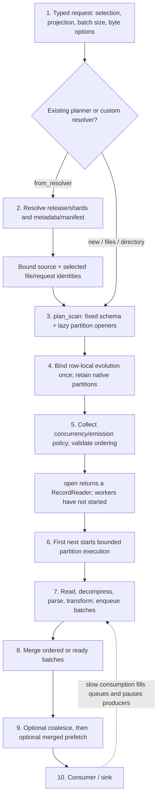
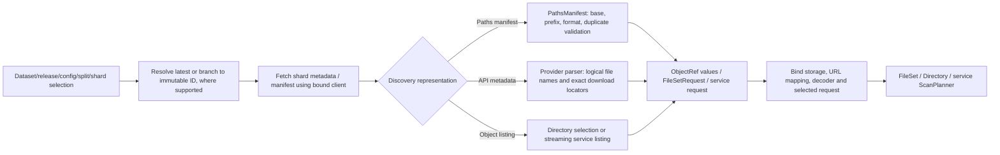
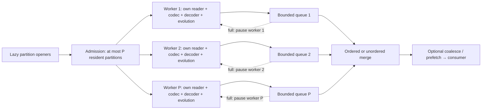
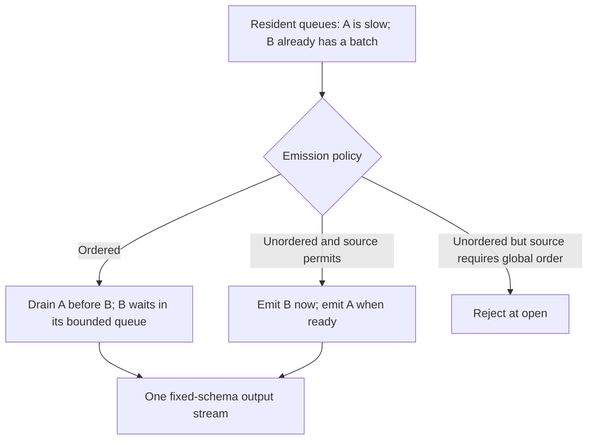
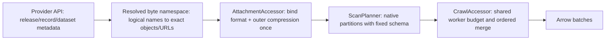

# Integrated crawls

`open_arrow_access::crawl` supplies one execution entry point for existing service
and dataset planners and a discovery-only interface for new services. It is always
available; enable the formats, services and codecs your source uses.

For a quick path, see [existing sources and configuration](#existing-sources-and-layer-configuration).
For implementation details, follow the [overall lifecycle](#overall-lifecycle),
[discovery](#discovery-metadata-and-manifests-become-file-selections),
[parallel reading](#parallel-reading-files-and-native-partitions), and
[emission](#emission-execution-order-and-delivery-order). The
[tuning guide](#tuning-parameters-by-pipeline-stage) maps each parameter to its stage.

## Abstraction boundaries

The service selects the input; the planner describes independent work; layers
configure execution and transform batches. `CrawlAccessor` composes these contracts
without implementing a second scheduler or a provider protocol.

| Abstraction | Input → output | Responsibility |
| --- | --- | --- |
| `CrawlResolver` (optional) | Typed service request → `ResolvedCrawl` | Pin a release/revision, inspect shard metadata and manifests, bind the selected source to its storage/client. |
| `ResolvedCrawl` | Bound accessor + its selected request | Carry file membership, logical-name mappings, signed URLs and snapshot context into planning. It contains no downloaded dataset. |
| Dataset/service accessor | Selected request → `ScanPlan` | Expose lazy partition openers and a fixed Arrow schema. A planner may inspect a preview or format metadata. |
| Byte accessor + codecs + format | Object reference → bytes → Arrow batches | Interpret locators, enforce transport policy, decompress and parse. Each reader owns its cursor/codec state. |
| `CrawlAccessor` | Planner + `CrawlOptions` → `RecordReader` | Compose transformation, execution, emission and optional output buffering. |
| Consumer | Arrow batches → application/sink | Apply scan-wide sampling/limits, consume/write output and own commit/recovery policy. |

The layer composition constructed by `CrawlAccessor::new` is equivalent to:

```text
source
  .layer(evolution)
  .layer(parallel_read)
  .layer(UnorderedEmissionLayer)  // only for unordered emission
  .layer(coalesce)                // only when configured
  .layer(prefetch)                // only when configured
```

The last layer is outermost. Opening travels inward to discover/plan the source;
batches travel outward. Parallel/emission layers collect policies into one plan
before execution; they do not create separate worker pools.

| Layer | Where it works | Default and effect | Main tuning control |
| --- | --- | --- | --- |
| `SchemaEvolutionLayer` | Inside each partition worker, after decode | Identity by default. Rename, cast and compute columns using a plan compiled once per scan and shared across workers. | `with_evolution`; optional complete source schema for projection pushdown. |
| `ParallelReadLayer` | Around the complete scan | 4 resident partitions. Overlap independent readers and decoder work; queue capacity applies backpressure. | `with_parallel_read(ParallelReadLayer::new(P, Q).with_read_ahead_bytes(B))`. |
| `UnorderedEmissionLayer` | Merge of resident partition queues | Installed by default. Emit ready batches when the entire source permits reordering. | `with_emission`; ordered mode omits this layer. |
| `CoalesceBatchesLayer` | One stream after merge | Disabled. Combine tiny batches before the consumer, retaining a fixed schema and row order. | `with_coalesce`; row target and/or estimated-byte target. |
| `PrefetchLayer` | One stream after optional coalescing | Disabled. Drive upstream while the consumer handles its current batch. | `with_prefetch`; queued row and/or estimated-byte budgets. |

Transport layers (HTTP concurrency, rate/backoff, retry), decompression and native
format settings remain on the supplied source. `MissingObjectLayer` can be
installed on the source before constructing the crawl. Sampling/limit layers
belong outside the crawl so their budgets cover the whole scan.

## Overall lifecycle



`open` can perform discovery, read Parquet metadata or consume a bounded inference
sample. It does not require decoding the whole dataset. Strict file-set planning
retains the first preview plan for execution. Union-by-name is a different policy:
it preflights selected file schemas and can retain samples/readers for all files.
There is no second inference pass added by the crawl wrapper.

```mermaid
sequenceDiagram
    participant User as Consumer
    participant Crawl as CrawlAccessor
    participant Source as Resolver / source planner
    participant Exec as Parallel executor
    participant Workers as Partition workers
    User->>Crawl: open(request)
    Crawl->>Source: resolve if configured, then plan_scan
    Source-->>Crawl: fixed schema and lazy openers
    Note over Crawl: Share evolution plan; collect execution/emission policies
    Crawl->>Exec: construct reader, validate policies
    Exec-->>User: reader with output metadata
    User->>Exec: next()
    Exec->>Workers: admit work up to P resident partitions
    Workers-->>Exec: transformed batches through bounded queues
    Exec-->>User: merged batch, optionally coalesced/prefetched
    User->>Exec: drop reader
    Note over Exec,Workers: Cancel owned workers; release queues and readers
```

## Discovery: metadata and manifests become file selections

Discovery chooses membership and identities before data execution. The crawl does
not infer which JSON keys in an arbitrary service response represent download
links: the service resolver parses and validates its own response format.



| Discovery form | How files are obtained | Startup and memory behavior |
| --- | --- | --- |
| Explicit file set | Caller supplies `FileSetRequest` object references. | No listing; preserve caller order and duplicates. |
| Paths manifest | `PathsManifest` reads lines, validates/resolves locators and returns `FileSetRequest`. | Collect selected keys and duplicate state, not file contents; not a streaming file-name API. |
| Provider metadata | Provider parser produces file membership and mappings, such as logical name → signed download URL. | Provider-specific metadata fetches; preserve exact URLs and use the same bound authentication/transport context for reads. |
| Directory/glob | `DirectoryAccessor` lists, filters, deduplicates and sorts selected names. | Collect names before planning to establish lexicographic order. |
| Streaming service discovery | A service planner yields lazy partition openers as listing/inventory advances. | Keep that stream; `CrawlAccessor::new` does not convert it into a full file vector. |

An object reference is interpreted by its bound byte accessor. For example:

```text
metadata says logical name "part-00000" maps to "https://host/data?signature=..."
→ selected request names "part-00000"
→ provider's bound namespace resolves that name to the exact URL
→ file reader opens bytes with that accessor's transport policy
→ codec/format parses those bytes into Arrow batches
```

For direct storage, the selected reference may instead be a bucket-relative key.
Do not replace the bound accessor with a fresh generic HTTP client: that can lose
authentication scope, snapshot binding, shared limits or URL semantics. Resolving
membership does not automatically download attachments named inside each record;
following `content_url` values remains a consumer/sink operation.

## Parallel reading: files and native partitions

`ScanPlan` contains independently owned, lazy reader openers. `P` is the maximum
number of resident partitions, not necessarily the number of files or requests.
The source planner determines the unit of independent work:

| Input shape | Work scheduled under the shared P budget |
| --- | --- |
| Multiple streaming JSON/CSV/WARC files with native file planning | Each worker plans and drains one file, overlapping download, framing and parsing across files. |
| Independently readable native partitions, such as Parquet row groups | Flatten native partitions across files under the same executor; do not build a file pool containing another partition pool. |
| Single streaming file with native planning | Retain its native chunk planning. Framing/decompression may still require a sequential byte stream. |
| Document service, such as PMC metadata | Service-defined independent documents/partitions. Metadata can be known before document data is fetched. |
| Cursor-dependent API pages | The continuation chain stays indivisible; only independent chains can overlap. |



Native partition queues reserve one of `Q` slots before decoding. Whole streaming
file queues instead charge estimated Arrow bytes against their per-file `B`
budget after decoding; `Q` does not also cap these queues. One oversized batch is
admitted alone, and a producer can hold a further decoded batch awaiting admission.
A completed worker's queue keeps its resident slot until drained, preventing
later files from accumulating unbounded output behind a blocked consumer.

Each reader also has its own byte-I/O settings, and the bound client may have a
shared HTTP request limit/rate policy. Increasing `P` cannot bypass that limit.
Increasing both `P` and per-reader I/O concurrency can multiply request pressure;
a streaming source should retain its sequential download path where appropriate.

## Emission: execution order and delivery order

Emission changes which ready batch the merge delivers; it does not add workers
or change the selected file membership. The default crawl requests unordered
emission. The combined resolver, accessor and plan contract must allow reordering,
otherwise opening fails before execution.



Within a partition, FIFO order is retained. Unordered output can interleave
partitions and is not reproducible; it neither sorts nor shuffles records. Use
ordered mode for global-order sources and repeatable seeded sampling/prefix
limits. Coalescing preserves whichever row order the merge produced.

## Tuning parameters by pipeline stage

| Stage / parameter | Configure with | Increasing it helps when… | Cost or limitation |
| --- | --- | --- | --- |
| Resident work `P` (default 4) | `with_parallel_read(ParallelReadLayer::new(P, Q))` | Independent reads are waiting on latency and transport/downstream still have capacity. | More open readers, codec state and queues; may amplify HTTP traffic and throttling. |
| Native queue slots `Q` (default 2) | Second argument to `ParallelReadLayer::new` | Native partition decoding benefits from limited read-ahead across consumer stalls. | More queued batches per partition; does not tune whole streaming-file byte queues. |
| Streaming file read-ahead `B` (default 8 MiB/file) | `ParallelReadLayer::with_read_ahead_bytes(B)` | File producers repeatedly run out of queue capacity during short downstream stalls. | Larger queues do not cure a persistently slower sink; memory scales with resident files. |
| Decoder batch rows (default 8192 in `ReadOptions`) | Request `ReadOptions::with_batch_size` or provider-specific decoder settings | The decoder produces many small batches and can actually honor a larger row target. | Higher latency/memory per batch; document decoders may still produce one row per object. |
| Output coalescing | `with_coalesce(CoalesceBatchesLayer::rows(R).with_max_estimated_bytes(C))` | Tiny document batches leave downstream download/write capacity underfed. | Combines after decode, so it does not remove per-document Arrow allocations; no flush timer. |
| Merged prefetch | `with_prefetch(PrefetchLayer::estimated_bytes(F).with_max_rows(R))` | Consumer work would otherwise stop polling an upstream scan that has spare capacity. | Adds a separate task/queue and memory budget; disabled by default. |
| Emission | `with_emission(EmissionPolicy::Ordered/Unordered)` | Ready results wait behind a slow earlier partition and reordering is allowed. | Unordered arrival changes sampling/prefix selections; source permission is mandatory. |
| Projection and evolution | Request projection plus `with_evolution`; optional `with_source_schema` | Unused columns consume decode/transport work or casts/computation should overlap across workers. | Pushdown depends on format support; casts allocate; incompatible shard schemas need earlier normalization. |
| Byte-I/O chunks/concurrency | Request `ByteReadOptions` | A range-capable backend/format benefits from splitting large reads. | Separate from `P`; inherited chunk settings can turn a sequential download into many requests. |
| HTTP in-flight/rate/backoff | Bound storage operator/client layers | The source permits more requests, or needs coordinated pacing/cooldowns. | Not a `CrawlOptions` field; retain the same shared client/policy across readers. |

For whole streaming files, `P × B` estimates only the configured partition queue
budgets. For native partitions, `P × Q × average batch bytes` is a rough queue
estimate. Neither is a process memory limit: add decoder/input buffers, oversized
and pending batches, optional merged prefetch/coalescing, inference samples and
consumer-held output. Union-by-name preflight can retain resources for every
selected file, independently of `P`.

### A workflow for choosing settings

1. Identify the scheduled unit (file, document or row group), required ordering,
   and whether discovery collects names or streams them. Start from
   `CrawlOptions::default()` and retain the source's existing HTTP/I/O policy.
2. Observe discovery/open latency, time to first batch, rows/bytes per batch,
   sustained **completed** output throughput, RSS, HTTP requests/retries and sink
   utilization. Distinguish processing an attempt from successfully committing it.
3. For small metadata documents, try coalescing before increasing source
   concurrency. A nominally large blob-download pool cannot use its slots if the
   source/sink feeds it only one tiny batch at a time; writer admission matters too.
4. If independent reads remain latency-bound and the source permits it, raise
   `P` gradually while watching request rate, retry tail latency and RSS. For large
   streaming files, preserve sequential reads and tune the per-file byte budget
   separately. Do not inherit small-object concurrency targets blindly.
5. If memory grows while output throughput stays flat, inspect which queues are
   full. Reduce the relevant queue budget or `P`, or address downstream saturation.
   Increase a queue only when buffering a short stall improves useful overlap.
6. If requests fail or retry tails dominate, inspect status/error details and the
   shared HTTP policy first. Raising concurrency is not a fix for rejected
   requests; failure recovery and final sink commit remain outside this accessor.

| Observed symptom | First place to inspect |
| --- | --- |
| Long startup before any worker starts | Resolver metadata/manifest latency, directory collection, schema inference or union preflight. |
| Later partitions are ready but no output arrives | Ordered merge waiting on an earlier partition, or coalescing waiting for its target. |
| Tiny batches and idle downstream download/write slots | Document output shape, coalesce settings, sink batch admission and writer count. |
| Low CPU and few active HTTP requests despite large `P` | Shared HTTP limits, sequential discovery, too few independent partitions or downstream backpressure. |
| More workers but more 403/429/retries and fewer completed jobs | Request amplification and source throttling/rejection; verify the service-specific policy and request shape. |
| RSS grows as concurrency increases | Per-file queues, decoder buffers, inference retention, prefetch and consumer-held batches. |

## Existing sources and layer configuration

Pass an existing `ScanPlanner` to `CrawlAccessor::new(source, options)`. For example,
`PmcDatasetAccessor`, `PmcInventoryAccessor`, `CommonCrawlWarcAccessor` and
`CommonCrawlSegmentAccessor` retain their existing discovery and decoder behavior.
Call `with_file_planning()` on Common Crawl accessors to expose native planning.
`CrawlAccessor::files(format, options)` constructs a file set with native planning;
`CrawlAccessor::directory(discovery, format, options)` does the same for directories
and globs. Directory discovery still collects and sorts names; streaming service
planners remain streaming.

```rust,ignore
use std::num::NonZeroUsize;
use arrow_schema::DataType;
use open_arrow_access::{
    Accessor, ReadRequest,
    crawl::{CrawlAccessor, CrawlOptions},
    layers::{ColumnEvolution, CoalesceBatchesLayer, ParallelReadLayer,
             PrefetchLayer, SchemaEvolutionLayer},
};

let options = CrawlOptions::default()
    .with_parallel_read(ParallelReadLayer::new(
        NonZeroUsize::new(64).unwrap(), // resident partitions/files
        NonZeroUsize::new(2).unwrap(),  // native partition batch queue
    ).with_read_ahead_bytes(NonZeroUsize::new(8 * 1024 * 1024).unwrap()))
    .with_evolution(SchemaEvolutionLayer::try_new(vec![
        ColumnEvolution::rename_column("paperId", "paper_id"),
        ColumnEvolution::change_data_type("year", DataType::Int64),
    ])?)
    .with_coalesce(CoalesceBatchesLayer::rows(NonZeroUsize::new(1024).unwrap())
        .with_max_estimated_bytes(NonZeroUsize::new(4 * 1024 * 1024).unwrap()))
    .with_prefetch(PrefetchLayer::estimated_bytes(
        NonZeroUsize::new(8 * 1024 * 1024).unwrap(),
    ).with_max_rows(NonZeroUsize::new(8192).unwrap()));
let crawl = CrawlAccessor::new(source, options);
let mut reader = crawl.open(request).await?;
while let Some(batch) = reader.next().await? { /* consume batch */ }
```

These values illustrate the independent budgets, not a production recommendation.
Every field accepts the existing layer configuration directly, including all its
builder settings. `CrawlOptions::default()` uses 4 resident partitions, 2 queued
batches per native partition, and the parallel layer's default 8 MiB read-ahead
budget per streaming file. Emission defaults to unordered, evolution is identity,
and coalescing/prefetch are disabled. Override settings with `with_parallel_read`,
`with_emission`, `with_evolution`, `with_coalesce` and `with_prefetch`.
Use `.with_emission(EmissionPolicy::Ordered)` for sources that require global
ordering or for reproducible sampling.

Request options retain batch size, projection and byte I/O settings. Projections
use evolved names. Supplying `evolution.with_source_schema(full_schema)` pushes
only required source columns down without an additional schema-discovery open.
Without a supplied schema, namespace-changing evolution widens projection using
the existing evolution rules. Identity evolution delegates planning directly.

## Service discovery

Implement `CrawlResolver` when a service needs to pin a release/revision, inspect
shard metadata and resolve files before constructing its source:

```rust,ignore
use open_arrow_access::{
    Accessor, ByteAccessor, ReadRequest, RecordCapability, Result, ScanPlanner, async_trait,
    crawl::{CrawlAccessor, CrawlResolver, ResolvedCrawl},
    dataset::{file_set::FileSetAccessor, manifest::PathsManifest},
};
use std::sync::Arc;

struct ManifestResolver<B, F> {
    raw_manifests: B,
    format: Arc<F>, // already bound to storage, codecs and transport policy
}

#[async_trait]
impl<B, F> CrawlResolver for ManifestResolver<B, F>
where
    B: ByteAccessor,
    F: ScanPlanner<Request = ReadRequest> + 'static,
{
    type Request = ReadRequest; // object identifies a paths manifest
    type Source = FileSetAccessor<Arc<F>>;

    fn capability(&self) -> RecordCapability {
        self.format.capability()
    }

    async fn resolve(&self, request: ReadRequest) -> Result<ResolvedCrawl<Self::Source>> {
        // Manifest selection/base/duplicate/format policies can be configured here.
        // This opens raw manifest bytes; PathsManifest owns suffix decompression.
        let files = PathsManifest::new(request.object)
            .with_byte_options(request.byte_options)
            .resolve(&self.raw_manifests).await?;
        Ok(ResolvedCrawl {
            accessor: FileSetAccessor::new(self.format.clone()).with_file_planning(),
            request: files,
        })
    }
}

let crawl = CrawlAccessor::from_resolver(resolver, options);
let reader = crawl.open(ReadRequest::new("release/shards.paths.gz")).await?;
```

The resolver owns provider-specific authentication, snapshot pinning, selection
and manifest validation. `ResolvedCrawl` carries both the selected request and the
accessor bound to that snapshot, including signed URLs and transport context.
The integration forwards common read and exposed byte options to the selected
request, even if the resolver constructed it with defaults. The resolver must
also forward byte options to any metadata I/O it performs during discovery.

Each `open` resolves once and plans once; it does not call `metadata` first or
reopen the preview file. Separate metadata/open operations resolve separately.
For a reusable fixed selection, resolve once and pass the resolved accessor and
request to `SelectionAccessor`, then wrap that with `CrawlAccessor::new`.
The resolver's ordering requirement combines with both the returned accessor and
plan; no layer may weaken a global requirement. Existing HF dataset and PageSet
contracts therefore require ordered emission. Token-dependent pagination remains
sequential inside each independent continuation chain.

## Performance boundaries

- There is one existing parallel executor, no extra file worker pool. Native
  Parquet partitions survive; JSON/CSV/WARC retain their streaming-file planning.
  Discovery and partition futures stay lazy. `FileSetAccessor` keeps its preview
  plan/inference sample for execution.
- Row-local evolution compiles once per scan and shares an immutable plan across
  workers. No SQL planning or schema-name lookup is added to each row. Renames
  share arrays; casts/computed columns allocate their outputs as before. Transform
  output is admitted to the existing bounded partition queues.
- A slow partition does not block other ready batches in unordered mode.
  Coalescing then combines tiny document batches before a downstream sink. It has
  no flush timer, so large row targets can increase first-batch latency.
- The file read-ahead byte limit, native partition batch queue, optional merged
  prefetch budget, decoder buffers and caller-held batches are distinct. Byte
  estimates are soft budgets, not a process RSS cap. Completed queues retain their
  resident slots until drained. Errors and dropping readers use the existing
  executor's cancellation behavior.
- No operator/client is recreated and no byte chunk size or HTTP concurrency is
  guessed. Preserve PMC's small-object sequential GET path, WARC's sequential
  download/BinaryView defaults, and caller-supplied shared HTTP rate/backoff policy.
  File concurrency is separate from each reader's I/O and HTTP limits; increasing
  all three can amplify requests rather than improve completed throughput.
- Source statistics and sink writer planning remain application concerns. If the
  source implements `StatisticsProvider`, retain an `Arc` to it alongside the
  crawl and inspect the same selection before execution. Do not infer body sizes
  from metadata bytes or let unknown output size silently force a single writer.
- Sampling and limits stay outside this execution boundary. Ordered emission is
  needed for repeatable prefix/seeded selections. This accessor adds no retry,
  checkpoint or commit semantics; restarting a failed crawl does not imply that
  its previous output can safely be skipped.

## Attachment providers share the same execution path

Providers such as Semantic Scholar, Zenodo, Dataverse and Figshare already resolve
metadata into a byte-accessible file namespace. Once that step has selected file
membership and retained the provider's transport context, attachment decoding and
execution need no provider-specific worker or format switch in the application.



```rust,ignore
use open_arrow_access::{
    Accessor, AttachmentAccessor, AttachmentFormat, AttachmentOptions,
    EmissionPolicy, ReadRequest,
    crawl::{CrawlAccessor, CrawlOptions},
};

// resolved_files is the provider-bound byte accessor; keep its authentication,
// snapshot identity, signed URLs and transport policy.
let records = AttachmentAccessor::new(
    resolved_files,
    AttachmentOptions::new(AttachmentFormat::Parquet),
)?;
let crawl = CrawlAccessor::new(
    records,
    CrawlOptions::default().with_emission(EmissionPolicy::Ordered),
);
let mut reader = crawl.open(ReadRequest::new("part-00000.parquet")).await?;
while let Some(batch) = reader.next().await? { /* consume batch */ }
```

| Attachment format | Work exposed by its planner |
| --- | --- |
| Parquet | Native independently readable partitions, retaining range access where the bound storage supports it. |
| CSV/TSV, JSON/JSONL and XML | The format's streaming/chunk plan; discovery/framing may remain sequential while decode chunks run in workers. |
| Binary | One whole-document partition; a single object remains one unchanged binary row. |

`AttachmentAccessor` retains `PreserveGlobal` ordering for provider-independent
selections. Configure ordered emission; adding native planning does not grant
permission to reorder unknown provider data. An attachment's own `metadata` and
`inspect_metadata` operations delegate to the selected format rather than opening
and discarding a bound reader. Planning does not perform a separate metadata call
and does not collect all partition openers. Input samples/readers retained by the
format remain part of its plan.

For several selected attachments, use
`FileSetAccessor::new(records).with_file_planning()` and pass that to the crawl
with a `FileSetRequest` containing their logical names. This retains one executor
budget across files and file-internal partitions. The provider still owns file
membership; this API does not discover arbitrary links or follow record-level
`content_url` fields. Advanced format/schema/partition settings can use the typed
format accessors directly.

## Differing schemas across files

A scan must have one fixed output schema. `options.evolution` runs after the
source's own planning/schema checks, so it cannot repair a file-set conflict that
already failed during planning. For string/numeric differences across shards,
apply normalization to the single-file format **before** building the file set:

```rust,ignore
let normalized = format.layer(normalization);
let files = FileSetAccessor::new(normalized).with_file_planning();
let crawl = CrawlAccessor::new(files, options);
```

`SchemaEvolutionLayer` now retains `ScanPlanner`, so this placement keeps native
partitions. Inferred per-file schemas may require separate normalization plans;
prefer an explicit format schema where practical. Use union-by-name only for
compatible types/missing fields; it retains its existing all-file preflight and
sample-memory costs. Invalid values/overflows still fail rather than silently
turning into nulls; use an explicit expression for a different conversion policy.
