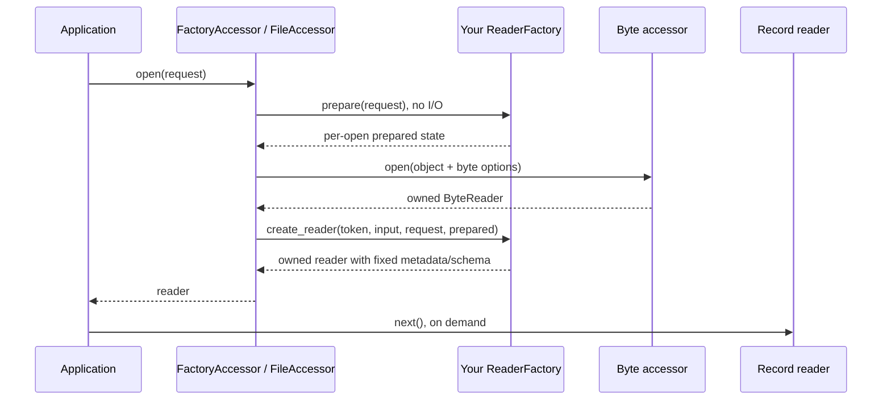
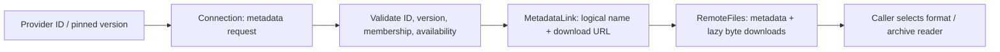
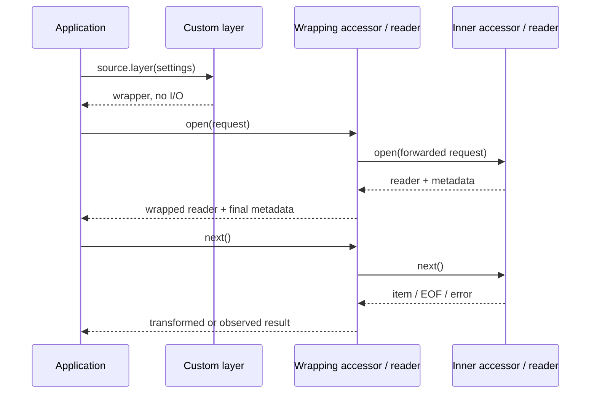
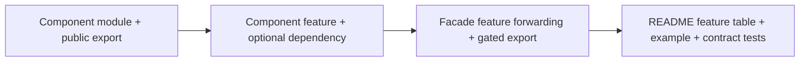

# Extend the library

Extensions can live in your application or another crate. Choose the boundary
that matches your input/output; core has no registry that you must modify.

| You want to add | Extension boundary | Bind it with |
| --- | --- | --- |
| A byte-to-record format | `ReaderFactory` | `FactoryAccessor::new(storage, format)` or `FileAccessor::from_format` |
| An incremental Arrow parser | `BatchDecoder` inside a factory | `decode_batches` |
| An upstream Arrow stream | Factory plus error mapping | `record_stream_reader` |
| One document → one Arrow row | `DocumentDecoder` | `DocumentAccessor::new(storage, decoder)` |
| A provider API / manifest | `service::common::Connection` plus provider validation | `json`, `files`, or `resolve_json_files` |
| A record/byte wrapper | `Layer<A>` plus wrapping accessor/reader | `source.layer(custom_layer)` |
| Another OpenDAL backend | Configure its operator | `OpenDalAccessor::new(operator)` |
| Storage outside OpenDAL | `Accessor` + `ByteReader`; optionally `ByteAccessor` | Supply it to existing formats |

## Add a format



1. Choose `Request` (usually `ReadRequest`), `Prepared`, and `Reader` (usually `dyn RecordReader`).
2. Implement `capability(input)` with the effective output operations and explicit `OrderRequirement`.
3. In `prepare`, validate settings and resolve explicit-schema projection before storage opens. Inferred-schema projection must wait until schema inspection.
4. In `create_reader`, inspect only what is needed, fix metadata, and return an owned reader. Preserve source errors and map parser failures to library errors with their cause.
5. Use the blanket `ReaderFactoryExt` opening flow. Call `open_input` for already-open bytes; never construct `FactoryToken` yourself.

For a small complete example, this format treats each UTF-8 physical line as one
`text` row. It emits one row per batch, preserves line endings, limits each line
to 1 MiB, and supports ordinary projection including zero columns. Add
`arrow-array = "58"`, `arrow-schema = "58"`, and `futures = "0.3"`.
No built-in format feature is required when using core's `FactoryAccessor`.

```rust,no_run
use std::sync::Arc;
use arrow_array::StringArray;
use arrow_schema::{DataType, Field};
use futures::TryStreamExt;
use open_arrow_access::{
    async_trait, read_lines, record_stream_reader,
    ByteReader, Capability, Error, ErrorKind, FactoryToken, OrderRequirement,
    ReadRequest, ReaderFactory, RecordBatch, RecordCapability, RecordMetadata,
    RecordReader, Result, Schema, SchemaRef,
};

struct LineFormat;

fn line_schema() -> SchemaRef {
    Arc::new(Schema::new(vec![Field::new("text", DataType::Utf8, false)]))
}

#[async_trait]
impl ReaderFactory for LineFormat {
    type Request = ReadRequest;
    type Prepared = (SchemaRef, Option<Vec<usize>>);
    type Reader = dyn RecordReader;

    fn capability(&self, input: Capability) -> RecordCapability {
        RecordCapability {
            read: input.read,
            read_with_range: false,
            read_parallel: false,
            list: false,
            ordering: OrderRequirement::Reorderable,
        }
    }

    fn prepare(&self, request: &ReadRequest) -> Result<Self::Prepared> {
        request.options.resolve_projection(&line_schema())
    }

    async fn create_reader(
        &self,
        _token: &FactoryToken,
        input: Box<dyn ByteReader>,
        _request: ReadRequest,
        (schema, projection): Self::Prepared,
    ) -> Result<Box<dyn RecordReader>> {
        let metadata = RecordMetadata { schema, source: input.metadata().source.clone() };
        let batches = read_lines(input, Some(1024 * 1024), "read_lines")
            .and_then(|line| async move {
                let text = std::str::from_utf8(&line).map_err(|error| {
                    Error::new(ErrorKind::Decode, "read_lines", "invalid UTF-8")
                        .with_source(error)
                })?;
                RecordBatch::try_new(line_schema(), vec![Arc::new(StringArray::from(vec![text]))])
                    .map_err(|error| {
                        Error::new(ErrorKind::Decode, "read_lines", "invalid batch")
                            .with_source(error)
                    })
            });
        Ok(Box::new(record_stream_reader(
            batches, metadata, projection, OrderRequirement::Reorderable,
        )))
    }
}

async fn read(operator: open_arrow_access::storage::opendal::Operator) -> Result<()> {
    use open_arrow_access::{Accessor, FactoryAccessor, storage::OpenDalAccessor};
    let records = FactoryAccessor::new(OpenDalAccessor::new(operator), LineFormat);
    let mut reader = records.open(ReadRequest::new("notes.txt")).await?;
    while let Some(batch) = reader.next().await? {
        println!("{} rows", batch.num_rows());
    }
    Ok(())
}
```

For larger batches, implement `BatchDecoder` and reuse `decode_batches`. Native
Arrow streams can use `record_stream_reader` as above; native non-Arrow records
can use `StreamReader` with their own metadata/capability types. See
[`JsonFormat`](../file-format/src/json/format.rs) and
[`ParquetFormat`](../file-format/src/parquet/format.rs) for production readers.

Implement `ScanPlanner` only if independent partition readers can preserve one
fixed schema and the source ordering contract. Ordinary `open` stays useful
without a planner. Partition discovery must remain lazy; `ParallelReadLayer`
executes it with a bounded resident-partition window.

## Add a service

A service resolves source identity and membership. Reuse the existing byte and
format components for downloads and decoding.



1. Define the provider selection (ID, version, revision, split) and its response contract.
2. Build a `Connection` with origin, credentials, and optional transport/policy settings.
3. Validate source identity and selection before returning file membership. Preserve explicit versions in metadata.
4. Map advertised links to `MetadataLink`. `Connection::files` validates names/URLs and supplies lazy downloads.
5. Follow provider pagination in protocol order. Use `PageSetAccessor` for independently addressable page requests only.

`resolve_json_files` combines a single JSON request with this mapping. This
example targets an **application-defined** API whose `records/{id}` response is
`{"id":"…","version":"…","files":[{"name":"…","url":"https://…"}]}`.
It requires no concrete provider feature.

```rust,no_run
use open_arrow_access::{Error, ErrorKind, Result};
use open_arrow_access::service::common::{Connection, MetadataLink, RemoteFiles};

fn invalid(message: &str) -> Error {
    Error::new(ErrorKind::InvalidInput, "resolve_catalog", message)
}

async fn resolve_catalog(api: &Connection, id: u64, version: &str) -> Result<RemoteFiles> {
    let expected_id = id.to_string();
    api.resolve_json_files(
        &format!("records/{id}"),
        &[("version", version)],
        |document| {
            let value = document.value();
            if value["id"].as_str() != Some(expected_id.as_str())
                || value["version"].as_str() != Some(version)
            {
                return Err(invalid("response ID/version does not match selection"));
            }
            value["files"].as_array().ok_or_else(|| invalid("missing file list"))?
                .iter().map(|file| {
                    Ok(MetadataLink {
                        file_name: file["name"].as_str()
                            .ok_or_else(|| invalid("missing filename"))?.into(),
                        url: file["url"].as_str()
                            .ok_or_else(|| invalid("missing download URL"))?.into(),
                    })
                }).collect()
        },
    ).await
}
```

The result retains the original API document, resolves exact logical filenames,
and opens sequential HTTP readers. It does not download attachments during
resolution. Ranged downloads need a compatible OpenDAL or custom byte accessor;
`Connection` downloads alone cannot serve Parquet/ZIP range reads.
For multiple metadata requests or custom typed metadata, compose `json` and
`files` explicitly. The internal `HttpFileService` helper is not a public extension API.

For a single document mapped to one Arrow row, implement `DocumentDecoder`:
`prepare` declares the full schema and `decode` emits exactly one row with the
supplied projected schema. Bind it with `DocumentAccessor::new(storage, decoder)`.
If the decoder implements `Default`, callers can use
`DocumentAccessor::<_, MyDecoder>::with_default_decoder(storage)`. See
[PMC](../service/src/pmc/) and [Gutenberg](../service/src/gutenberg/) for examples.
Use the built-in `BinaryDecoder` to preserve an object as one non-null
`data: LargeBinary` value: `DocumentAccessor::new(storage, BinaryDecoder)`.
It buffers the complete object and preserves empty inputs and arbitrary bytes.

## Add a layer



Implement `Layer<A>` to build a wrapper retaining `A::Request` and `A::Reader`.
A layer that only observes opening can return the original reader. This complete
record-accessor example counts attempted opens:

```rust,no_run
use std::sync::{Arc, atomic::{AtomicUsize, Ordering}};
use open_arrow_access::{
    async_trait, Accessor, Layer, RecordCapability, RecordReader, Result,
};

struct CountOpens(Arc<AtomicUsize>);
struct Counted<A> { inner: A, count: Arc<AtomicUsize> }

impl<A: Accessor<Reader = dyn RecordReader>> Layer<A> for CountOpens {
    type Layered = Counted<A>;
    fn layer(&self, inner: A) -> Self::Layered {
        Counted { inner, count: self.0.clone() }
    }
}

#[async_trait]
impl<A: Accessor<Reader = dyn RecordReader>> Accessor for Counted<A> {
    type Request = A::Request;
    type Reader = dyn RecordReader;
    fn capability(&self) -> RecordCapability { self.inner.capability() }
    async fn open(&self, request: A::Request) -> Result<Box<dyn RecordReader>> {
        self.count.fetch_add(1, Ordering::Relaxed);
        self.inner.open(request).await
    }
}

fn instrument<A: Accessor<Reader = dyn RecordReader>>(source: A) {
    use open_arrow_access::AccessorExt;
    let count = Arc::new(AtomicUsize::new(0));
    let _records = source.layer(CountOpens(count.clone()));
}
```

This wrapper does not expose `ScanPlanner`. Place it outside an already composed
parallel accessor to observe logical opens. To observe individual partition
opens, implement planning delegation and wrap each partition too.

For per-item transformations, return your own `Reader` wrapping the inner
reader. Set final metadata before the first item; preserve source identity,
row/order semantics unless the layer explicitly changes them, and terminal
EOF/error behavior. Byte wrappers must forward range/listing operations or
remove their capabilities. Record wrappers must explicitly forward/strengthen
ordering. A schema transformation must describe every output batch consistently.
See [`SamplingLayer`](../layers/src/sampling.rs) for a complete reader wrapper.

`source.layer(a).layer(b)` puts `b` outermost. Generated columns and sampling
belong outside parallel execution, so one logical scan owns their state.
See the [layer guide](../layers/README.md) for composition examples.

## Add storage or a codec

For an existing OpenDAL backend, enable its `services-*` feature on the caller's
OpenDAL dependency, configure credentials/root/endpoint on the operator, and
wrap it in `OpenDalAccessor`. No parser or library feature is required.

For storage outside OpenDAL, implement the byte accessor/reader boundary with
owned readers, accurate metadata/capabilities, independent cursors, and exact
ranges where advertised. Locators belong to the accessor; format code must not
reinterpret them as backend-specific paths.

For a streaming codec, implement `decompression::Codec` and reuse the shared
layer/factory. Archive formats instead own entry selection and session lifetimes
above `ByteReader`; see the [decompression guide](../decompression/README.md).

## Wire an extension into this workspace



For a hypothetical optional `foo` format:

1. Add `file-format/src/foo/` and export it under `#[cfg(feature = "foo")]`.
2. Add `foo = ["dep:foo-parser"]` to `file-format/Cargo.toml`, with the parser dependency optional.
3. Add `format-foo = ["dep:open-arrow-access-file-format", "open-arrow-access-file-format/foo"]` to the root features.
4. Include `format-foo` in the `file_format` export gate in `src/lib.rs`.
5. Give examples/tests `required-features` where necessary; document input/output, schema, limits, and feature names.

For services use `service-foo` → `open-arrow-access-service/foo` (the service
crate is already a facade dependency). For codecs use `decompression-foo` and
update the decompression export gate. Layers in the layers crate are currently
always exported; add their module/public export without inventing a facade feature.

Verify both disabled-feature builds and enabled behavior. Use
[test-support contracts](../test-support/README.md) for lifecycle, projection,
request forwarding, and source errors. Keep parser/domain values in the owning
suite and serialized inputs in documented [fixtures](../testdata/README.md).
The [API contracts](contracts.md) define full capability, reader, and planning
requirements.
