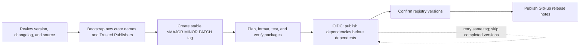

# Release and publish

The Rust workspace follows OpenDAL's publication pattern: one user-facing facade,
multiple component crates, one coordinated version, and dependency-ordered
publication. Enabling a feature does not create an independent release. Test-only
support remains `publish = false`.



## One coordinated version

Update `[workspace.package].version`, the matching internal dependency versions in
`[workspace.dependencies]`, and `Cargo.lock` in one reviewed preparation PR. Add a
changelog entry and update installation examples. Every publishable component
inherits the workspace version. The planner rejects mixed component versions,
stale internal version requirements, runtime/build dependency cycles, and
runtime references to an unpublished local package.

The facade keeps the public import path `open_arrow_access::{storage,
file_format, service, layers, ...}`. Components remain separate published packages;
users normally add only the facade and select its features.

## Bootstrap new crate names

Before tagging, discover missing names without credentials:

```sh
python3 .github/scripts/release_rust/bootstrap.py discover
```

Dispatch **Bootstrap Rust Crates** (`bootstrap_rust_crates.yml`) from `main` when
new names need reservation. It uses the separate `rust-bootstrap` environment
and its `CARGO_REGISTRY_BOOTSTRAP_TOKEN` secret. That token needs `publish-new` and
`trusted-publishing` scopes for this project's crate names; it is not exposed to
the normal release job.

For missing names the bootstrap publishes a dependency-free `0.0.0` reservation,
configures its Trusted Publisher, and enables Trusted-Publishing-only access.
The reservation contains no library implementation. Reruns reconcile partially
configured reservations. Established crates are audited but are never silently
migrated by this workflow.

The expected publisher for every crate is:

| Setting | Value |
| --- | --- |
| Repository owner | `dentiny` |
| Repository | `open-arrow-access` |
| Workflow filename | `release_rust.yml` |
| Environment | `release` |

For crates published before this workflow existed, configure this exact publisher
in crates.io settings and enable Trusted Publishing only before the next normal
release. Do not replace an unrelated publisher or change crate ownership as part
of release automation. Configure GitHub environment reviewers according to the
repository's maintainer policy. Bootstrap and normal publication share a
concurrency group and cannot write to the registry concurrently.

## Verify the reviewed source

Use the toolchain pinned by `rust-toolchain.toml`:

```sh
cargo fmt --all -- --check
cargo check --workspace --no-default-features --locked
cargo test --workspace --all-features --locked
cargo publish --workspace --exclude open-arrow-access-test-support --dry-run --all-features --locked
```

The workspace-wide dry run verifies independent package contents and can stage
unpublished sibling packages during the first release. Normal uploads run only
after these checks pass. Repo-local development dependencies are removed from
each upload manifest and restored afterward, preventing test dependency cycles
from becoming registry publication requirements.

## Tag and publish

After merging the reviewed source, tag that exact commit, for example:

```sh
git tag -a v0.1.1 REVIEWED_COMMIT -m 'Release open-arrow-access 0.1.1'
git push origin refs/tags/v0.1.1
```

**Release Rust Packages** plans and verifies the tag, then publishes in dependency
order. Only stable tags matching the workspace version can publish. The verified
commit SHA is passed to every later job, so moving a tag during a run cannot
change the source being uploaded. Publish jobs use the `release` environment and
`id-token: write`; each upload/retry exchanges a fresh GitHub OIDC credential and
revokes it after use. There is no long-lived-token fallback in normal releases.

Once the facade and all planned component versions appear in the registry,
publish the GitHub release notes for the same tag. A tag or GitHub Release alone
does not mean crates.io publication has completed.

## Resume an interrupted release

Dispatch **Release Rust Packages** from `main` with the existing stable tag.
The automation checks out that tag's exact source while using the current
workflow helpers, so older tags can be resumed without moving or recreating them.

Already published exact versions are skipped before requesting credentials.
Yanked versions require maintainer attention. Rate limits wait until the
server-provided time and retry sequentially; do not switch accounts or force
re-upload. New crate names have a separate, slower quota than new versions.

For another error, inspect the failed job and rerun after fixing the cause.
Published versions are immutable: source changes belong in a new version and
new tag. Do not rewrite an existing tag to incorporate fixes or newer examples.
