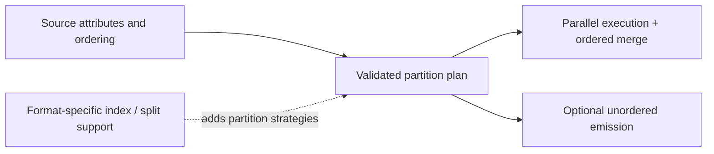

# Roadmap

The goal is composable source access and decoding for **pretraining data
preparation**: select a raw corpus representation, decode it through shared
interfaces, and hand consistent Arrow batches to downstream preprocessing.
Planned capabilities focus on making corpus inputs easier to access, combine,
and prepare for cleaning, filtering, deduplication, and tokenization jobs.

This is a capability roadmap, not a release schedule. Existing support is listed
in the [support matrix](support.md); the items below labeled planned do not have
public implementations or reserved Cargo feature flags.

## Implemented foundations

- Shared async accessor, reader, factory, layer, and capability contracts.
- Bounded CSV schema inference with automatic header detection and sample replay.
- Bounded JSON schema inference with sample replay and fixed-schema native scans.
- Caller-configured OpenDAL storage, exact ranges, discovery, and per-reader I/O settings.
- Parquet, CSV/TSV, JSON/JSONL, XML, and ATIF Arrow readers; native WARC parsing.
- Streaming gzip, bzip2, LZ4, and Zstandard; ZIP and TAR entry access.
- Ordered directory/file-set reads with strict projected-schema compatibility.
- Provider discovery, metadata, and file access, including a Hugging Face Parquet split reader.

The earlier framework PR plan is superseded by this capability view. S3 uses the
existing OpenDAL adapter with upstream backend features; it does not require a
new project-specific storage implementation.

## Planned capabilities

| Workstream | Intended result | Prerequisite / completion boundary |
| --- | --- | --- |
| Cross-file schema reconciliation | Read compatible shards with missing or reordered fields | Explicit merge rules, nullability/metadata conflict policy, batch alignment, opt-in supported casts |
| Generated columns | Compute derived fields during reading | Dependency-aware projection, fixed augmented schema, isolated expression-engine dependency |
| Metrics | Observe source cost and throughput | Separate byte I/O from emitted rows/batches; preserve values, schema, and order |
| Timeout and read budgets | Bound read operations and resource use | Cover sequential and ranged paths; preserve errors without replaying delivered records |
| Source attributes and planning | Describe legal partitions and ordering constraints | Resolve source requirements before admitting execution/emission policies |
| Parallel reads | Read independent files/partitions concurrently | Bounded scheduling, cancellation, and ordered merging by default |
| Unordered emission | Implemented: emit ready batches when source semantics allow | Explicit opt-in; reject sources requiring global order |
| WARC Arrow conversion | Feed web-archive records into Arrow pipelines and existing record datasets | Defined schema, binary payload policy, provenance/record locator semantics |
| Indexing and splitting | Plan format-specific independent work units | Validate index identity, compression coordinates, and source-order compatibility |

## Schema inference and reconciliation

Inference comes first, followed by cross-file merging and batch alignment as
separate changes. Explicit schemas remain supported, and merging stays opt-in.

Inference must bound its sample, retain sampled input for replay, and resolve the
output schema before returning a reader. Later values outside that schema need
an explicit error policy. CSV and JSON now support bounded per-input inference
and replay; CSV also supports header detection. Dataset-wide merging remains
separate work.

Cross-file rules must define field order, nullability, nested compatibility, and
metadata conflicts. Alignment should reorder by name and fill missing nullable
fields with nulls. Incompatible types must fail unless the caller selects an
explicit supported cast policy. CSV headers and column compatibility need their
own format rules.

## Generated columns and observation

[`TypeConversionLayer`](../layers/README.md) is implemented and always available.
It uses the existing layer contract for explicit Arrow output casts.

`GeneratedColumnsLayer` is implemented and always available, with
ordered row-level SQL expressions, a fixed output schema, and final projection.
It currently reads all source columns for complete schema validation;
dependency-aware pushdown remains planned. See the
[generated-column design](generated-columns.md).

Metrics can be developed independently. Byte counts, record batches, row counts,
latency, and failures describe different stages and should remain separate.
Timeout/budget layers should reuse OpenDAL policies where those already cover
the required storage behavior.

## Planning, parallelism, and order

Parallel execution and output ordering are independent:

| Execution | Emission | Intended behavior |
| --- | --- | --- |
| Sequential | Ordered | Current baseline |
| Parallel | Ordered | Concurrent work with bounded ordered merging |
| Parallel | Unordered | Emit ready results when source constraints permit |

ATIF requires global order. WARC splitting depends on valid indexing and the
compressed representation. Planning-aware layers must also wrap the partition
accessors they create so generated columns, observation, and budgets survive
partition execution. See [source attributes and scan planning](source-attributes.md).

A sequential decompressor alone cannot enable random access. Reading externally
compressed Parquet would need an explicit materialization or indexing strategy;
this remains separate from streaming codec support.

## Scope of future additions

New formats and providers should reuse byte/record boundaries and document their
output types, source identity, ordering, and memory behavior. Feature availability
must track implemented capabilities. Tokenization, deduplication, sample packing,
and dataset writing remain downstream concerns.
