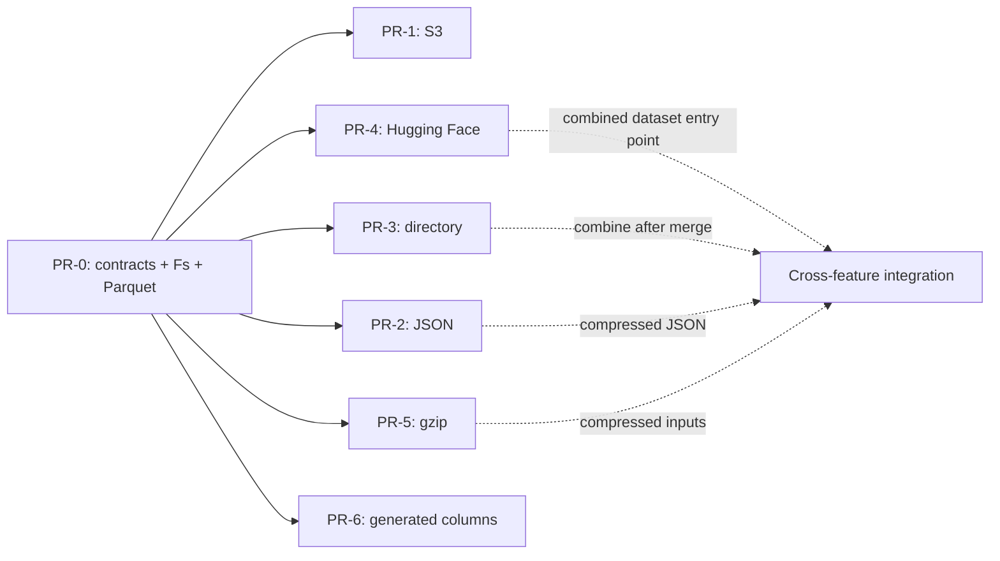

# PR plan

PR-0 denotes the initial framework change, not a GitHub pull request number.
Follow-up labels match the planned workstreams; they can be developed in
parallel against the shared contracts once PR-0 lands.

| PR | Scope | Review/acceptance boundary |
| --- | --- | --- |
| PR-0 | Async OpenDAL Fs, Parquet, shared reader/accessor/layer contracts | Single local file → ordered Arrow; test-only wrappers prove extension/delegation |
| PR-1 | S3 storage | Reuse shared OpenDAL reads; add S3 configuration/auth and feature; reuse Parquet tests |
| PR-2 | JSON | Add a format feature consuming ByteReader; explicit record selection/schema policy; define JSONL separately if included |
| PR-3 | Directory dataset | Add discovery and Dataset/Table composition, fixed schema, sequential ordered file reads |
| PR-4 | Hugging Face | Resolve repository revision/config/split into object references; provide single-file access via shared contracts |
| PR-5 | Gzip decompression | ByteReader/Accessor wrapper, multi-member support, decoded byte coordinates, accurate capabilities |
| PR-6 | Generated-column layer | Implement the required GeneratedColumnsLayer, expression planning, fixed augmented schema, and dependency-safe projection |

## Initial framework

The first PR intentionally does not implement datasets, services, external
decompression, archive handling, or production layers. Their top-level
directories document where independent implementations belong. No fake feature
flags or placeholder methods report these capabilities as available.

The initial Parquet feature supports uncompressed and Snappy pages. Parquet's
internal codecs are separate from external file decompression. Storage and
format features are default-off and can be built independently.

## Parallel work and integration

- HF discovery and explicit file reading do not require a Dataset/Table
  implementation. The combined dataset entry point is integrated with PR-3;
  supported HF representations must be stated explicitly.
- Gzip itself can be verified against byte fixtures without JSON or directory
  support. To support `.parquet.gz`, add a bounded materialization helper before
  passing input to the existing Parquet accessor. This is temporary input
  handling, not a sink. Compressed JSON integration can follow PR-2's merge.
- Each PR primarily changes its own directory and feature forwarding. Changes
  to common contracts require review rather than backend/format-specific forks.
- Cross-feature tests are added when both implementations are available; parallel
  development does not imply every combination exists in every intermediate PR.

## Layer candidates

Use PR-6 for the required **GeneratedColumnsLayer**, with a separate default-off
feature. The framework provides `ReadOptionsProvider` for generic request options;
expression evaluation remains outside the initial framework PR. The
[feature design](generated-columns.md) defines expression dependencies, final
projection, schema/metadata behavior and optional source-context fields.

**MetricsLayer** can follow separately: count opens, operations, failures and latency;
at byte scope measure bytes read, and at record scope count batches/rows. Keep
these distinct to avoid equating I/O bytes with emitted record bytes. It should
observe operations without changing values, metadata or order.

Next candidates are **TimeoutLayer** and **ReadBudgetLayer** (for example, byte
budgets enforced on both sequential and ranged paths). Use OpenDAL's existing
storage policies where sufficient. Layers must never transparently replay
already delivered Arrow records.

After directory/partition contracts are justified, independently implement
**ParallelReadLayer** and **UnorderedEmissionLayer**, both default-off:

| Execution | Emission | Behavior |
| --- | --- | --- |
| Sequential | Ordered | Baseline |
| Sequential | Unordered | Same arrival order when no other concurrent stage exists |
| Parallel | Ordered | Concurrent work with bounded ordered merging |
| Parallel | Unordered | Emit ready results without waiting for preceding units; benchmark for throughput |

Indices and format-specific splitting are subsequent extensions, not blockers
for a basic reader, storage adapter, service or observation layer.
