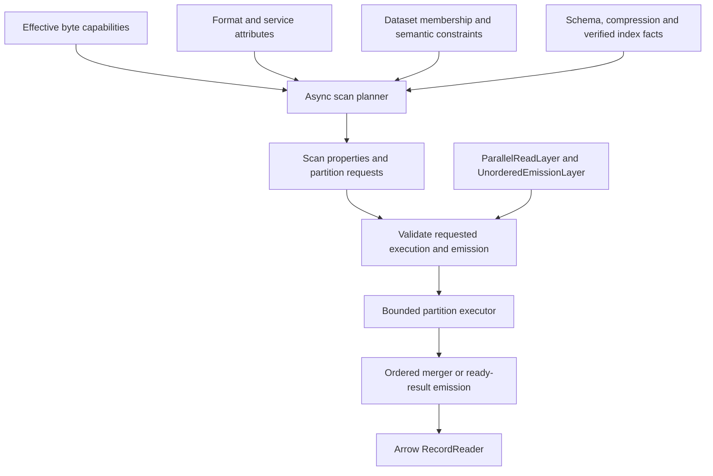

# Source attributes and scan planning

Status: the runtime now implements `ScanPlanner`, ordered parallel execution,
`OrderRequirement`, and `ScanPlan::ordering`; see [parallel reading](parallel-read.md).
The fuller attribute/strategy types below remain a design proposal. In particular,
`SourceAttributes` and `ScanProperties` are not current exports. Unordered emission
is the next step and remains explicitly opt-in.

Confirmed application requirement: **the entire ATIF input must retain global
record order**. Preserving order only within each trajectory is insufficient.
This is our adapter contract, not a claim about every use of the ATIF standard.

## Separate capabilities, requirements and policies

| Concept | Question | Owner |
| --- | --- | --- |
| Byte `Capability` | Can this composed interface read ranges or discover objects? | Storage and byte layers |
| `SourceAttributes` | What ordering requirements and partition strategies does this adapter declare? | Format, dataset or provider service |
| `ScanProperties` | What is proven valid for this selected input and composed pipeline? | Async scan planner |
| Execution/emission policy | Which permitted behavior did the caller request? | Enhancement layers |

Fs/S3 expose bytes, so Arrow emission order is not a storage attribute. Services
such as Hugging Face/PMC expose dataset semantics and participate in source
attribute resolution. A service that reads API records directly uses the same
record-side contract as a format or dataset accessor.

`supports_unordered_emission` must express permission to relax order, not whether
the current reader happens to return ordered data. `supports_parallel_read`
must concern independently readable record partitions. Per-reader byte I/O
concurrency, partition concurrency and parallel Arrow conversion are separate.

## Proposed attribute types

The following Rust sketches are proposed API shapes, not current exports:

```text
enum OrderRequirement {
    Reorderable,
    PreserveGlobal,
}

enum SplitSupport {
    WholeInput,       // No independent subdivisions within this provider's input.
    NativeUnits,      // Implemented strategy using native layout/metadata.
    IndexedUnits,     // Implemented strategy requiring a verified index.
    InspectInput,     // Cannot decide before inspecting the selected input.
}

struct SourceAttributes {
    ordering: Option<OrderRequirement>, // None means unresolved, not reorderable.
    splitting: SplitSupport,
}

enum OrderBasis {
    DeclaredSequence,  // Explicit input list/manifest or authoritative source order.
    DiscoverySequence,// Enumeration order within this scan, not cross-run stability.
    Undefined,
}

struct ScanProperties {
    ordering: OrderRequirement,
    independent_partitions: bool,
    order_basis: OrderBasis,
    partition_count: Option<usize>,
}
```

`SourceAttributes` declares the strategies actually implemented by an adapter.
It does not advertise every optimization theoretically possible for its format.
`ScanProperties` contains resolved facts: ordering is never unknown there.

Unordered emission is allowed only for `Reorderable`. Parallel partition reading
requires proven independence; a plan with a single partition has no partition
concurrency benefit. Neither property automatically enables an execution policy.
Unknown facts never grant permission for an optimization.

Attributes describe strategies at the provider's input scope: a format's input
is one logical file; a directory dataset's input is its selected file collection;
a service's input is the selected revision/config/split or API query. A parent's
file partition is not a claim that its child format can split within that file.

## Examples and composition

This matrix describes target adapters once the relevant planners exist. The
current Parquet implementation has no partition planner and must not yet report
row-group scan parallelism at runtime.

| Provider | Ordering requirement | Candidate partitioning | Admission conditions |
| --- | --- | --- | --- |
| Parquet file | Reorderable unless a surrounding source imposes order | Native row groups | Effective range access, footer/schema and independently initialized row-group readers |
| ATIF file | PreserveGlobal | WholeInput | One sequential record scan; reject unordered emission |
| WARC file | Source/view dependent; raw-record view may be reorderable | Indexed record groups | Verified record boundaries, correct offset coordinates, complete decode context and independently decodable compression units |
| Directory dataset | Resolve child/source constraints | Independent files, optionally child partitions | Files must be independently readable; fixed output schema; defined file order for global-order scans |
| Hugging Face service | Resolve dataset/view constraints | Selected immutable shards, then child partitions | Selected revision/config/split and each representation's constraints |
| Cursor API returning records | Provider contract | Usually WholeInput for a dependent cursor chain | A next-page token discovered only from its predecessor is not an independent request |
| Cursor API discovering file references | Resolve discovered inputs | Independent file reads may overlap discovery | Sequential discovery does not itself prohibit independent reads of discovered files |

Parquet's native layout stores row groups and column locations in footer metadata;
that makes row-group partitioning a candidate, not an unconditional property of
every compressed/storage combination. See the
[Parquet file format](https://parquet.apache.org/docs/file-format/).

An ATIF file has no intra-file record partition strategy in this design. Several
independent ATIF files may be read concurrently by a dataset planner **only** if
their independence and authoritative file sequence are established and the
merger preserves the global file/record sequence. A dataset with cross-file
state/dependencies must keep one sequential partition instead.

A Parquet container can also hold data whose dataset requires global order.
Changing the physical format never automatically removes that semantic constraint.

## Planning and admission



1. Resolve the selected source/view, schema and available strategies. Inspect
   metadata/indexes asynchronously; attribute getters themselves perform no I/O.
2. Validate the chosen strategy against the **effective** bytes after compression
   and other wrappers. Native layout alone does not establish random access.
3. Produce partition requests only when they can be opened and decoded without
   another partition's mutable cursor/parser state. They cover the selected
   logical records without omissions or duplicate ownership; overlapping I/O
   ranges are permitted.
4. Combine semantic constraints: any format, dataset, service or layer requiring
   `PreserveGlobal` makes the entire composed scan globally ordered. A wrapper
   may strengthen this requirement, never silently weaken it.
5. Validate policies before emitting records. Explicit unordered emission with
   `PreserveGlobal` is an error, including a one-partition ATIF scan. Explicit
   partition parallelism without an admissible strategy is unsupported unless
   the caller explicitly permits a sequential fallback.
6. Execute with bounded workers and buffers. A parallel ordered plan needs
   authoritative partition order keys and internally ordered partition readers.
   Reserve progress/buffer capacity for the earliest unfinished partition so
   later ready partitions cannot deadlock the ordered merger.

Default behavior stays sequential + ordered. Parallel execution alone retains
order. Unordered emission alone does not create workers or force shuffling.
The two layer configurations are collected before planning/merging, independent
of layer insertion order; conflicting duplicate configurations are errors.

Ordered output for a reorderable source may preserve this scan's discovery
sequence without claiming reproducibility across runs. A `PreserveGlobal` source
requires its declared logical sequence; undefined directory listing order does
not supply one. Use an explicit list, a manifest, or a declared sorting rule.

## Dataset and service rules

Composition is strategy-specific, not an AND/OR of format/backend booleans.
Independent file tasks can exist when each file is internally unsplittable;
independent row-group tasks require a suitable byte access path.

Mixed datasets must resolve global ordering constraints **before** admitting
unordered emission. Inspecting the first file is insufficient: discovering an
ATIF input after emitting unordered Parquet batches cannot repair the earlier
output. Either the provider supplies a trustworthy dataset-wide format/order
contract, membership is discovered and checked first, or the scan remains
conservatively ordered. Explicit unordered requests with unresolved constraints
must not be accepted optimistically.

Planning may stream partitions with bounded memory once dataset-wide constraints
are established. The membership/order contract is fixed for the selected scan;
mutable listings do not imply an atomic snapshot. Schema compatibility of later
inputs is still validated and can terminate the stream on mismatch.

Provider adapters own revision selection, cursors, schema conventions and
authoritative order. A service resolving files delegates to dataset/format
planners. A direct-record API provides its own partition requests. New providers
do not add backend/format cases to a core enumeration.

## WARC index and compression validation

An index existing on disk is insufficient. Bind it to source identity/version
or a verified fingerprint, size, parser configuration and index schema. Check
the coordinate space: storage-byte offsets and decoded-byte offsets differ.
Selected logical-record boundaries and any shared decode context must be valid.

For `.warc.gz`, compressed offsets need independently decodable members/frames
or a valid compression recovery index. The WARC specification describes
record-at-a-time gzip members and external offsets for random access; a single
arbitrary gzip stream does not gain that property merely from a record index.
See [WARC 1.1, Annex D](https://iipc.github.io/warc-specifications/specifications/warc-format/warc-1.1/).

An explicitly requested invalid/stale index is an error. A missing optional index
can yield a whole-input sequential plan when that policy is allowed and an
actual sequential reader is available. Building an index or materializing input
is an explicit, budgeted operation; the planner never pretends that decoding
from byte zero for every task provides independent random access.

## Optional planner extension

Preserve `Accessor` / `Reader` / `Layer` as the common read protocol. Add a
planning extension when its first implementation lands, rather than requiring
every byte or record accessor to implement partition planning today:

```text
trait SourceInfo: Send + Sync {
    fn attributes(&self) -> SourceAttributes;
}

#[async_trait]
trait ScanPlanner: Accessor<Reader = dyn RecordReader> + SourceInfo {
    type PartitionAccessor:
        Accessor<Reader = dyn RecordReader>;

    async fn plan_scan(&self, request: Self::Request)
        -> Result<ScanPlan<Self::PartitionAccessor>>;
}

struct ScanPlan<A: Accessor<Reader = dyn RecordReader>> {
    properties: ScanProperties,
    schema: SchemaRef,
    accessor: A,
    partitions: BoxStream<'static, Result<Partition<A::Request>>>,
}

struct Partition<R> {
    request: R,
    order_key: Option<OrderKey>,
}
```

The executor opens each partition through the same `Accessor::open` protocol.
The provider owns the partition request type: Parquet may select row groups,
WARC indexed records, and a service shard/page keys. Core does not enumerate
these formats. Immutable footer/schema/decoder context may be shared, but each
partition owns independent mutable read/decoder state.
Partition requests own their selection/context and are Send + 'static.

Planning-aware record layers must wrap the returned partition accessor as well
as the logical scan. Forwarding a plan unchanged could otherwise bypass generated
columns, metrics or budgets. Generated columns retain the source's order
requirement; scan-scoped evaluation context is shared consistently across
partitions. A schema-changing layer also updates the plan's fixed output schema.
A byte/decompression layer's effective capabilities participate in
planning through the wrapped byte accessors.

`ScanProperties` belongs to the resolved plan/control path, not hidden Arrow
columns or schema metadata. Existing accessors without this extension continue
to support their ordinary sequential `open` path.

Execution/emission settings belong to each scan request. Future enhancement
layers resolve them before planning and expose the resolved policy and reasons
for any explicitly permitted fallback. They do not mutate shared source
attributes when concurrent scans choose different policies.
An optional `ScanOptionsProvider`, following `ReadOptionsProvider`'s pattern,
can give generic layers access to `ExecutionMode` and `EmissionPolicy` on
provider-specific requests. Add that contract together with the real execution
layers; record readers do not acquire mutable global policy switches.

## Delivery and validation

1. Implement the attribute types and optional planning protocol with the first
   real planner; keep current capability flags truthful until then.
2. Directory planning starts with independently readable whole-file tasks;
   Parquet can subsequently provide row-group partition accessors and shared
   immutable footer metadata.
3. Add ParallelReadLayer and UnorderedEmissionLayer as separate default-off
   features. Test policy admission before enabling concurrent execution.
4. Add indexed WARC planning with real index/compression validation.

Acceptance cases include ATIF rejecting unordered mode; a globally ordered
Parquet dataset overriding the format's reorderable default; mixed datasets
rejecting optimistic unordered emission; valid/stale/missing WARC indexes;
sequential discovery with parallel file reads; dependent API pagination;
parallel + ordered merging; row multiplicity, fixed schema, bounded buffering,
error/cancellation behavior and layers wrapping partition accessors correctly.

`ByteReadOptions::io_concurrency` remains a per-reader data-I/O limit. With P
active partitions and limit I per reader, data I/O can reach roughly P × I;
metadata/discovery traffic is additional. A shared backend concurrency/rate
budget can be composed separately through OpenDAL. None of these settings
constitutes a total Arrow decoder-memory bound.
