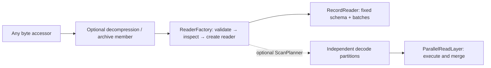

# File formats

Use a format accessor to turn one `ByteReader` into records. Storage selection
and credentials stay on the byte accessor. Enable each format on the facade;
component-crate users enable the shorter feature name shown below.

## Choose a format

| Input | Facade feature | Component feature | Entry point / output |
| --- | --- | --- | --- |
| CSV / TSV | `format-csv` | `csv` | `csv::CsvAccessor`; Arrow, explicit or inferred schema |
| JSON objects / JSONL | `format-json` | `json` | `json::JsonAccessor`; Arrow, explicit or inferred schema |
| Parquet | `format-parquet` | `parquet` | `parquet::ParquetAccessor`; Arrow schema from file |
| XML | `format-xml` | `xml` | `xml::XmlAccessor`; Arrow, record path and explicit or inferred mappings |
| ATIF | `format-atif` | `atif` | `atif::AtifAccessor`; trajectory Arrow mapping |
| WARC | `format-warc` | `warc` | `warc::WarcAccessor` for native records; `warc::WarcArrowAccessor` for Arrow |

JSON expects whitespace-separated objects, including pretty-printed objects;
a top-level array/scalar is unsupported. WARC Arrow output preserves physical
records and binary bodies; it does not extract HTML text. See [format behavior](../docs/formats.md)
for schema inference, mappings, supported layouts, and limits.

## Read JSONL

Enable `format-json` and OpenDAL's `services-fs`. This complete function accepts
a caller-configured operator:

```rust,no_run
use open_arrow_access::{
    Accessor, ReadOptions, ReadRequest,
    file_format::json::JsonAccessor,
    storage::{OpenDalAccessor, opendal},
};
use std::num::NonZeroUsize;

async fn read(operator: opendal::Operator) -> open_arrow_access::Result<()> {
    let records = JsonAccessor::infer(OpenDalAccessor::new(operator));
    let mut reader = records.open(ReadRequest::new("records.jsonl").with_options(ReadOptions {
        batch_size: NonZeroUsize::new(1024).unwrap(),
        projection: Some(vec!["id".into(), "title".into()]),
    })).await?;
    println!("schema: {:?}", reader.metadata().schema);
    while let Some(batch) = reader.next().await? {
        println!("{} rows", batch.num_rows());
    }
    Ok(())
}
```

The example expects `id` and `title` in the inferred schema. Use an explicit
schema when the input contract is known. Projection uses top-level field names
in caller order; an empty projection retains row counts with zero columns.
Metadata declares a fixed schema before the first batch.

## Composition and parallel reads



Ordinary `open` reads sequentially. Install [`ParallelReadLayer`](../docs/parallel-read.md)
on a planner-capable accessor to execute partitions. Parquet plans row groups;
JSON, CSV, XML, ATIF JSONL, and WARC Arrow frame complete records before parallel
conversion. Framing and upstream stream decompression can remain sequential.
`DecodePartitionOptions` controls a soft byte target; a complete record may
exceed it. CSV configured through opaque `with_format` settings uses a whole-input
plan; use `with_dialect` for supported record partitioning. ATIF retains global order.

Parquet needs exact byte ranges and known input length. Other sequential formats
can read after streaming decompression. Snappy and uncompressed Parquet pages are
included; enable `format-parquet-zstd`, `format-parquet-lz4`,
`format-parquet-gzip`, or `format-parquet-brotli` for other page codecs. On this
crate those features are `parquet-zstd`, `parquet-lz4`, `parquet-gzip`, and
`parquet-brotli`. They also enable the base Parquet feature.

### WARC Arrow partitions

`WarcArrowAccessor::plan_scan` frames complete physical WARC records, then
converts independent groups to Arrow. Bodies remain binary and physical order
is preserved with ordered execution. Framing/decompression remain sequential;
the partition byte target is soft and permits an oversized complete record.

## Add a format

1. Implement `ReaderFactory`: choose request, prepared state, reader type, and effective capabilities/order.
2. Validate settings in `prepare`; inspect bytes and establish metadata in `create_reader`.
3. Bind it with `FileAccessor::from_format(storage, format)`. Use `ReaderFactoryExt::open_input` for an already-open archive member or byte reader.
4. Reuse `decode_batches` for incremental Arrow conversion or `record_stream_reader` for a native Arrow stream.
5. Add a feature-gated module and facade feature if integrating it into this workspace.

See the [extension guide](../docs/extending.md#add-a-format) for the opening
sequence, trait hooks, tests, and reference implementations.
