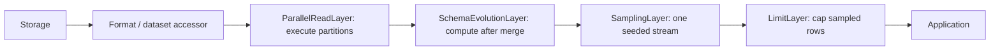
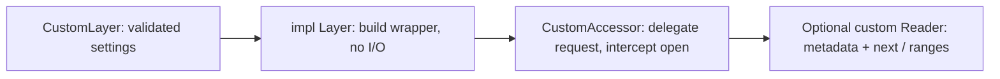

# Layers

Stream layers wrap an accessor with `AccessorExt::layer`. They preserve its Rust
request and reader interfaces; record layers may change Arrow schema and values.
`AttachmentFallbackLayer` instead wraps cell accessors with `wrap` and returns a
single typed attachment cell before any Arrow batch assembly.
Built-in layers are available through `open_arrow_access::layers` when their
Cargo features are enabled. Both crates default to no built-in layers.
Byte decompression layers use the same contract but require [codec features](../decompression/README.md).

## Features

| Layer / adapter | Facade feature | `open-arrow-access-layers` feature |
| --- | --- | --- |
| `AttachmentFallbackLayer` | `layer-attachment-fallback` | `attachment-fallback` |
| `CoalesceBatchesLayer` | `layer-coalesce-batches` | `coalesce-batches` |
| `FilterLayer` | `layer-filter` | `filter` |
| `LimitLayer` | `layer-limit` | `limit` |
| `MetricsLayer` re-export | `layer-metrics` | `metrics` |
| `MissingObjectLayer` | `layer-missing-object` | `missing-object` |
| `ParallelReadLayer` | `layer-parallel-read` | `parallel-read` |
| `PrefetchLayer` | `layer-prefetch` | `prefetch` |
| `SamplingLayer` | `layer-sampling` | `sampling` |
| `SchemaEvolutionLayer` | `layer-schema-evolution` | `schema-evolution` |
| `SourceColumns` | `layer-source-columns` | `source-columns` |
| `SourcePositionLayer` | `layer-source-positions` (or `source-positions`) | `source-positions` |
| `UnorderedEmissionLayer` | `layer-unordered-emission` | `unordered-emission` |
| All of the above | `layers-all` | `all` |

`unordered-emission` and `missing-object` also enable `parallel-read` because
they use the shared partition executor. `source-positions` also enables `source-columns` and frame codecs.
Only `filter` and `schema-evolution` enable DataFusion; the latter also enables
SQL. Arrow cast/select kernels, Tokio, and compression dependencies are optional
and enabled by the layers that use them. The core `Layer` trait and
`core::metrics` API remain available independently of the built-in layer exports.

```toml
open-arrow-access = { version = "0.21.8", default-features = false, features = [
    "format-parquet",
    "layer-limit",
    "layer-sampling",
] }
```

For direct use of this crate, select the unprefixed features on
`open-arrow-access-layers`. During migration, `layers-all` / `all` restores the
complete set of layer APIs. Enabling features only compiles APIs; construct the
layers to apply their behavior. Cargo combines features across dependencies, so
another consumer of schema evolution or filtering can still enable DataFusion.

## Choose a layer

| Layer | Use it for | Key behavior |
| --- | --- | --- |
| `AttachmentFallbackLayer` | Choose a typed attachment cell per logical item | Uses the alternate only when that cell is absent; returns one cell, not batches |
| `MetricsLayer` | Observe byte/record reads | In-memory aggregates by default; optional OpenDAL instrumentation |
| `SchemaEvolutionLayer` | Add computed columns, remove, rename, or cast top-level columns | Ordered DataFusion Expr / SQL operations; fixed output schema |
| `FilterLayer` | Filter rows or mask individual cells | Boolean rules; reads hidden dependencies; cell targets become nullable |
| `LimitLayer` | Keep at most N rows | One budget per open; stops and releases the source at the limit |
| `SamplingLayer` | Seeded Bernoulli row sampling | Approximate count; preserves selected row order |
| `PrefetchLayer` | Read ahead while the caller processes batches | Per-open row and/or estimated-byte queue budgets; preserves batch boundaries |
| `CoalesceBatchesLayer` | Combine small batches across the opened scan | Row and estimated-byte budgets; preserves schema and row order |
| `ParallelReadLayer` | Execute independent scan partitions concurrently | Requires `ScanPlanner`; preserves output order by default |
| `UnorderedEmissionLayer` | Emit ready batches from a reorderable scan | Use with parallel execution; global-order sources reject it |

Enabling Cargo features does not install a layer. Construct it and call `.layer`.
OpenDAL layers belong on the OpenDAL operator and configure a separate I/O boundary.

## Compose layers



`source.layer(a).layer(b)` makes `b` outermost: opening goes through `b`, then
`a`, then the source. Batches flow back through `a` and then `b`.

Enable `format-json`, `layer-parallel-read`, `layer-schema-evolution`,
`layer-sampling`, and `layer-limit` for this complete composition function:

```rust,no_run
use open_arrow_access::{
    Accessor, AccessorExt, ReadRequest,
    file_format::json::JsonAccessor,
    layers::{ColumnEvolution, SchemaEvolutionLayer, ParallelReadLayer, SamplingLayer, LimitLayer},
    storage::{OpenDalAccessor, opendal},
};
use std::num::NonZeroUsize;

async fn read(operator: opendal::Operator) -> open_arrow_access::Result<()> {
    let source = JsonAccessor::infer(OpenDalAccessor::new(operator));
    let evolution = SchemaEvolutionLayer::try_new(vec![
        ColumnEvolution::add_column_sql("title_length", "character_length(title)"),
    ])?;
    let records = source
        .layer(ParallelReadLayer::new(NonZeroUsize::new(4).unwrap(), NonZeroUsize::MIN))
        .layer(evolution)
        .layer(SamplingLayer::try_new(0.1, 42)?)
        .layer(LimitLayer::new(100));
    let mut reader = records.open(ReadRequest::new("records.jsonl")).await?;
    while let Some(batch) = reader.next().await? {
        println!("{} sampled rows", batch.num_rows());
    }
    Ok(())
}
```

This expects a string `title` column. Sampling keeps each row with probability
0.1; it does not request an exact 10% count. The same seed and ordered input
produce the same selection across different batch boundaries. Unordered input
can change the sample. `LimitLayer` then keeps at most 100 selected rows;
without sampling it keeps the first 100 input rows. This is not uniform random
fixed-size sampling. If fewer rows are available, all available rows are returned.
Zero reads no batches (the source is still opened for metadata).

Keep sampling and limits **outside** `ParallelReadLayer` so they run over one
merged scan; they do not implement `ScanPlanner`. Schema evolution can run outside
for a serial transform, or inside for parallel partition-local transforms. Its
`ScanPlanner` implementation compiles expressions once per scan, shares the
immutable plan across workers, and retains native partitions and scan policies.
Stable expressions such as `now()` use the same planned value across partitions.
[`CrawlAccessor`](../docs/crawl.md) uses this parallel placement by default. Supply a complete `with_source_schema` to
read only the source columns needed by all changes and the final output. Without
it, adding, removing or renaming columns requires reading the full source schema.
All configured computations run before final projection.

## Filter rows and cells

`FilterLayer::new(Vec<Expr>)` retains a row only when every DataFusion predicate
returns `true`. A predicate may reference one or multiple columns and may call a
custom scalar UDF. False and null results discard the entire row. Use `or` within
an expression for alternatives, or `is_null().or(...)` to explicitly retain nulls.

Like generated-column expressions, predicates accept caller-provided DataFusion
scalar UDFs through `udf.call(...)`. The UDF owns its input types, configuration
and logic; each rule requires a Boolean result.

```rust
use datafusion::{logical_expr::ScalarUDF, prelude::{col, lit}};
use open_arrow_access_core::{Accessor, AccessorExt, ReadOptionsProvider, RecordReader};
use open_arrow_access_layers::{FilterAccessor, FilterLayer};

fn filter<A>(source: A, predicate: ScalarUDF) -> FilterAccessor<A>
where
    A: Accessor<Reader = dyn RecordReader>,
    A::Request: ReadOptionsProvider,
{
    source.layer(FilterLayer::new(vec![
        predicate.call(vec![col("data")]),
        col("score").gt(lit(0_i64)),
    ]))
}
```

Use `FilterLayer::with_rules(Vec<FilterRule>)` to mix row and cell filtering:

```rust
use datafusion::prelude::{col, lit};
use open_arrow_access_layers::{FilterLayer, FilterRule};

let filter = FilterLayer::with_rules(vec![
    FilterRule::Row(col("score").gt(lit(0_i64))),
    FilterRule::Cell {
        column: "data".into(),
        predicate: col("size").lt_eq(lit(1024_i64)),
    },
]);
```

`FilterRule::Row` discards the whole row when its predicate is false or null.
`FilterRule::Cell` replaces only the target cell with null, preserving the row
and other cells. Targets are top-level column names and become nullable in the
output schema, even when the input field is non-nullable. Union and RunEndEncoded
targets are rejected before reading because they lack a top-level validity bitmap.
Data types and field/schema metadata are preserved. Multiple rules for a target combine with
AND. Every predicate sees the original batch, including values masked by an
earlier rule; cell masking never changes a later rule's input.

For a cell-size rule, the caller can provide a Boolean UDF that compares each
cell's byte length with a captured limit. A UDF can also take multiple columns,
reference generated columns from an inner `SchemaEvolutionLayer`, or return a
scalar Boolean that expands to every row in the batch. The layer provides no
built-in domain-specific predicates.

Predicate dependencies and cell targets are added to an explicit input projection,
then hidden from output unless requested. Caller column order, field/schema metadata and
zero-column row counts are preserved (except for rows discarded by row rules).
Predicates compile once per open or scan;
unknown columns, non-Boolean results, aggregates, windows, subqueries and volatile
functions fail before batches are consumed. All predicates evaluate on the original
batch in vector order; do not depend on short-circuiting to guard failing casts.
Filtered empty batches are skipped; an empty predicate vector is a pass-through.
Errors terminate reading and release the source.

Filtering takes place after decoding and does not avoid loading oversized cells
or cap decoder memory. Place the filter inside `ParallelReadLayer` to filter in
partition workers with a shared compiled plan, or outside it to filter after merge.
The planner retains source partitioning, execution settings and ordering.

## Coalesce small batches

Document sources such as PMC emit one row per batch. Place `CoalesceBatchesLayer`
outside `ParallelReadLayer` to combine those rows before a downstream sink, whose
download concurrency may otherwise be limited by the number of rows in each batch.

```rust
use std::num::NonZeroUsize;
use open_arrow_access_core::{Accessor, AccessorExt, RecordReader};
use open_arrow_access_layers::{CoalesceBatchesAccessor, CoalesceBatchesLayer};

fn coalesce<A: Accessor<Reader = dyn RecordReader>>(source: A) -> CoalesceBatchesAccessor<A> {
    source.layer(
        CoalesceBatchesLayer::rows(NonZeroUsize::new(64).unwrap())
            .with_max_estimated_bytes(NonZeroUsize::new(4 * 1024 * 1024).unwrap()),
    )
}
```

Use `rows(...)` for only a row budget, `estimated_bytes(...)` for only a byte
budget, or add the other budget with `with_max_rows(...)` /
`with_max_estimated_bytes(...)`. Constructors always enable at least one budget.
With both enabled, the first budget reached flushes the batch. A configured row
limit is strict; larger input batches are sliced. Estimated array bytes
bound accumulation, with an oversized slice emitted alone. Shared buffers and
concatenation allocations mean this is not a process memory cap. Empty batches
are skipped; nonempty zero-column batches cost at least one byte under a byte
budget. The final partial batch is returned at EOF. Buffered rows precede
an upstream error. There is no flush timer: a partial batch waits for more input.
Place `PrefetchLayer` outside coalescing to read the next combined batch while the
caller processes the current one, with a separate bounded queue budget.

## Prefetch records

`PrefetchLayer` overlaps upstream reading/decoding with caller work. It wraps any
`Accessor<Reader = dyn RecordReader>`; requests, schema, source metadata, batch
boundaries, row order and source ordering requirements are preserved. Each open
has its own queue. No batches are read and no tasks start during construction or
opening. The first `next()` starts one worker on the current Tokio runtime;
reading without a runtime returns an error. The worker keeps reading when the
caller pauses, until backpressure prevents another read or queue admission.

```rust
use std::num::NonZeroUsize;
use open_arrow_access_core::{Accessor, AccessorExt, RecordReader};
use open_arrow_access_layers::{PrefetchAccessor, PrefetchLayer};

fn prefetch<A: Accessor<Reader = dyn RecordReader>>(source: A) -> PrefetchAccessor<A> {
    source.layer(
        PrefetchLayer::rows(NonZeroUsize::new(10_000).unwrap())
            .with_max_estimated_bytes(NonZeroUsize::new(64 * 1024 * 1024).unwrap()),
    )
}
```

For only a byte budget, use `PrefetchLayer::estimated_bytes(bytes)`. Both budgets
use `NonZeroUsize` so zero and completely unbounded configurations cannot be
constructed. With both enabled, queued batches must fit **both** limits; reaching
either stops further reads. If a decoded batch does not fit the remaining space,
the producer waits for consumption before admitting it. Delivery releases its
queue budget immediately, even while the caller retains the returned batch.

Byte estimates use Arrow's `RecordBatch::get_array_memory_size()`, which includes
array overhead and can count shared buffers repeatedly. They describe decoded
Arrow arrays, not compressed/source bytes or exact resident memory. Slices may
retain larger backing buffers. Each empty or zero-byte batch costs at least one
unit of each enabled budget, preventing unbounded queues of empty batches.

Batches are never split or copied. A batch larger than a configured budget is
admitted alone. The producer may also hold **one decoded batch awaiting queue
admission**, because its size is unknown before reading. Thus total prefetch
memory includes the queue, one in-flight/staged batch, and upstream decoder
allocations; configure decoder batch sizes separately. Caller-retained output
batches and queues in other layers are outside this budget.

Queued batches precede a subsequent upstream error; errors retain their original
classification, source chain and HTTP metadata. EOF and errors are terminal.
Worker panics become read errors after the queue is drained. Dropping the reader
aborts its worker even during a pending read or while awaiting budget. As with
other stateful readers, drop the reader after cancelling an in-flight `next()`.

Place prefetch **outside** `ParallelReadLayer` for one queue over the merged scan.
The parallel layer's per-partition batch queues remain independent and additive.
Place it before an expensive schema transformation to overlap input work, or
after the transformation to precompute output batches. `PrefetchAccessor` does
not expose `ScanPlanner`, so planning/execution layers must be installed inside
it. An outer `LimitLayer` cancels prefetch when its row limit is reached; already
prefetched input can exceed the number of rows delivered by that limit.

## Evolve a schema

Add matching `datafusion = { version = "54.1.0", default-features = false }`
and `arrow-schema = "58"` dependencies. For a record accessor `source` and
its complete `source_schema` containing `count` and `obsolete` columns:

```rust,ignore
use arrow_schema::DataType;
use datafusion::prelude::{col, lit};
use open_arrow_access::{AccessorExt, layers::{ColumnEvolution, SchemaEvolutionLayer}};

let records = source.layer(SchemaEvolutionLayer::try_new(vec![
    ColumnEvolution::remove_column("obsolete"),
    ColumnEvolution::rename_column("count", "row_count"),
    ColumnEvolution::change_data_type("row_count", DataType::Int64),
    ColumnEvolution::add_column("next_count", DataType::Int64, col("row_count") + lit(1i64)),
])?.with_source_schema(source_schema));
```

Changes execute in vector order. Each name refers to the schema produced by
preceding changes. Rename targets must be unoccupied at that step; swapping names
requires a temporary name. Removed names can be reused by later additions.

Added columns append in vector order. `add_column(name, type, expr)` produces a
nullable column and checks that the DataFusion `Expr` returns the declared type.
`add_column_expr(name, expr)` and `add_column_sql(name, sql)` infer the output
type, nullability and field metadata; SQL additions also record the original
expression in `open_arrow_access:generated_expression`. Expressions can reference
earlier additions, renames, and casts; removed columns are unavailable. Scalars
expand to the batch row count, including zero. Use a `ScalarUDF` for custom
computation, with its input columns represented as expression arguments.
Aggregates, window functions, subqueries, and volatile expressions are rejected.

Projection uses evolved names. With `with_source_schema`, the layer traces source
dependencies through the ordered changes and reads only columns needed by
expressions, casts, or final output. Each expression is compiled against its own
dependency schema, so its physical column indices match the compact input view.
All configured expressions and casts run even when hidden by final projection.
The supplied schema must describe the complete current source; selected input
fields are checked once at open. Without it, namespace changes require an
unprojected open because `Accessor` has no separate schema-discovery API.

Unchanged arrays share buffers; field/schema metadata and zero-column row counts
are preserved. Invalid expression types and unsupported casts fail at open;
invalid values, overflows, and expression failures terminate reading with context.
Arrow casts can lose precision and do not reconcile schemas across files.

Opening indexes source names once. Layer-owned per-batch validation checks only
affected fields, with a schema-identity fast path. Type checks recurse only within
changed types. A name index and append-only field slots preserve vector order.
The final schema scans those slots once in O(F + K) for F source fields and K
changes. Source projection indices are assigned on first use during planning;
there is no later rebinding pass. Expression dependency discovery visits its
expression tree, and each input view visits only that expression's dependencies.
Final assembly visits P output columns. Arrow's safe batch constructors check
those assembled views; DataFusion planning and computation have their own costs.

See the [runnable example](../examples/schema_evolution.rs),
[generated columns](../docs/generated-columns.md), and
[parallel reading](../docs/parallel-read.md).

## Add a layer



Implement `Layer<A>` and a wrapping `Accessor` retaining `A::Request` and
`A::Reader`. Wrap each returned reader if transforming batches or observing
reads. Preserve EOF/error lifecycle, source identity, and explicit ordering;
update metadata when changing the schema or byte representation. Forward optional
listing/range/planning operations, or remove the associated advertised abilities.
Planning-aware wrappers must also wrap partition accessors.

For batch transformations, adapt the input with core's `into_stream`, apply
stream combinators, and wrap the output with `StreamReader::records`. This
reuses terminal cleanup on EOF or error instead of implementing another reader
state machine. Preserve the effective reader capability with `with_capability`.

See [adding a layer](../docs/extending.md#add-a-layer) and the
[`SamplingLayer` implementation](src/sampling.rs) for a compact complete example.

## Metrics

`MetricsLayer` observes byte or record accessors with a default in-memory exporter.
See [read metrics](../docs/metrics.md) for OpenDAL I/O integration, snapshots,
byte-count semantics and custom exporters.

## Missing source objects

`MissingObjectLayer::default()` fails on errors. Opt into skipping missing data
objects at native scan-partition boundaries, before coalescing/transforms:

```rust,ignore
let missing = MissingObjectLayer::new(MissingObjectPolicy::Skip, |error| {
    record_failure(error.object().unwrap().locator(), &error.to_string())?;
    Ok(())
});
let source = source.layer(missing).layer(ParallelReadLayer::new(partitions, prefetch));
```

A recoverable error must have typed `NotFound` classification and an exact object
locator; explicit HTTP status metadata, when present, must be 404. Native missing
filesystem objects use the same category. 403, 410, timeouts, decode errors and
unknown-object errors remain fatal. No error-message strings are parsed.
The reporter must succeed before a partition is skipped; it may run concurrently
and should not block. Reporter failures fail the scan, and no unbounded list is
retained in the library. `Error::object()` exposes the missing child locator.

The layer handles partition open/first-read errors, including lazy PMC metadata
reads from an inventory. Planning/discovery errors (such as a missing inventory
manifest) remain fatal. A partition that already emitted rows also fails rather
than silently returning a truncated file. Schema must be known from the underlying
plan; a missing input required for schema inference cannot be skipped by this
layer. Surviving partition order and configured executor budgets are preserved.

## Select an attachment cell with fallback

```rust,ignore
use open_arrow_access_core::AttachmentCellAccessor;
use open_arrow_access_layers::AttachmentFallbackLayer;

let cells = AttachmentFallbackLayer::new(pdf_source).wrap(latex_source);
let first = cells.read_cell(first_article).await?;   // Some({ latex bytes, Latex })
let second = cells.read_cell(second_article).await?; // Some({ PDF bytes, Pdf })
```

`AttachmentCellAccessor::read_cell` returns exactly one `Option<AttachmentCell>`.
Each cell owns `data: Bytes`, `data_type: AttachmentDataType` and optional source
identity. Both providers accept the same logical request, including any version
selection. Providers perform their own format-specific reading and decoding;
the fallback helper is service-independent and has no Arrow reader/batch path.
It uses `wrap`, not the stream-oriented `AccessorExt::layer` interface.

A primary `Some(cell)` is returned unchanged. Empty bytes are an existing cell.
`None` or a default-classified `NotFound` triggers a lazy alternate read **for
that item only**. Two missing cells return `None`. Permission, authentication,
transport and decoding errors propagate; `.when(...)` can explicitly classify
other primary absence errors. Fallback errors are preserved. Wrap a fallback
accessor to express ordered choices such as TXT → XML → PDF. Each call has its
own state, so different rows can choose different representations concurrently.

Arrow assembly happens outside the helper. For arXiv, retain the top-level
`data: LargeBinary` content column and add a separate top-level
`data_type: Utf8` column. For example, the first row can hold LaTeX bytes with
`data_type="latex"`, and the second PDF bytes with `data_type="pdf"`. No Struct
wrapper is required. This example is a provider integration contract; this
provider-independent PR does not change the arXiv output schema itself.

Use `cell.data_type.as_str()` for the tag; the Rust enum distinguishes Txt,
Latex, Pdf, Xml, Html, Binary and a provider-defined Other value. Type tags must
travel with the selected bytes, not be inferred from the Arrow binary type.
A dictionary string column is another storage choice for the type tag. The
helper does not perform text conversion, concatenation or batch-wide fallback.
