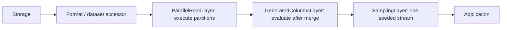
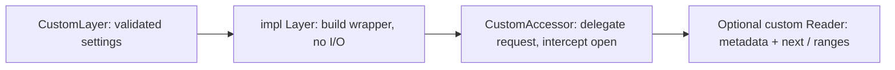

# Layers

Layers wrap an accessor with `AccessorExt::layer`. They preserve its Rust request
and reader interfaces; record layers may change the Arrow schema and values.
All layers in this crate are always available through `open_arrow_access::layers`.
Byte decompression layers use the same contract but require [codec features](../decompression/README.md).

## Choose a layer

| Layer | Use it for | Key behavior |
| --- | --- | --- |
| `SchemaRemapLayer` | Rename or cast top-level columns | Plans a fixed output schema; invalid values terminate reading |
| `GeneratedColumnsLayer` | Append row-level SQL expressions | Declarations see earlier generated fields; uses DataFusion |
| `SamplingLayer` | Seeded Bernoulli row sampling | Approximate count; preserves selected row order |
| `ParallelReadLayer` | Execute independent scan partitions concurrently | Requires `ScanPlanner`; preserves output order by default |
| `UnorderedEmissionLayer` | Emit ready batches from a reorderable scan | Use with parallel execution; global-order sources reject it |

Enabling Cargo features does not install a layer. Construct it and call `.layer`.
OpenDAL layers belong on the OpenDAL operator and configure a separate I/O boundary.

## Compose layers



`source.layer(a).layer(b)` makes `b` outermost: opening goes through `b`, then
`a`, then the source. Batches flow back through `a` and then `b`.

Enable `format-json` for this complete composition function:

```rust,no_run
use open_arrow_access::{
    Accessor, AccessorExt, ReadRequest,
    file_format::json::JsonAccessor,
    layers::{GeneratedColumnSpec, GeneratedColumnsLayer, ParallelReadLayer, SamplingLayer},
    storage::{OpenDalAccessor, opendal},
};
use std::num::NonZeroUsize;

async fn read(operator: opendal::Operator) -> open_arrow_access::Result<()> {
    let source = JsonAccessor::infer(OpenDalAccessor::new(operator));
    let generated = GeneratedColumnsLayer::try_new(vec![GeneratedColumnSpec {
        column: "title_length".into(),
        expression: "character_length(title)".into(),
    }])?;
    let records = source
        .layer(ParallelReadLayer::new(NonZeroUsize::new(4).unwrap(), NonZeroUsize::MIN))
        .layer(generated)
        .layer(SamplingLayer::try_new(0.1, 42)?);
    let mut reader = records.open(ReadRequest::new("records.jsonl")).await?;
    while let Some(batch) = reader.next().await? {
        println!("{} sampled rows", batch.num_rows());
    }
    Ok(())
}
```

This expects a string `title` column. Sampling keeps each row with probability
0.1; it does not request an exact 10% count. The same seed and ordered input
produce the same selection across different batch boundaries. Unordered input
can change the sample.

Keep generated columns and sampling **outside** `ParallelReadLayer` so they run
over one merged scan. They do not implement `ScanPlanner`; putting the parallel
layer outside either is unsupported. Generated columns currently read all source
columns and evaluate all declarations before final projection.

## Rename or cast columns

Add a matching `arrow-schema = "59.3.0"` dependency to name Arrow types directly.
For an existing record accessor `source`, this configuration renames `count` and
casts it to `Int64`:

```rust,ignore
use arrow_schema::DataType;
use open_arrow_access::{AccessorExt, layers::{FieldRemap, SchemaRemapLayer}};

let records = source.layer(SchemaRemapLayer::try_new(vec![FieldRemap {
    source_name: "count".into(),
    target_name: Some("row_count".into()),
    target_data_type: Some(DataType::Int64),
}])?);
```

Unchanged arrays share buffers. Unsupported casts fail at open; invalid values
and overflows fail during reading. Arrow casts can lose precision. Casts do not
implicitly reconcile schemas across files. See [generated columns](../docs/generated-columns.md)
and [parallel reading](../docs/parallel-read.md) for detailed constraints.

## Add a layer



Implement `Layer<A>` and a wrapping `Accessor` retaining `A::Request` and
`A::Reader`. Wrap each returned reader if transforming batches or observing
reads. Preserve EOF/error lifecycle, source identity, and explicit ordering;
update metadata when changing the schema or byte representation. Forward optional
listing/range/planning operations, or remove the associated advertised abilities.
Planning-aware wrappers must also wrap partition accessors.

See [adding a layer](../docs/extending.md#add-a-layer) and the
[`SamplingLayer` implementation](src/sampling.rs) for a compact complete example.
