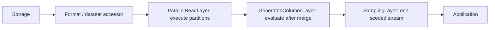
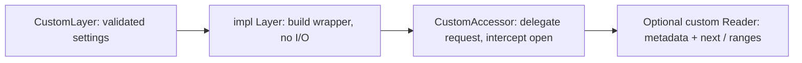

# Layers

Layers wrap an accessor with `AccessorExt::layer`. They preserve its Rust request
and reader interfaces; record layers may change the Arrow schema and values.
All layers in this crate are always available through `open_arrow_access::layers`.
Byte decompression layers use the same contract but require [codec features](../decompression/README.md).

## Choose a layer

| Layer | Use it for | Key behavior |
| --- | --- | --- |
| `SchemaEvolutionLayer` | Add, remove, rename, or cast top-level columns | Fixed output schema; added columns use batch functors |
| `GeneratedColumnsLayer` | Append row-level SQL expressions | Declarations see earlier generated fields; uses DataFusion |
| `SamplingLayer` | Seeded Bernoulli row sampling | Approximate count; preserves selected row order |
| `ParallelReadLayer` | Execute independent scan partitions concurrently | Requires `ScanPlanner`; preserves output order by default |
| `UnorderedEmissionLayer` | Emit ready batches from a reorderable scan | Use with parallel execution; global-order sources reject it |

Enabling Cargo features does not install a layer. Construct it and call `.layer`.
OpenDAL layers belong on the OpenDAL operator and configure a separate I/O boundary.

## Compose layers



`source.layer(a).layer(b)` makes `b` outermost: opening goes through `b`, then
`a`, then the source. Batches flow back through `a` and then `b`.

Enable `format-json` for this complete composition function:

```rust,no_run
use open_arrow_access::{
    Accessor, AccessorExt, ReadRequest,
    file_format::json::JsonAccessor,
    layers::{GeneratedColumnSpec, GeneratedColumnsLayer, ParallelReadLayer, SamplingLayer},
    storage::{OpenDalAccessor, opendal},
};
use std::num::NonZeroUsize;

async fn read(operator: opendal::Operator) -> open_arrow_access::Result<()> {
    let source = JsonAccessor::infer(OpenDalAccessor::new(operator));
    let generated = GeneratedColumnsLayer::try_new(vec![GeneratedColumnSpec {
        column: "title_length".into(),
        expression: "character_length(title)".into(),
    }])?;
    let records = source
        .layer(ParallelReadLayer::new(NonZeroUsize::new(4).unwrap(), NonZeroUsize::MIN))
        .layer(generated)
        .layer(SamplingLayer::try_new(0.1, 42)?);
    let mut reader = records.open(ReadRequest::new("records.jsonl")).await?;
    while let Some(batch) = reader.next().await? {
        println!("{} sampled rows", batch.num_rows());
    }
    Ok(())
}
```

This expects a string `title` column. Sampling keeps each row with probability
0.1; it does not request an exact 10% count. The same seed and ordered input
produce the same selection across different batch boundaries. Unordered input
can change the sample.

Keep generated columns and sampling **outside** `ParallelReadLayer` so they run
over one merged scan. They do not implement `ScanPlanner`; putting the parallel
layer outside either is unsupported. Generated columns currently read all source
columns and evaluate all declarations before final projection.

## Evolve a schema

Add matching `arrow-array = "59.3.0"` and `arrow-schema = "59.3.0"`
dependencies to work with Arrow values directly. For a record accessor `source`
with `count` and `obsolete` columns:

```rust,ignore
use std::sync::Arc;
use arrow_array::StringArray;
use arrow_schema::DataType;
use open_arrow_access::{AccessorExt, layers::{ColumnEvolution, SchemaEvolutionLayer}};

let records = source.layer(SchemaEvolutionLayer::try_new(vec![
    ColumnEvolution::add_column("source", DataType::Utf8, |batch| {
        Ok(Arc::new(StringArray::from(vec!["import"; batch.num_rows()])))
    }),
    ColumnEvolution::remove_column("obsolete"),
    ColumnEvolution::rename_column("count", "row_count"),
    ColumnEvolution::change_data_type("count", DataType::Int64),
])?);
```

Names in removal, rename, and type-change declarations refer to the original
source schema. Changes are declarative: a column can be renamed and cast in the
same layer, and simultaneous name swaps are supported. Removing a column while
also renaming or casting it is rejected. Final output names must be unique;
a new column may reuse a source name freed by removal or renaming.

Unchanged columns keep their source order and share array buffers. New columns
are appended in declaration order and are nullable. The batch functor is a
`Fn(&RecordBatch) -> Result<ArrayRef> + Send + Sync + 'static`; it sees the
**original source batch**, including removed columns and original names/types.
It cannot reference other added columns. Its array must have the declared type
and exactly the input row count, including for empty batches. Schema and field
metadata are retained for existing columns.

Projection uses the evolved output names and order. Functors and casts run even
when their columns are omitted by the final projection. An arbitrary functor
needs every source column, so additions read the full source schema. Removing
all columns and empty projections retain row counts. Callback errors and invalid
arrays terminate the reader while retaining error context.

Unsupported casts fail at open; invalid values and overflows fail during reading.
Arrow casts can lose precision and do not implicitly reconcile schemas across
files. This API replaces `SchemaRemapLayer`/`FieldRemap`; use separate rename and
type-change declarations instead of a combined remap. See the runnable
[schema evolution example](../examples/schema_evolution.rs),
[generated columns](../docs/generated-columns.md), and
[parallel reading](../docs/parallel-read.md).

## Add a layer



Implement `Layer<A>` and a wrapping `Accessor` retaining `A::Request` and
`A::Reader`. Wrap each returned reader if transforming batches or observing
reads. Preserve EOF/error lifecycle, source identity, and explicit ordering;
update metadata when changing the schema or byte representation. Forward optional
listing/range/planning operations, or remove the associated advertised abilities.
Planning-aware wrappers must also wrap partition accessors.

See [adding a layer](../docs/extending.md#add-a-layer) and the
[`SamplingLayer` implementation](src/sampling.rs) for a compact complete example.
