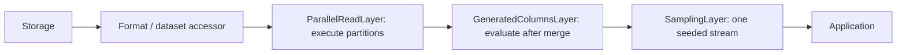
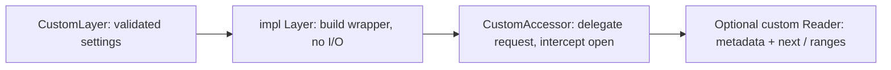

# Layers

Layers wrap an accessor with `AccessorExt::layer`. They preserve its Rust request
and reader interfaces; record layers may change the Arrow schema and values.
All layers in this crate are always available through `open_arrow_access::layers`.
Byte decompression layers use the same contract but require [codec features](../decompression/README.md).

## Choose a layer

| Layer | Use it for | Key behavior |
| --- | --- | --- |
| `SchemaEvolutionLayer` | Add, remove, rename, or cast top-level columns | Fixed output schema; added columns use DataFusion expressions |
| `GeneratedColumnsLayer` | Append row-level SQL expressions | Declarations see earlier generated fields; uses DataFusion |
| `SamplingLayer` | Seeded Bernoulli row sampling | Approximate count; preserves selected row order |
| `ParallelReadLayer` | Execute independent scan partitions concurrently | Requires `ScanPlanner`; preserves output order by default |
| `UnorderedEmissionLayer` | Emit ready batches from a reorderable scan | Use with parallel execution; global-order sources reject it |

Enabling Cargo features does not install a layer. Construct it and call `.layer`.
OpenDAL layers belong on the OpenDAL operator and configure a separate I/O boundary.

## Compose layers



`source.layer(a).layer(b)` makes `b` outermost: opening goes through `b`, then
`a`, then the source. Batches flow back through `a` and then `b`.

Enable `format-json` for this complete composition function:

```rust,no_run
use open_arrow_access::{
    Accessor, AccessorExt, ReadRequest,
    file_format::json::JsonAccessor,
    layers::{GeneratedColumnSpec, GeneratedColumnsLayer, ParallelReadLayer, SamplingLayer},
    storage::{OpenDalAccessor, opendal},
};
use std::num::NonZeroUsize;

async fn read(operator: opendal::Operator) -> open_arrow_access::Result<()> {
    let source = JsonAccessor::infer(OpenDalAccessor::new(operator));
    let generated = GeneratedColumnsLayer::try_new(vec![GeneratedColumnSpec {
        column: "title_length".into(),
        expression: "character_length(title)".into(),
    }])?;
    let records = source
        .layer(ParallelReadLayer::new(NonZeroUsize::new(4).unwrap(), NonZeroUsize::MIN))
        .layer(generated)
        .layer(SamplingLayer::try_new(0.1, 42)?);
    let mut reader = records.open(ReadRequest::new("records.jsonl")).await?;
    while let Some(batch) = reader.next().await? {
        println!("{} sampled rows", batch.num_rows());
    }
    Ok(())
}
```

This expects a string `title` column. Sampling keeps each row with probability
0.1; it does not request an exact 10% count. The same seed and ordered input
produce the same selection across different batch boundaries. Unordered input
can change the sample.

Keep generated columns and sampling **outside** `ParallelReadLayer` so they run
over one merged scan. They do not implement `ScanPlanner`; putting the parallel
layer outside either is unsupported. Generated columns currently read all source
columns and evaluate all declarations before final projection.

## Evolve a schema

Add matching `datafusion = { version = "55.2.0", default-features = false }`
and `arrow-schema = "59.3.0"` dependencies. For a record accessor `source` and
its complete `source_schema` containing `count` and `obsolete` columns:

```rust,ignore
use arrow_schema::DataType;
use datafusion::prelude::{col, lit};
use open_arrow_access::{AccessorExt, layers::{ColumnEvolution, SchemaEvolutionLayer}};

let records = source.layer(SchemaEvolutionLayer::try_new(vec![
    ColumnEvolution::remove_column("obsolete"),
    ColumnEvolution::rename_column("count", "row_count"),
    ColumnEvolution::change_data_type("row_count", DataType::Int64),
    ColumnEvolution::add_column("next_count", DataType::Int64, col("row_count") + lit(1i64)),
])?.with_source_schema(source_schema));
```

Changes execute in vector order. Each name refers to the schema produced by
preceding changes. Rename targets must be unoccupied at that step; swapping names
requires a temporary name. Removed names can be reused by later additions.

Added columns are nullable and appended in vector order. Each takes a DataFusion
`Expr` whose result must match the declared data type. Expressions can reference
earlier additions, renames, and casts; removed columns are unavailable. Scalars
expand to the batch row count, including zero. Use a `ScalarUDF` for custom
computation, with its input columns represented as expression arguments.
Aggregates, window functions, subqueries, and volatile expressions are rejected.

Projection uses evolved names. With `with_source_schema`, the layer traces source
dependencies through the ordered changes and reads only columns needed by
expressions, casts, or final output. Each expression is compiled against its own
dependency schema, so its physical column indices match the compact input view.
All configured expressions and casts run even when hidden by final projection.
The supplied schema must describe the complete current source; selected input
fields are checked once at open. Without it, namespace changes require an
unprojected open because `Accessor` has no separate schema-discovery API.

Unchanged arrays share buffers; field/schema metadata and zero-column row counts
are preserved. Invalid expression types and unsupported casts fail at open;
invalid values, overflows, and expression failures terminate reading with context.
Arrow casts can lose precision and do not reconcile schemas across files.

Opening indexes source names once. Layer-owned per-batch validation checks only
affected fields, with a schema-identity fast path. Type checks recurse only within
changed types. A name index and append-only field slots preserve vector order.
The final schema scans those slots once in O(F + K) for F source fields and K
changes. Source projection indices are assigned on first use during planning;
there is no later rebinding pass. Expression dependency discovery visits its
expression tree, and each input view visits only that expression's dependencies.
Final assembly visits P output columns. Arrow's safe batch constructors check
those assembled views; DataFusion planning and computation have their own costs.

See the [runnable example](../examples/schema_evolution.rs),
[generated columns](../docs/generated-columns.md), and
[parallel reading](../docs/parallel-read.md).

## Add a layer



Implement `Layer<A>` and a wrapping `Accessor` retaining `A::Request` and
`A::Reader`. Wrap each returned reader if transforming batches or observing
reads. Preserve EOF/error lifecycle, source identity, and explicit ordering;
update metadata when changing the schema or byte representation. Forward optional
listing/range/planning operations, or remove the associated advertised abilities.
Planning-aware wrappers must also wrap partition accessors.

For batch transformations, adapt the input with core's `into_stream`, apply
stream combinators, and wrap the output with `StreamReader::records`. This
reuses terminal cleanup on EOF or error instead of implementing another reader
state machine. Preserve the effective reader capability with `with_capability`.

See [adding a layer](../docs/extending.md#add-a-layer) and the
[`SamplingLayer` implementation](src/sampling.rs) for a compact complete example.
