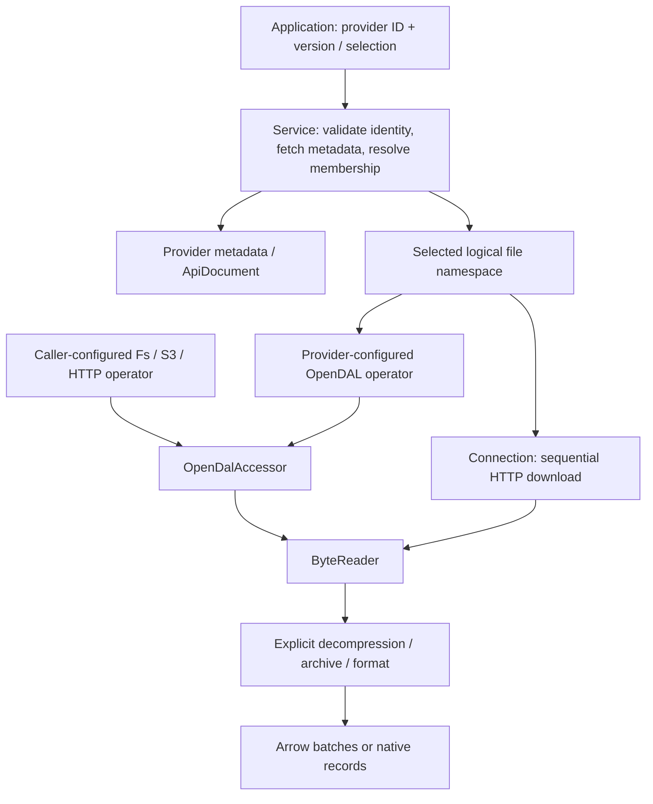
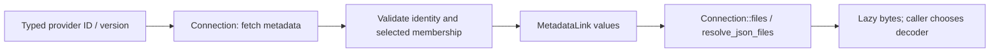

# Services

Services add source-specific IDs, revisions, discovery, and metadata above the
shared storage/format contracts. Start by choosing the output you need: provider
metadata, original files, native records, or Arrow batches.

<a id="service-and-data"></a>

## Choose a service

Enable the listed feature on `open-arrow-access`. On `open-arrow-access-service`
directly, remove the `service-` prefix. Common Crawl shares `service-warc`.

| Provider | Facade feature | Output / purpose | Guide |
| --- | --- | --- | --- |
| Hugging Face | `service-huggingface` | Dataset repository files and Parquet config/split exports | [Hugging Face](huggingface.md) |
| Zenodo | `service-zenodo` | Attachments of a public published research record | [Zenodo](zenodo.md) |
| Dataverse | `service-dataverse` | Original files of an explicit released research dataset version | [Dataverse](dataverse.md) |
| Internet Archive | `service-internet-archive` | Public item file membership and original files | [Internet Archive](internet-archive.md) |
| Figshare | `service-figshare` | Versioned research article files and collection pages | [Figshare](figshare.md) |
| PMC | `service-pmc` | One article-version metadata JSON as one Arrow row | [Article metadata](pmc.md) |
| PMC inventory | `service-pmc` | Manifest-selected inventory CSV shards as Arrow rows | [Inventory](pmc-inventory.md) |
| arXiv bulk | `service-arxiv` | PDF/source TAR manifests and archive member bytes | [Bulk archives](arxiv.md) |
| arXiv metadata | `service-arxiv` | Raw OAI-PMH article metadata XML pages | [Metadata](arxiv-metadata.md) |
| bioRxiv / medRxiv | `service-biorxiv` | Dated preprint metadata pages and JATS XML links | [Preprints](biorxiv.md) |
| MECA | `service-meca` | Scholarly ZIP package manifests and selected members | [MECA](meca.md) |
| Semantic Scholar | `service-semantic-scholar` | Release-pinned bulk partitions and diff manifests | [Bulk datasets](semantic-scholar.md) |
| Project Gutenberg | `service-gutenberg` | Per-book RDF metadata as one Arrow row | [Gutenberg](gutenberg.md) |
| DOAB | `service-doab` | Open-access book metadata via OAI-PMH | [DOAB](doab.md) |
| OAPEN | `service-oapen` | Book metadata via OAI-PMH and selected hosted book bytes | [OAPEN](oapen.md) |
| HathiTrust | `service-hathifiles` | Full/update Hathifiles catalogue exports | [Hathifiles](hathifiles.md) |
| OpenStax | `service-openstax` | Commit-pinned textbook source ZIP archives | [OpenStax](openstax.md) |
| BHL | `service-bhl` | Biodiversity literature metadata, item links and OCR export files | [BHL](bhl.md) |
| Common Crawl | `service-warc` | Crawl/segment WARC membership and separately composed record reads | [Common Crawl](commoncrawl.md) |
| CourtListener | `service-courtlistener` | Dated bulk table exports as decompressed CSV bytes | [CourtListener](courtlistener.md) |
| Federal Register | `service-federal-register` | Rule/notice metadata and advertised document representations | [Federal Register](federal-register.md) |
| GovInfo | `service-govinfo` | Government bulk directories and package representations | [GovInfo](govinfo.md) |
| Library of Congress | `service-library-of-congress` | Digital-collection metadata, resource files and OCR JSON | [Library of Congress](library-of-congress.md) |
| USPTO | `service-uspto` | Patent/trademark bulk product pages and original files | [USPTO](uspto.md) |
| Regulations.gov | `service-regulations` | Documents, comments, dockets and attachment representations | [Regulations.gov](regulations.md) |

The linked guides document credentials, version selection, request types, and
response schemas. Shared `service::common` HTTP/JSON utilities are always
available; concrete providers are feature-gated.

## Example setup

The following example discovers files and reads bytes.

```toml
[dependencies]
open-arrow-access = { version = "0.2.2", default-features = false, features = ["service-figshare"] }
futures = "0.3"
tokio = { version = "1", features = ["macros", "rt-multi-thread"] }
```

```rust,no_run
use futures::TryStreamExt;
use open_arrow_access::{Accessor, ByteAccessor, Result, service::figshare::FigshareService};
use std::num::NonZeroU64;

#[tokio::main]
async fn main() -> Result<()> {
    let files = FigshareService::new()?
        .article(NonZeroU64::new(21422193).unwrap(), None)
        .await?;
    println!("version: {}", files.metadata().value()["version"]);
    let mut names = files.list("".into()).await?;
    if let Some(name) = names.try_next().await? {
        println!("file: {}", name.locator());
        let mut reader = files.open(name.into()).await?;
        if let Some(chunk) = reader.next().await? {
            println!("first chunk: {} original bytes", chunk.len());
        }
    }
    Ok(())
}
```

This resolves an article and reads at most one original chunk. `None` selects
the current version; select an explicit version for repeatable membership.
Files remain lazy, may be compressed, and are not automatically parsed or
converted to text. A byte chunk is not a logical record.

## Where storage and decoding belong



| Access pattern | Examples | Your configuration |
| --- | --- | --- |
| Caller supplies storage | PMC, Gutenberg, CourtListener, arXiv bulk | Operator root, endpoint, region, credentials, requester-pays settings |
| Provider constructs storage | Hugging Face, Zenodo, Dataverse, Internet Archive | Provider ID/version/revision and supported endpoint/token options |
| API metadata plus advertised download URLs | Figshare, BHL, GovInfo, bioRxiv, LoC, OpenStax, Semantic Scholar, USPTO, Regulations.gov | Provider configuration and optional custom `Connection` |
| Already-open archive input | MECA | Ranged byte reader with known length |

OpenDAL supplies storage I/O and the HTTP transport used by `Connection`.
Provider requests determine the source's identity and membership. Connection
credentials are origin-scoped; its downloads are sequential. Ranged consumers
such as ZIP/Parquet need an appropriate OpenDAL-backed or custom ranged source.
See [connection configuration](provider-connection.md) for transport, retry,
timeout, and authentication settings.

## Consume the returned type

| Return type | Consume with | Meaning |
| --- | --- | --- |
| `ApiDocument` | `value()` | Parsed upstream JSON retaining unknown fields |
| `RemoteFiles<M>` / `ResolvedFileSet<A, M>` | `metadata()`, `list`, `open` | Fixed logical membership with lazy byte downloads |
| `ByteReader` | `next().await` | Original or explicitly decoded bytes |
| `RecordReader` | `metadata().schema`, `next().await` | Fixed-schema Arrow batches |
| `OaiPage` | `bytes`, `record_count`, `resumption_token` | XML envelope and protocol continuation |
| Archive session | Inspect entries, open selected member | Member metadata and bytes |

Bind an explicit format through `ResolvedFileSet::records(format)` and select
names with `FileSetRequest` to decode resolved files. For API metadata use
`ApiDocument::records_at(pointer, format)`; OAI pages expose `records(format)`.
These bindings do not follow PDF/HTML URLs, infer content mappings, or discover
additional pages. See [response shapes](response-schemas.md).

Independent API requests can be wrapped in `common::PageSetAccessor`, then
executed through `ParallelReadLayer`. Supply independently addressable requests
and one schema. Cursor/resumption-token chains must still be discovered in
protocol order. [Parallel reading](../docs/parallel-read.md) covers planning.

## Add a service



Reuse public `Connection` methods for API-backed services. Use
`resolve_json_files` for one JSON response mapped to download links, or `json`
and `files` for multi-request discovery. For one-document-to-one-row providers,
implement `DocumentDecoder` and use `DocumentAccessor`. Keep provider identity,
version checks, mapping, and pagination in the service.

See [adding a service](../docs/extending.md#add-a-service) for implementation
steps, feature wiring, and examples.
