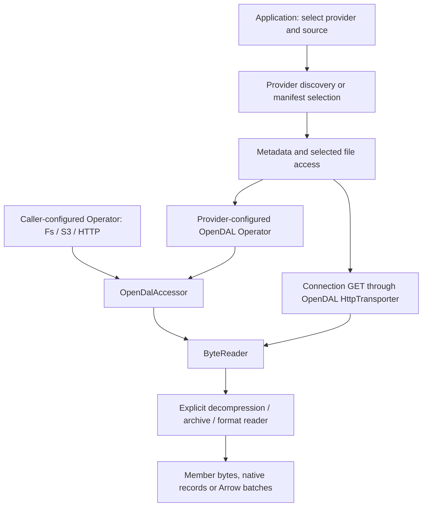

# Dataset services

## Service and data

This crate connects external data sources to Open Arrow Access. A provider can
return discovery metadata, a named set of original files, archive members, or
Arrow batches. The individual guide states exactly which representation it reads.
All service guides live directly in this `service/` directory; `src/` contains
implementation code.

### Directory layout

```text
service/
  README.md                 Service catalogue, interaction model and setup
  <provider>.md             Data, request/response and usage for one provider
  response-schemas.md        Shared response families and schema references
  src/
    lib.rs                  Public modules and provider feature gates
    <provider>/             Provider-specific requests, discovery and metadata mapping
    common/                 Public Connection, ApiDocument and file-link helpers
    http_client.rs          Shared HTTP requests over OpenDAL transport
    http_body.rs            Shared response-body handling
    resolved_files.rs       Metadata plus a lazy named-file accessor
    oai/                    OAI-PMH protocol shared by several providers
  tests/                    Provider and shared-contract tests
```

### Included services

| Source | Data available through this library | Guide |
| --- | --- | --- |
| Hugging Face | Dataset repository files and Parquet config/split exports | [Hugging Face](huggingface.md) |
| Zenodo | Attachments of a public published research record | [Zenodo](zenodo.md) |
| Dataverse | Original files of an explicit released research dataset version | [Dataverse](dataverse.md) |
| Internet Archive | Public item file membership and original files | [Internet Archive](internet-archive.md) |
| Figshare | Versioned research article files and collection pages | [Figshare](figshare.md) |
| PMC | One article-version metadata JSON as one Arrow row | [Article metadata](pmc.md) |
| PMC inventory | Manifest-selected inventory CSV shards as Arrow rows | [Inventory](pmc-inventory.md) |
| arXiv bulk | PDF/source TAR manifests and archive member bytes | [Bulk archives](arxiv.md) |
| arXiv metadata | Raw OAI-PMH article metadata XML pages | [Metadata](arxiv-metadata.md) |
| bioRxiv / medRxiv | Dated preprint metadata pages and JATS XML links | [Preprints](biorxiv.md) |
| MECA | Scholarly ZIP package manifests and selected members | [MECA](meca.md) |
| Semantic Scholar | Release-pinned bulk partitions and diff manifests | [Bulk datasets](semantic-scholar.md) |
| Project Gutenberg | Per-book RDF metadata as one Arrow row | [Gutenberg](gutenberg.md) |
| DOAB | Open-access book metadata via OAI-PMH | [DOAB](doab.md) |
| OAPEN | Book metadata via OAI-PMH and selected hosted book bytes | [OAPEN](oapen.md) |
| HathiTrust | Full/update Hathifiles catalogue exports | [Hathifiles](hathifiles.md) |
| OpenStax | Commit-pinned textbook source ZIP archives | [OpenStax](openstax.md) |
| BHL | Biodiversity literature metadata, item links and OCR export files | [BHL](bhl.md) |
| Common Crawl | Crawl/segment WARC membership and separately composed record reads | [Common Crawl](commoncrawl.md) |
| CourtListener | Dated bulk table exports as decompressed CSV bytes | [CourtListener](courtlistener.md) |
| Federal Register | Rule/notice metadata and advertised document representations | [Federal Register](federal-register.md) |
| GovInfo | Government bulk directories and package representations | [GovInfo](govinfo.md) |
| Library of Congress | Digital-collection metadata, resource files and OCR JSON | [Library of Congress](library-of-congress.md) |
| USPTO | Patent/trademark bulk product pages and original files | [USPTO](uspto.md) |
| Regulations.gov | Documents, comments, dockets and attachment representations | [Regulations.gov](regulations.md) |

Each guide follows the same order: what the source contains, request/response
formats, then a complete Rust usage example and an explanation of its result.

## Request and response

### How services interact with OpenDAL

OpenDAL supplies two parts of the I/O layer:

- **Storage operators:** an `opendal::Operator` configures a backend such as Fs,
  S3, HTTP or Hf. `storage::OpenDalAccessor` adapts its operations to our
  `ByteAccessor` / `ByteReader` interfaces, including listing and exact ranges
  when supported by the configured source.
- **HTTP transport:** provider metadata requests and sequential downloads use
  OpenDAL's `OperationContext` / `HttpTransporter`, with a reqwest transport by
  default. Our shared HTTP client and `Connection` add provider request rules,
  response parsing and origin-scoped credentials above that transport.

The provider adds the source-specific meaning: which endpoint or manifest to
read, which ID/version/split was selected, which files belong to that selection,
and which metadata to retain. A logical filename returned by a provider maps to
a backend object key or download URL; callers use that name with `open`.



| Integration pattern | Services / entry points | What the caller configures |
| --- | --- | --- |
| Caller supplies byte storage, usually an OpenDAL operator wrapped by `OpenDalAccessor` | PMC article/inventory, Gutenberg, CourtListener, arXiv bulk | Backend root, endpoint, credentials, region and any requester-pays settings; provider requests select keys/manifests |
| Provider creates the operator for its file namespace | Hugging Face repository/dataset; Zenodo, Dataverse, Internet Archive | Provider ID/revision/version and supported endpoint/token options; the provider configures the Hf or HTTP backend |
| Provider calls APIs and opens advertised URLs through `Connection` | Figshare, GovInfo, BHL, bioRxiv, LoC, OpenStax, Semantic Scholar, USPTO, Regulations.gov and other JSON/OAI providers | Provider API settings/keys; optional custom Connection/transport; downloads are sequential |
| Caller supplies an already opened byte reader | MECA archive inspection | A ranged, known-length source reader; this can come from OpenDAL or another compatible accessor |

Common Crawl provides an HTTP-operator helper and also accepts caller-supplied
manifest/record accessors, so a local mirror or another byte backend can be used.
The core accessor traits also allow application-defined storage implementations.

A typical interaction has three stages:

1. **Select/discover:** request a record, dataset version, crawl or manifest.
   The provider returns metadata, file membership or an opened record reader,
   according to its API.
2. **Read bytes:** open an exact selected file name/object. OpenDAL operators or
   the shared HTTP transport perform the I/O; provider metadata resolution does
   not eagerly download every attachment.
3. **Decode when needed:** compose decompression, archive or format readers.
   Some providers already return Arrow metadata/dataset readers; their guides
   identify the schema and what they read internally.

### Enable an entry point

Enable a concrete provider with its facade feature, for example
`service-figshare`. On `open-arrow-access-service` directly, the corresponding
feature is `figshare`. Shared `service::common` utilities are available without a
provider feature. Credentials, when required, are described in the provider guide;
Hugging Face additionally supports its environment/cached-token settings.

| Response family | How to consume it | What it contains |
| --- | --- | --- |
| `ApiDocument` | `document.value()` | Parsed upstream JSON, including unknown fields |
| `RemoteFiles<M>` / `ResolvedFileSet<A, M>` | `metadata()`, `list("")`, `open(name)` | Provider metadata plus a fixed logical file namespace; file bodies are lazy |
| `ByteReader` | `next().await` | Original or explicitly decoded byte chunks; a chunk is not a record |
| `RecordReader` | `metadata().schema`, `next().await` | Arrow batches with the declared schema |
| `OaiPage` | `bytes`, `record_count`, `resumption_token` | Exact XML response and continuation information |
| Archive session | inspect entries, then open a member | Original member names/metadata and decoded member bytes |

All fallible calls use the library's `Result<T>`. Readers return `Some(item)`
until EOF (`None`); errors and EOF terminate them. Byte readers from public
`Connection` are sequential; OpenDAL-backed providers can support exact ranges.
ZIP/Parquet consumers need an appropriate ranged source, not just any HTTP reader.

JSON-retaining providers expose parsed responses through `ApiDocument`.
Zenodo, Dataverse and Internet Archive instead retain their documented typed
metadata subsets. Arrow schemas are provider-specific or come from the selected
file format; downloading a PDF/XML/ZIP does not automatically create Arrow rows.
See [response shapes](response-schemas.md) for a common reference.

Shared guides: [connections](provider-connection.md), [API metadata](api-document.md),
[named files](remote-files.md), [downloads](http-downloads.md),
[custom transport](http-transport.md), [validation helpers](provider-validation.md),
[OAI-PMH](oai-protocol.md), [OAI provider configuration](oai-provider.md), and
[development fixtures](provider-test-fixtures.md).

## Usage and results

### Example setup

Examples use the root facade and ordinary async Rust functions. Add the feature
listed in your provider guide. For the executable Figshare example below:

```toml
[dependencies]
open-arrow-access = { git = "https://github.com/dentiny/open-arrow-access", features = ["service-figshare"] }
futures = "0.3"
tokio = { version = "1", features = ["macros", "rt-multi-thread"] }
```

```rust
use futures::TryStreamExt;
use open_arrow_access::{Accessor, ByteAccessor, Result, service::figshare::FigshareService};
use std::num::NonZeroU64;

#[tokio::main]
async fn main() -> Result<()> {
    // BHL's public OCR export is published as this Figshare article.
    let files = FigshareService::new()?
        .article(NonZeroU64::new(21422193).unwrap(), None)
        .await?;
    println!("selected version: {}", files.metadata().value()["version"]);
    let mut names = files.list("".into()).await?;
    if let Some(name) = names.try_next().await? {
        println!("available file: {}", name.locator());
        let mut reader = files.open(name.into()).await?;
        if let Some(chunk) = reader.next().await? {
            println!("first original chunk: {} bytes", chunk.len());
        }
    }
    Ok(())
}
```

This resolves one public article, prints its observed version and one file name,
and reads at most one original byte chunk. `None` intentionally selects the
current version; use an explicit version for repeatable selection. The bytes
may still be compressed. The provider does not infer a format or extract text.

### Example with caller-configured OpenDAL storage

For a provider backed by a local mirror, enable `service-pmc` on the facade and
add OpenDAL's filesystem backend to the dependency configuration above:

```toml
opendal = { version = "=0.59.2", default-features = false, features = ["services-fs"] }
```

```rust
use open_arrow_access::{
    Accessor, ReadRequest,
    service::pmc::PmcAccessor,
    storage::{OpenDalAccessor, opendal},
};

async fn read_pmc_mirror(root: &str, metadata_key: &str) -> Result<(), Box<dyn std::error::Error>> {
    // OpenDAL owns the backend/root; the provider interprets the selected object.
    let operator = opendal::Operator::new(opendal::services::Fs::default().root(root))?;
    let bytes = OpenDalAccessor::new(operator);
    let articles = PmcAccessor::with_default_decoder(bytes);
    let mut reader = articles.open(ReadRequest::new(metadata_key)).await?;
    println!("Arrow schema: {:?}", reader.metadata().schema);
    if let Some(batch) = reader.next().await? {
        println!("article metadata rows: {}", batch.num_rows());
    }
    Ok(())
}
```

With root `/data/pmc-mirror` and key `metadata/PMC123.2.json`, OpenDAL reads that
mirror object and the PMC decoder emits one article-metadata row. Content URL
fields remain metadata. To use S3 or another backend, configure its operator and
retain the same `OpenDalAccessor` / provider composition.

The Figshare example above demonstrates provider-managed HTTP access; this
example demonstrates caller-managed storage. See each provider guide for its
configuration boundary and return type. [Repository examples](../examples/) show
complete command-line readers.

### Planning resolved files and API pages

The `record-files` feature adds `ResolvedFileSet::records(format)`: bind an explicit
Arrow format/schema, select logical names with `FileSetRequest`, then install
`ParallelReadLayer` or call `plan_scan`. Provider resolution still validates the
revision, membership, names and availability before planning; no file extension
or content decoder is guessed. Explicit duplicate selections retain their order.

For already fetched JSON API metadata, `ApiDocument::records_at(pointer, format)`
selects one object or an ordered array at a JSON pointer. OAI pages expose
`page.records(format)` for an explicit XML record path/schema. These page plans do
not follow continuation URLs or make cursor-dependent page requests independent.
Use provider protocol methods to discover subsequent pages in the required order.

These are explicit decoding bindings, not new per-provider metadata schemas.
Referenced PDF/HTML links remain URL fields under the selected schema and are
never followed automatically. Already embedded document bodies require a native
content mapping to `LargeBinary`; an ordinary JSON string is not silently treated
as Arrow's hexadecimal binary representation. The binding does not perform that
source-specific content mapping.
